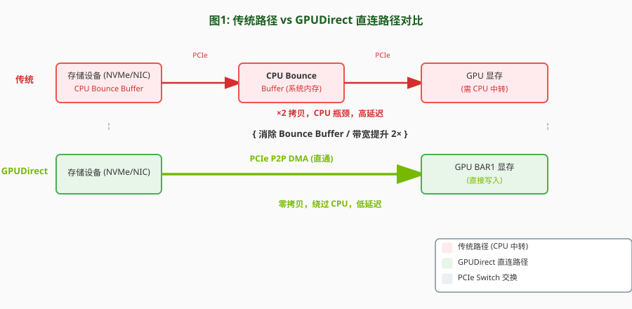
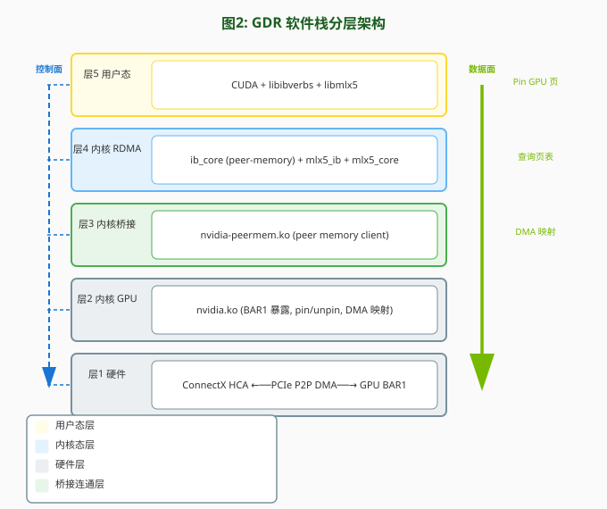
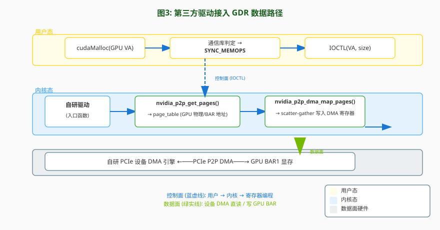
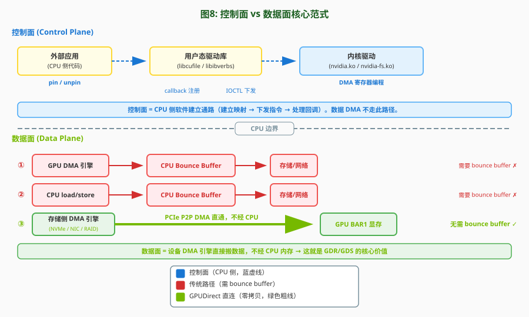
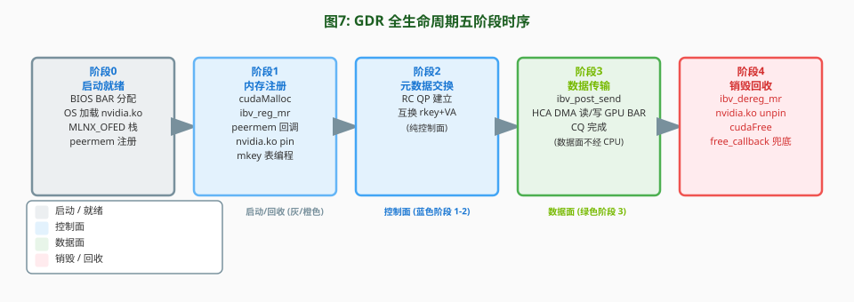
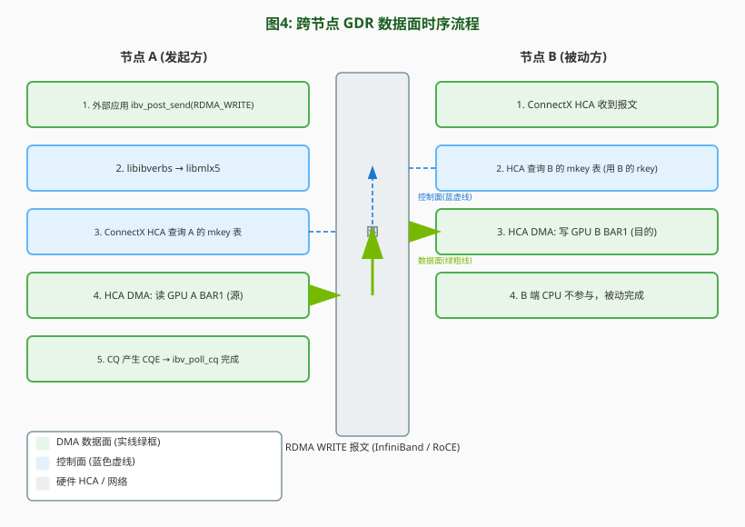
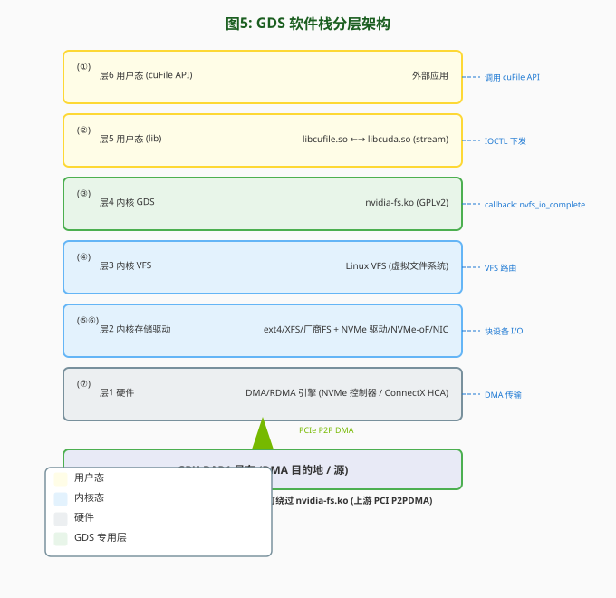
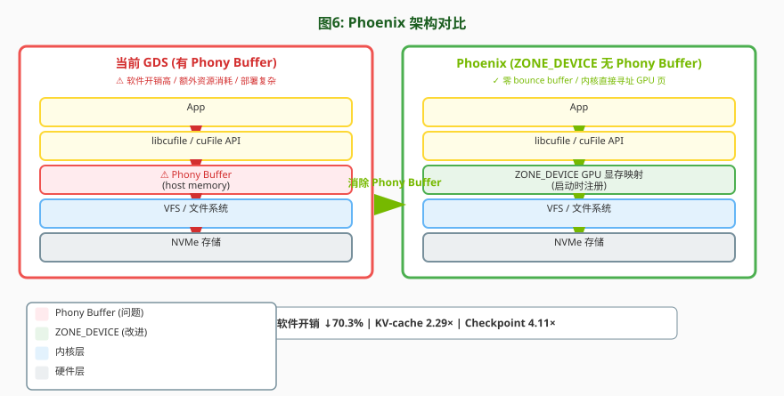

# GPUDirect RDMA (GDR) 与 GPUDirect Storage (GDS) 技术文档

> 基于 NVIDIA 官方文档整理 · 面向工程师与架构师的平衡深度资料
>
> 主要参考来源：[GPUDirect RDMA 文档](https://docs.nvidia.com/cuda/gpudirect-rdma/)、[GPUDirect Storage Overview Guide](https://docs.nvidia.com/gpudirect-storage/overview-guide/index.html)、[GPUDirect Storage Design Guide](https://docs.nvidia.com/gpudirect-storage/design-guide/index.html)、[NVIDIA GPUDirect 主页](https://developer.nvidia.com/gpudirect)

---

## 目录

- [一、背景与动机](#一背景与动机)
- [二、GPUDirect 技术演进](#二gpudirect-技术演进)
- [三、软件生态全景](#三软件生态全景)
- [四、控制面 vs 数据面路径](#四控制面-vs-数据面路径)
- [五、组网形态](#五组网形态)
- [六、GPU 兼容性矩阵](#六gpu-兼容性矩阵)
- [七、GPUDirect RDMA (GDR) 技术细节](#七gpudirect-rdma-gdr-技术细节)
- [八、GDR 全生命周期实例：跨节点 GPU 读写](#八gdr-全生命周期实例跨节点-gpu-读写)
- [九、GPUDirect Storage (GDS) 技术细节](#九gpudirect-storage-gds-技术细节)
- [十、GDR vs GDS 对比与平台拓扑专题](#十gdr-vs-gds-对比与平台拓扑专题)
- [十一、典型应用场景](#十一典型应用场景)
- [十二、部署与启用要点](#十二部署与启用要点)
- [十三、术语释义](#十三术语释义)
- [十四、总结与参考链接](#十四总结与参考链接)
- [十五、论文精讲：Phoenix](#十五论文精讲phoenix)

---

## 一、背景与动机

### 1.1 GPU 数据搬运的痛点

GPU 的算力增长远快于 I/O 带宽。当数据集越来越大（AI 训练、HPC 模拟、数据分析），"数据装载"的时间开始成为瓶颈——快速 GPU 被慢速 I/O 拖累，应用从 compute-bound 退化为 IO-bound。

传统的 GPU↔存储/网络 数据搬运路径存在三重开销：

1. **双倍拷贝**：数据先从存储拷到 CPU bounce buffer（内存临时中转缓冲区），再从 bounce buffer 拷到 GPU，一次搬运产生两份数据移动。
2. **带宽瓶颈**：数据必须穿过 CPU 根端口，而 CPU 的 PCIe 带宽可能低于 GPU/HCA 的能力。
3. **CPU 占用**：CPU 被用来搬运数据，干扰其他计算工作，引入抖动（jitter）与延迟。




### 1.2 GPUDirect 家族概览

**NVIDIA GPUDirect** 是 Magnum IO 体系下的一组技术家族，让网络适配器与存储驱动器**直接读写 GPU 显存**，消除多余拷贝、降低 CPU 开销与延迟。家族成员包括：

| 技术 | 全称 | 直连对象 | 说明 |
|------|------|----------|------|
| **GDR** | GPUDirect RDMA | GPU ↔ 网卡 (HCA) | 实现跨节点 GPU 显存直接通信，数据通路绕过主机内存，消除 bounce buffer 拷贝（控制通路仍依赖 CPU） |
| **GDS** | GPUDirect Storage | GPU ↔ 存储 (NVMe / NVMe-oF) | 存储侧 DMA 引擎直接搬数据进/出 GPU 显存，绕过 CPU bounce buffer |
| **P2P** | GPUDirect Peer-to-Peer | GPU ↔ GPU | 经 PCIe / NVLink 的 GPU 间直接拷贝与 load/store，CUDA 驱动原生支持 |
| **Video** | GPUDirect for Video | GPU ↔ 采集设备 | 帧设备（采集卡、HD-SDI、CameraLink）与 GPU 间高效传帧，仅 Windows |
| **Async** | GPUDirect Async (GDA-ST/GT) | 异步触发 | 将存储 I/O 排入 CUDA stream/graph，利用 GPU 同步硬件在数据就绪后启 kernel，或 kernel 完成后存数据 |

本文聚焦其中的 **GDR（RDMA）** 与 **GDS（Storage）** 两项核心技术。

---

## 二、GPUDirect 技术演进

GPUDirect 技术历经十余年演进，从最初的"设备直连显存"构想，逐步发展为一个覆盖网络、存储、视频与异步触发的完整技术家族。其主线可概括为：**直连对象不断扩展，实现方式从 NVIDIA 专有驱动逐步向 Linux 上游标准靠拢，控制面日益与 CUDA 流/图语义融合，而数据面始终坚守"绕过 CPU、设备 DMA 直达显存"的核心价值。**

> 说明：NVIDIA 官方文档主要以 **CUDA 版本** 标注里程碑；下文中的**公历年份**为依该 CUDA 版本发布时间推算的近似值，仅作时间感参考，精确时点以官方为准。

**2010 年前后（Fermi 时代）**，NVIDIA **首次提出 GPUDirect 概念**，允许第三方 PCIe 设备**绕过 CPU 直接访问 GPU 显存**，奠定了"设备直连显存"的技术基础。

**2011 年（CUDA 4.0）**，引入**统一虚拟地址空间（UVA）**，并在此基础上推出**GPUDirect 对等通信（P2P）**，使同一节点内的多块 GPU 能**经 PCIe 直接拷贝与互访**，GPU 间数据交换不再绕经系统内存。

**2012 年（Kepler 架构 + CUDA 5.0）**，**GPUDirect RDMA 正式登场**，把直连范围从节点内 GPU 间扩展到**GPU 与远端第三方设备之间**——网络适配器、采集卡、存储适配器等可经标准 PCIe 机制直接读写 GPU 显存。这一代确立了**"控制面在 CPU、数据面由设备 DMA 直连"**的核心范式，并明确了"两端须共享同一 PCIe 根复合体、IOMMU 须禁用或直通"的硬件前提。

**2014—2016 年（CUDA 6.0—8.0）**，RDMA 路径持续打磨：**取消强制的安全令牌**以降低第三方接入门槛、让 **BAR 映射可在多次锁定间复用**以节省资源、为 I/O 地址与 CPU 物理地址不一致的平台补齐地址映射能力，并兼容多进程服务（MPS）。同期 **GPUDirect Video** 把直连对象扩展到帧采集设备，形成网络、视频并行的能力。

**2018—2021 年（CUDA 10.1—11.4）**，GPUDirect RDMA 向**嵌入式与车载平台**延伸，先后支持 Jetson AGX Xavier、DRIVE AGX Xavier 与 Jetson Orin；同时 NVIDIA 把以往由社区维护的离线对等内存模块整合为**随驱动官方发布的内核模块**，与 Mellanox OFED、InfiniBand 及 RoCE 协议栈深度协同，标志着网络侧直连进入**"官方化、产品化"**阶段。

**2020 年前后（CUDA 11.x）**，GPUDirect 家族迎来最新成员 **GPUDirect Storage（GDS）**，归入 Magnum IO 体系。GDS 把"直连显存"理念从网络侧推广到**存储侧**。与之配套的用户态库与内核驱动，填补了操作系统无法把 GPU 虚拟地址向下传递至文件系统栈的空白，使**文件级存储也能享受直连**。

**2022—2024 年（CUDA 12.2—12.8）**，GDS 进入成熟与异构化阶段：**异步 IO 接入 CUDA 流与图**，实现"数据就绪后自动启动 kernel、kernel 完成后自动存盘"的计算—IO 联动；支持 **CPU 与 GPU 间可迁移内存**，兼容 Grace-Hopper 等统一内存架构；非 O_DIRECT 打开的文件对页对齐缓冲也能自动走直连路径，降低使用门槛。更重要的是，**自 CUDA 12.8 起，NVMe 直连改走 Linux 上游内核的 PCI P2PDMA 基础设施**，逐步摆脱对专用内核驱动与定制驱动的依赖，迈向与开源内核主线融合。

**2025 年（CUDA 13.0）**，GPUDirect RDMA 进入**代际切换**：面向 Blackwell 代 SoC 与新一代嵌入式平台，传统的专有页锁定接口进入**弃用周期**，NVIDIA 鼓励迁移到 Linux 上游标准的页锁定与 DMA 映射接口；相关设备能力查询也同步更新，标志着 GPUDirect 从"NVIDIA 专有路径"向**"上游化、标准化"**演进。

总体来看，GPUDirect 的演进清晰展现了三条交织的脉络：

1. **直连对象扩展**：GPU 间 → GPU 与网络 → GPU 与视频 → GPU 与存储 → 异步触发（流/图联动）。
2. **实现上游化**：从依赖 NVIDIA 专有内核接口与定制驱动，逐步转向 Linux 内核主线标准的 P2PDMA、页锁定与 DMA 映射机制。
3. **控制面与 CUDA 融合**：从早期同步、需手动管理的 pin/unpin，演进到与 CUDA 流、图语义统一，实现计算与 IO 的异步联动。

---

> **内容来源说明**：本文 GPUDirect 技术演进的资料获取自 NVIDIA 官方公开文档与开发者站点，主要包括：
> - NVIDIA GPUDirect 开发者主页：<https://developer.nvidia.com/gpudirect>
> - GPUDirect RDMA 官方文档（CUDA 13.3 / v13.3）：<https://docs.nvidia.com/cuda/gpudirect-rdma/>
> - GPUDirect Storage Overview Guide（v1.18）：<https://docs.nvidia.com/gpudirect-storage/overview-guide/index.html>
> - GPUDirect Storage Design Guide（v1.18）：<https://docs.nvidia.com/gpudirect-storage/design-guide/index.html>
>
> 这些站点仅以 CUDA 版本号标注里程碑；文中公历年份为依据 CUDA 各版本发布时间所作的近似推算。

---

## 三、软件生态全景

### 3.1 GDR 软件组件

GDR 的软件栈围绕"在内核态拿到 GPU 显存的物理/总线地址、再交给设备 DMA 引擎"这一核心目标组织。涉及的组件按职责可分为三层：GPU 端地址提供者（`nvidia.ko`）、RDMA 子系统中的 GPU 代理（`nvidia-peermem.ko`）、以及承载 RDMA 协议栈的核心应用（MLNX_OFED）。




#### 3.1.1 当 GPU 上电时 —— 前置知识

以下前置知识假定读者为对 Linux 内核与内存访问机制不甚熟悉的计算机从业人员。

**① GPU 上电与 BAR1 空间的分配**

GPU 插入 PCIe 插槽并上电后，主板 BIOS / 固件在 POST（开机自检）阶段为 GPU 的 BAR1 分配一段 **PCI 总线物理地址**——这是 GPU 显存向 PCIe 总线暴露的一段"窗口"（即 BAR1 aperture）。任何 PCIe 设备向这段总线地址发起读写，就是在直接访问 GPU 显存。

这段 BAR1 地址随后被 CPU 侧的内核驱动程序（`nvidia.ko`）通过 `ioremap` 映射到**内核态虚拟地址**，再通过 `mmap` 暴露给用户态进程——这使得 CPU 代码能够通过虚拟地址间接读写 GPU 的寄存器与显存。

但是，**其他 PCIe 设备并不能通过 CPU 虚拟地址访问 GPU 显存**。例如一台 RDMA 网卡，其硬件 DMA 引擎只识别 **PCI 总线物理地址**——它不能理解 CPU 虚拟地址（需经 CPU 页表才能翻译），也不能理解 GPU 内部的虚拟地址空间（由 GPU 的 MMU 管理，独立于 CPU 页表）。这就构成了设备间直连的"地址鸿沟"：CPU 能访问 GPU 显存，但另一台 PCIe 设备不行。

**② MMIO 与设备间互访的缺失**

**MMIO**（Memory-Mapped I/O，内存映射 I/O）把硬件设备的寄存器或板载内存映射到 CPU 的物理地址空间，使 CPU 可以用普通 load/store 指令读写硬件——就像读写普通内存一样。这块被映射的地址区域就称为 **MMIO 区**。

然而，Linux 内核**并不为两个硬件设备之间提供 MMIO 能力**。也就是说，没有标准化机制能让设备 A 的 MMIO 区域（例如 GPU 的 BAR1 窗口）暴露给设备 B 的驱动程序（例如 RDMA 网卡驱动）。这正是 `nvidia.ko` 需要自行导出地址翻译函数的根本原因。

**③ pin（页锁定）**

pin（页锁定）是把一段内存/显存的物理页"钉住"，保证在 DMA 传输期间其物理位置不发生迁移、不被回收、不被换出。分为两类：

- **CPU pin**：由内核函数 `get_user_pages()` 执行，锁定 CPU 系统内存中的物理页。标准 Linux 驱动在做 DMA 前几乎都会调用它，将上游用户态传下来的虚拟地址翻译为一组连续的物理页并锁定。
- **GPU pin**：由 `nvidia.ko` 导出的 `nvidia_p2p_get_pages()` 执行，锁定 GPU 显存的物理 / BAR 页。GPU 有自己的内存管理单元（MMU）和页表，与 CPU 页表完全独立，因此 `get_user_pages()` 对 GPU 显存地址无效——必须由 `nvidia.ko` 自行处理。

**为什么 DMA 传输必须 pin**：DMA 引擎只认物理/总线地址，不认虚拟地址。如果在 DMA 传输期间对应物理页被迁移或回收，DMA 引擎就会读写到错误位置，导致数据损坏或内核崩溃。

**④ IOMMU 与地址直通**

**IOMMU**（I/O Memory Management Unit，I/O 内存管理单元）是负责 I/O 设备地址翻译与隔离的硬件组件（Intel 称 **VT-d**，AMD 称 **AMD-Vi**）。当 IOMMU 开启并做非直通翻译时，每个 I/O 设备看到的"总线地址"（I/O 地址）可能与 CPU 的物理地址不一致。

GDR 与 GDS 依赖一个关键前提：**所有 PCIe 设备的视角中，GPU 显存的物理/BAR 地址必须一致**。如果 IOMMU 做非 1:1 翻译（例如把 GPU BAR 地址重映射到不同地址空间），那么网卡 DMA 引擎拿到的地址与 GPU 实际的物理页就对不上了。因此，GDR/GDS 环境要求 IOMMU **禁用**或配置为 **pass-through（直通，1:1 恒等翻译）**。

#### 3.1.2 `nvidia.ko` —— GPU 端地址翻译与映射提供者

`nvidia.ko` 是 NVIDIA GPU 内核驱动，是整个 GDR 机制的**底层基石**。它的不可替代性在于一个操作系统层面的空白：**Linux 缺乏在驱动之间交换 MMIO 区（PCI BAR 映射）的标准机制**，因此无法把 GPU 的 BAR 物理地址窗口交给第三方驱动。`nvidia.ko` 通过导出一组内核符号，自行承担地址翻译与映射职责。

其核心作用包括：

- **页锁定（pin）**：把用户态拿到的 GPU 虚拟地址对应的一段显存锁定，确保其物理位置在 DMA 期间不发生迁移或回收（详见 §3.1.1③）。

- **物理地址回填**：当其他 PCIe 设备（或其驱动）需要访问一段 GPU 显存时，`nvidia.ko` 接收该设备传入的 **GPU 虚拟地址**，将其翻译为 **GPU 物理地址**（经 GPU 内部页表），再经 BAR1 窗口映射为 **PCI 总线地址**。最终返回的地址列表中，每个条目对应一个 64KB 的 GPU 物理页并附带长度信息——这些 **PCI 总线地址**即可供其他 PCIe 设备的 DMA 引擎直接读写 GPU 显存。与 CPU 侧的 `get_user_pages()`（返回的是 CPU 物理页的 `struct page *`）不同，GPU 侧返回的是 BAR 映射后的总线地址，因为 GPU 显存不在 Linux 内核的 `struct page` 体系中，需由 NVIDIA 驱动自行管理。

- **DMA 映射**：当平台存在 IOMMU 且未配置 pass-through 时，"物理地址回填"得到的 PCI 总线地址与目标设备 DMA 引擎实际所需的 I/O 地址**可能不同**（IOMMU 会做地址变换）。此时 `nvidia.ko` 需针对特定的目标设备，将 GPU BAR 页进一步映射到该设备的 DMA 地址空间，返回该设备真正可用的总线地址列表——即 DMA 引擎编程时需要写入寄存器的地址。在标准 x86 + IOMMU 直通配置下，I/O 地址与 CPU 物理地址一致，此步骤可省略（恒等映射）。这也就是"按需调用"的由来：仅在 I/O 地址非恒等的平台上才必须执行。

- **撤销通知（free callback）**：当 GPU 显存被用户态释放或进程退出时，同步回调第三方驱动，让其清理对页表的引用，避免悬垂访问。

最关键的导出接口（仅列必要）：

```c
int nvidia_p2p_get_pages(..., uint64_t va, uint64_t len,
                         struct nvidia_p2p_page_table **pt,
                         void (*free_callback)(void *), void *data);
int nvidia_p2p_put_pages(..., struct nvidia_p2p_page_table *pt);
int nvidia_p2p_dma_map_pages(struct pci_dev *peer,
                             struct nvidia_p2p_page_table *pt,
                             struct nvidia_p2p_dma_mapping **mapping);
void nvidia_p2p_free_page_table(struct nvidia_p2p_page_table *pt);  // 在 callback 中调用
```

`nvidia.ko` 本身不感知"是谁在 DMA"——它只负责把地址交出来。真正让设备发起 DMA 的，是下层的对等内存代理与第三方驱动。

#### 3.1.3 `nvidia-peermem.ko` —— InfiniBand/RDMA 子系统中的 GPU 代理

`nvidia-peermem.ko`（CUDA 11.4 起随 NVIDIA GPU 驱动包发布，in-tree）是一个**胶水模块**：它站在 InfiniBand/RDMA 子系统一侧，把"GPU 显存"伪装成一种可供 RDMA 注册的"对等内存（peer memory）"。

它的角色是双向桥接：

- **向 RDMA 子系统注册**：以 peer memory client 身份向 InfiniBand Core 登记，使 RDMA 应用在注册一块 GPU buffer（获取 rkey/lkey）时，IB Core 会回调 `nvidia-peermem` 去"锁定并取址"。
- **向 `nvidia.ko` 求助**：收到回调后，它调用 `nvidia_p2p_get_pages()` 拿到 GPU 页的物理/总线地址，回填给 HCA（Host Channel Adapter，如 ConnectX）驱动；HCA 据此把 GPU BAR 地址编入其 scatter-gather 列表，随后由网卡 DMA 引擎直接读写 GPU 显存。

由此，RDMA 应用的"内存注册"语义被无缝扩展到 GPU 显存上——应用代码几乎无感，底层却走了 PCIe 直连而非 bounce buffer。该模块支持 **NVIDIA ConnectX-3 VPI 及更新**适配器，同时兼容 InfiniBand 与 RoCE（RDMA over Converged Ethernet）。

> 与早期社区维护的离线模块 `nv_peer_mem` 不同，`nvidia-peermem` 由 NVIDIA 官方随驱动维护、与驱动版本严格匹配，是当前推荐路径。`nv_peer_mem` 自 GPU 驱动 R470 分支起已 deprecated，仅作历史/兼容背景了解，新部署不应再采用。

#### 3.1.4 MLNX_OFED —— GDR 的核心承载栈

MLNX_OFED（Mellanox OpenFabrics Enterprise Distribution）是 NVIDIA/Mellanox ConnectX 网卡（InfiniBand/RoCE/以太网）的完整驱动与协议栈，**是 GDR 落地最核心、最主流的应用承载**。可以说，绝大多数 GDR 的真实部署（NCCL、MPI、GPUDirect RDMA 通信库）都跑在 MLNX_OFED 之上。

它在 GDR 中的关键作用：

- **提供 RDMA peer-memory 框架**：在 InfiniBand Core 与 peer memory client 之间定义了标准 API。内核必须具备该 RDMA peer-memory 支持（由 MLNX_OFED 或上游内核补丁提供），`nvidia-peermem` 才能加载并工作。
- **HCA 驱动与 DMA 引擎**：ConnectX HCA 驱动接收 GPU BAR 总线地址后，由 HCA 上的 DMA 引擎经 PCIe 直接发起对 GPU 显存的读写，完成真正意义上的"RDMA for GPUDirect"。
- **版本协同约束**：`nvidia-peermem` 必须用 MLNX_OFED 提供的 RDMA API 编译。**若 GPU 驱动先于 MLNX_OFED 安装，需卸载并重装 GPU 驱动**，以保证 `nvidia-peermem` 与当前 MLNX_OFED 的 ABI 一致。
- **依赖范围**：RDMA-based 文件系统（如 GDS 的 Lustre/WekaFS/NFS RDMA 路径）也依赖 MLNX_OFED 5.1 及以上；GDR 场景则依赖 ConnectX-3 及以上。

简言之，MLNX_OFED 是把"GPU 显存可被 RDMA"这一能力暴露给上层应用与 RDMA 中间件（libibverbs、NCCL、MPI）的承载层；没有它，`nvidia-peermem` 无处挂载，HCA 也无从发起对 GPU 的直接 DMA。

#### 3.1.5 第三方驱动如何接入 GDR（重点）

这是本次调研的关注重心：**如何让自研的通信系统/设备经 PCIe 直接访问 GPU 显存**。接入路径在用户态与内核态各有职责，本质是复用 `nvidia.ko` 导出的页锁定与地址映射能力，把 GPU 显存的物理/总线地址交给自研设备的 DMA 引擎。

**整体数据通路**（控制面在 CPU、数据面不经 CPU）：




**用户态要做的事**：

1. **分配 GPU 显存**：用 `cudaMalloc`/`cuMemAlloc` 获得位于 CUDA 统一虚拟地址空间（UVA）的 GPU 虚拟地址。只有这类指针背后才是 GPU 物理页。
2. **判定指针归属**：通信库须区分 CPU 指针与 GPU 指针——用 `cuPointerGetAttribute()` 查询（如 buffer id、memory type 等）。CPU 指针走标准 `get_user_pages()` 路径，GPU 指针才走 GDR 路径。
3. **启用同步语义**：在把 GPU buffer 交给内核前，调用 `cuPointerSetAttribute(CU_POINTER_ATTRIBUTE_SYNC_MEMOPS)`，确保 CUDA 的内存操作在 API 返回前对该 BAR 映射可见，避免 data race。
4. **下沉到内核**：把 GPU 虚拟地址 + 长度经自研驱动的 IOCTL 传入内核态。
5. **性能优化**：维持注册缓存（registration cache）+ 懒卸载（lazy unpinning），用 buffer id 做标签检查以检测重分配，避免每次传输都 pin/unpin。

**内核态要做的事**：

1. **链接 `nvidia.ko` 符号**：自研内核模块编译时须链接 `nvidia.ko` 的 `Module.symvers`（`KBUILD_EXTRA_SYMBOLS`），否则无法调用 `nvidia_p2p_*` 导出符号。
2. **64KB 对齐锁定**：`nvidia.ko` 要求地址与长度按 64KB 边界对齐后再调用 `nvidia_p2p_get_pages()`，返回 `nvidia_p2p_page_table`（GPU 物理页表）。
3. **（按需）DMA 映射**：若平台 I/O 地址 ≠ CPU 物理地址，调用 `nvidia_p2p_dma_map_pages()` 把 GPU 页映射进自研设备的 I/O 地址空间，得到设备可用的总线地址。
4. **编程 DMA 引擎**：把得到的物理/总线地址组织成 scatter-gather 列表，写入自研设备 DMA 引擎寄存器——此后设备经 PCIe 直接读写 GPU BAR，数据面完全不经 CPU。
5. **注册撤销回调**：`nvidia_p2p_get_pages()` 调用时须传入 `free_callback`；当 GPU 显存被释放或进程退出时，`nvidia.ko` 同步回调自研驱动，后者须等待在途 DMA 完成、清理页表引用，并调用 `nvidia_p2p_free_page_table()`（**不是** `put_pages()`）。
6. **正常清理**：传输结束后调用 `nvidia_p2p_put_pages()` 解除锁定（须在与 `get` 相同的进程上下文）。

**接入方式的选择**：

- 若自研设备就是 Mellanox/NVIDIA ConnectX 网卡，**直接复用 `nvidia-peermem` + MLNX_OFED**，无需自研内核驱动，上层用 libibverbs/NCCL 即可。
- 若自研设备是**非 Mellanox 的 RDMA/PCIe 设备**（自研通信卡、采集卡、自研存储 HCA），则须**编写自研内核驱动**，按上述步骤直接调用 `nvidia.ko` 导出的 `nvidia_p2p_*` 符号；同时用户态通信库按上述步骤配合。这是让自研通信系统经 PCIe 直访 GPU 显存的标准路径。
- **演进提示**：CUDA 13.0 起，`nv-p2p`（`nvidia_p2p_*`）在 Blackwell SoC 进入弃用，长期应迁移到 Linux 上游的 `pin_user_pages` + `dma_map_sgtable` 标准接口；自研驱动在设计时应预留这条迁移路径。

> 合规提示：`nvidia_p2p_*` 由 NVIDIA 内核驱动导出，调用方自研内核模块须遵循相应许可与符号导出要求；GDS 侧的 `nvidia-fs.ko` 则明确以 GPLv2 发布（见 §3.2）。

### 3.2 GDS 软件组件

| 组件 | 来源 | 类型 | 作用 |
|------|------|------|------|
| **`libcufile.so`** | NVIDIA | 用户态闭源库 | cuFile API 实现：Driver / 同步 IO / Batch / Stream async / Buf |
| **`libcufile_static.a`** | NVIDIA | 静态库 | 静态链接场景 |
| **`libcufile_rdma.so`** | NVIDIA | 用户态库 | Workflow 2 中获取 RDMA info（keys, GID, LID）给 libcufile |
| **`nvidia-fs.ko`** | NVIDIA | 内核驱动（**GPLv2**, DKMS） | 处理 cuFile IOCTL；实现 DMA callback 翻译 GPU VA→物理地址；管理 DMA 机制与缓冲。**CUDA 12.8 起 NVMe 不再需要它** |
| **`libcuda.so`** | NVIDIA | CUDA 用户态驱动 | stream 子集 API 的运行时依赖 |
| **第三方文件系统驱动** | 伙伴/厂商 | 内核态 | Lustre / WekaFS / NFS / EXAScaler / VAST-NFS；NVIDIA 可能提供对 NVMe/NVMe-oF 的 patch |
| **DGX BaseOS** | NVIDIA | 系统镜像 | 6.0+ 含 `nvidia-fs.ko` 内核源 |
| **上层框架** | 开源社区 | 库 | RAPIDS / DALI / **kvikio**（C++/Python 高层封装） |

#### `nvidia-fs.ko` 许可与生态约束

> `nvidia-fs.ko` 以 **GPLv2** 许可发布。任何调用 nvidia-fs API 的第三方内核组件也应受 GPLv2 约束。

这是 GDS 内核态集成的关键合规边界。

### 3.3 依赖矩阵

| 层级 | 依赖 |
|------|------|
| cuFile 用户库 | `libmount-dev`、`libnuma-dev`；运行时依赖 `libcuda.so` |
| `nvidia-fs` 内核驱动 | Linux kernel 4.15+；MLNX_OFED 5.1+（RDMA-based FS）；可能依赖 Mellanox ConnectX-5+ |
| `nvidia-peermem` (GDR) | MLNX_OFED；ConnectX-3+（RDMA 兼容性） |
| CUDA 12.8 P2PDMA | Linux kernel 6.2+（PCI P2PDMA）；OpenRM 570+ 带 registration key |

---

## 四、控制面 vs 数据面路径

这是理解 GPUDirect 的核心范式：**控制面（CPU 侧软件建立通路）与数据面（设备 DMA 引擎直接搬数据）分离**。



### 4.1 GDS 的控制面/数据面哲学

> GPUDirect Storage Design Guide 原文：*"The direct data path that GDS provides relies on the availability of file system drivers that are enabled with GDS. These drivers run on the CPU and implement the **control path** that sets up the direct data path."*

即：文件系统驱动运行在 CPU 上，实现控制面来建立直连数据面；DMA 数据流本身不经 CPU 显存。

#### 三种数据搬移 agent 对比

GDS 把数据搬移的"agent"分为三类，前两类都需要 bounce buffer，只有第三类是 GDS 直连路径：

| Agent | 搬移方式 | 是否需 bounce buffer |
|-------|----------|----------------------|
| ① GPU DMA 引擎 | 由 CPU 编程；第三方设备通常不暴露内存供他方 DMA，故只能拷到/出 CPU 内存 | **需要** bounce buffer |
| ② CPU load/store | CPU 一般无法在两个其他设备间直接拷贝 | **需要** bounce buffer |
| ③ 存储侧 DMA 引擎（NVMe/NIC/RAID） | GPU PCIe BAR 地址可暴露给其他 DMA 引擎；NIC 驱动（Mellanox 等）支持此路径 | **不需要**（GDS 直连） |

GDS 的价值即在于让 ③ 路径在文件系统存储端点可用——绕过 OS 不支持 GPU VA 穿过文件系统的限制。

### 4.2 GDR 的控制流/数据流分离

**控制面（CPU 侧：IOCTL + pin/unpin + callback）**

基于标准 DMA Transfer 模式扩展，GDR 新增两组件（用户态 CUDA 库 + NVIDIA 内核驱动）。CPU/GPU 地址走不同路径：
- CPU memory：内置 `get_user_pages()` / `put_page()`
- GPU memory：NVIDIA 内核驱动提供的 pin/unpin（`nvidia_p2p_get_pages` / `put_pages`）

控制面关键 API：

```c
// kernel-side
int nvidia_p2p_get_pages(uint64_t p2p_token, uint32_t va_space_token,
        uint64_t virtual_address, uint64_t length,
        struct nvidia_p2p_page_table **page_table,
        void (*free_callback)(void *data), void *data);
int nvidia_p2p_put_pages(uint64_t p2p_token, uint32_t va_space_token,
        uint64_t virtual_address, struct nvidia_p2p_page_table *page_table);
int nvidia_p2p_dma_map_pages(struct pci_dev *peer,
        struct nvidia_p2p_page_table *page_table,
        struct nvidia_p2p_dma_mapping **dma_mapping);   // I/O 地址 ≠ CPU 物理地址时
```

**数据面（设备侧：DMA 引擎直接读写 GPU BAR）**

第三方设备 DMA 引擎对 GPU BAR 地址发起 read/write（与访问 system memory 方式相同）。NVIDIA 内核驱动仅做地址翻译/映射；**DMA 不经 CPU**（除非走兼容/staging 路径）。

**Unpin Callback（控制面关键机制）**

- `nvidia_p2p_get_pages()` 时必须提供 callback；NVIDIA 驱动在需撤销映射时同步调用。
- callback **同步执行**，给第三方驱动清理机会（等 outstanding DMA 完成）。可阻塞数毫秒，但应尽快完成。
- callback 内必须调用 `nvidia_p2p_free_page_table()`（**不是** `put_pages()`）。
- 触发场景：① 用户态显式 dealloc GPU memory 先于第三方 unpin；② 进程提前退出（FD 关闭顺序问题）。
- 死锁风险：NVIDIA 驱动持锁后调 callback，第三方也持锁 → 需谨慎设计。

### 4.3 GDS Workflow 1（经 `nvidia-fs.ko` 的 7 步调用栈）

GPU 虚拟地址由代理 CPU 系统内存地址代表。代理地址穿过 Linux IO 栈，被转换为设备特定 DMA bus 地址。**下列步骤在标准 `pread`/`pwrite` 中均不发生。**

1. **App → libcufile.so**：调用 `cuFileRead`/`cuFileWrite`；alignment 在此层处理（buffer 无需 4KB/512KB 对齐）。
2. **libcufile 决策**：基于 FS、配置、硬件支持，选兼容模式或 GDS，及是否用内部 GPU buffer。
3. **libcufile.so → nvidia-fs.ko**：发 IOCTL；按需与 `libcuda.so` 交互（stream 子集）。
4. **nvidia-fs.ko → VFS**：遍历必要 IO 操作，把完成回调放入 `kiocb->common.ki_complete`（值 `nvfs_io_complete`，步骤 7 用）；调用进入 VFS，再到下层（ext4/XFS/NVMe 或厂商 FS）。
5. **Storage kernel drivers → nvidia-fs.ko**：callback API 经 `cuFileDriverOpen` 注册。GPU 内存地址在独立 map（Linux page map 之外），故用 `nvidia-fs.ko` API：
   - `nvfs_is_gpu_page`：判断 DMA 目标是否在 GPU 上。
   - `nvfs_dma_map_sg*`：查询 GPU DMA 目标地址列表，替代 VFS 传入的 CPU 系统内存地址。
6. **Storage kernel drivers → DMA/RDMA engines**：取得 GPU 内存地址后，编程 DMA 引擎（NVMe/NIC）直接在 storage 与 GPU memory 间搬数据。代理 CPU 地址**不**被 DMA 引擎访问。
7. **DMA/RDMA engines → storage kernel driver**：每个 block transfer 完成回报；每次迭代完成经步骤 4 注册的 callback 回报 `nvidia-fs.ko`。

### 4.4 GDS Workflow 2（用户态 `ib_verbs` RDMA）

1. **App → libcufile.so**：同 Workflow 1，alignment 在此层处理。
2. **libcufile_rdma.so**：获取 RDMA info（keys, GID, LID 等）给 libcufile。
3. **libcufile.so → vendor library**：调用厂商库 callback 函数，直接在用户态通信 Rkeys，或经 `nvidia-fs` 内核 callback（取决于厂商驱动实现）。

### 4.5 直连 vs 兼容路径触发条件

**兼容模式（fallback 到 CPU bounce buffer）** 在以下条件之一触发：
- `cufile.json` 显式配置控制
- 缺 `nvidia-fs.ko`（CUDA 12.8+ NVMe 除外）
- 缺 GDS-enabled 文件系统
- FS 特定条件（如不能 `O_DIRECT`）

**虽可用 GDS 但非直传** 的无缝处理场景：
- buffer / offset / size 不对齐（cufile 块大小）
- IO 太小，FS 不支持 RDMA
- 传输超过 GPU BAR1 aperture
- 最优路径需中间 staging（如用 NVLink）

---

## 五、组网形态

组网形态见其他材料。

---

## 六、GPU 兼容性矩阵

| 维度 | GDR | GDS |
|------|-----|-----|
| **架构门槛** | Kepler+（CUDA 5.0 引入） | 需暴露 BAR1 aperture |
| **可用系列** | Tesla（数据中心）/ Quadro | Quadro / RTX 专业卡 / 数据中心 GPU（暴露 BAR1 的子集） |
| **不可用系列** | GeForce 消费卡；Blackwell SoC（Tegra）`nv-p2p` 已移除 | GeForce 消费卡；不暴露 BAR1 的 GPU |
| **BAR1 要求** | Kepler 最小 256MB（32MB 保留）；Tesla large BAR 16GB+ | 子集 GPU 暴露 BAR1；传输超 aperture 自动分块 + staging |

### GPU 代际兼容性时间线

按 NVIDIA GPU 架构代际从早到晚排列，标注 GDR / GDS 可用性：

| 架构（年份） | 代表产品 | GDR | GDS | 备注 |
|---|---|---|---|---|
| Fermi (2010) | Tesla C2050/C2070 | ❌ | ❌ | GDR 尚未引入 |
| Kepler (2012) | Tesla K20/K40/K80 | ✅ 引入 | ❌ | CUDA 5.0，GDR 起点 |
| Maxwell (2014) | Tesla M40/M60 | ✅ | ❌ | — |
| Pascal (2016) | Tesla P100/P40 | ✅ | ⚠️ | GDS 部分支持，详见 Release Notes |
| Volta (2017) | Tesla V100 | ✅ | ✅ | — |
| Turing (2018) | Quadro RTX 6000/8000 | ✅ | ✅ | RTX 专业卡 |
| Ampere (2020) | A100 / RTX A6000 | ✅ Gen4 PCIe | ✅ | GDS 软件栈随 CUDA 11.x 发布 |
| Hopper (2022) | H100 | ✅ Gen5 PCIe | ✅ | — |
| Blackwell (2024) | B100/B200 | ✅* | ✅ | *SoC 变体 nv-p2p 弃用（CUDA 13.0） |
| **GeForce 消费卡（各代）** | GTX / RTX 3090 / 4090 等 | ❌ 全系不支持 | ❌ 全系不支持 | — |

> - **Grace-Hopper**：GDS P2P 模式不支持 migratable memory（`cudaMallocManaged`/系统分配），走兼容路径（内部 GPU/CPU bounce buffer）支持 IO。
> - **Large BAR1**：部分 Tesla 级 GPU 启用 large BAR（16GB+），旧主板须启用特殊 BIOS 功能以避免 POST 阶段卡住。

---

## 七、GPUDirect RDMA (GDR) 技术细节

### 7.1 工作原理

当建立 GDR 通信时，从 PCI Express 设备视角看，所有物理地址相同。在此物理地址空间内有线性窗口 **PCI BAR**。每个设备最多 6 个 BAR 寄存器（64bit BAR 占两个）。PCIe 设备对 peer 设备 BAR 地址发起 read/write，方式与访问 system memory 相同。

传统 MMIO 映射经 CPU MMU；但 OS 缺乏跨驱动交换 MMIO 区的机制，故 **NVIDIA 内核驱动导出函数**完成地址翻译与映射。第三方驱动在 `get_user_pages()` 附近修改少量地址映射代码即可接入。

### 7.2 标准 DMA Transfer（6 步）

1. 用户程序经通信库请求传输（virtual address + size）。
2. 通信库确保对应内存区 ready，否则交内核驱动。
3. 内核驱动把 VA 翻译为 physical page list 并 **pin**（"pinning the memory"）。
4. 内核驱动用 page list 编程设备 DMA 引擎。
5. 通信库发起传输。
6. 完成后清理 pin 资源（**unpin**）。

### 7.3 GDR 在此基础上的变化

新增两组件：用户态 CUDA 库 + NVIDIA 内核驱动。CPU/GPU 地址走两条路径：
- CPU memory：`get_user_pages()` / `put_page()`
- GPU memory：NVIDIA 内核驱动提供的 pin/unpin（`nvidia_p2p_get_pages` / `put_pages`）

### 7.4 关键用户态 API

```c
// 启用同步语义（pin 前必须调用）
unsigned int flag = 1;
cuPointerSetAttribute(&flag, CU_POINTER_ATTRIBUTE_SYNC_MEMOPS, pointer);

// 获取 buffer id（自 CUDA 6.0，检测重分配）
uint64_t buf_id;
cuPointerGetAttribute(&buf_id, CU_POINTER_ATTRIBUTE_BUFFER_ID, pointer);

// 批量查询
cuPointerGetAttributes(numAttributes, attributes, data, ptr);
```

### 7.5 Pin/Unpin 代码（64KB 对齐）

```c
#define GPU_BOUND_SHIFT   16
#define GPU_BOUND_SIZE    ((u64)1 << GPU_BOUND_SHIFT)
#define GPU_BOUND_OFFSET  (GPU_BOUND_SIZE-1)
#define GPU_BOUND_MASK    (~GPU_BOUND_OFFSET)

struct kmd_state {
    nvidia_p2p_page_table_t *page_table;
};

void kmd_pin_memory(struct kmd_state *my_state, void *address, size_t size)
{
    u64 virt_start = (u64)address & GPU_BOUND_MASK;
    size_t pin_size = ((u64)address + size - virt_start + GPU_BOUND_SIZE - 1) & GPU_BOUND_MASK;
    if (!size) return -EINVAL;
    int ret = nvidia_p2p_get_pages(0, 0, virt_start, pin_size,
                                   &my_state->page_table, free_callback, &my_state);
    // 成功后 page_table 用于编程 DMA 引擎
}

void unpin_memory(void *address, size_t size, nvidia_p2p_page_table_t *page_table)
{
    nvidia_p2p_put_pages(0, 0, (u64)address, page_table);  // 必须在 get 的同一进程上下文
}
```

### 7.6 设计要点

- **Lazy Unpinning（懒卸载）**：pin GPU 显存到 BAR 是昂贵操作（毫秒级）。传输完成后保持 pinned，LRU 在总 size 达阈值或 BAR 耗尽时才 unpin。
- **Registration Cache（注册缓存）**：通信中间件常用 pin-down cache；64KB 边界对齐更省资源（BAR 以 64KB page 映射，同 64KB 边界两区返回同一 BAR mapping）。失效检测两选项：① 拦截所有 CUDA alloc/dealloc API（推荐）；② Buffer ID tag check（引入额外 CUDA 调用，**不推荐用于延迟敏感**）。
- **BAR1 大小**：Kepler 最小 256MB（32MB 保留）；Tesla large BAR 16GB+。用 `nvidia-smi -q` 看 BAR1；编程式 `nvmlDeviceGetBAR1MemoryInfo()`。
- **IOMMU 限制**：GDR 依赖各 PCI 设备视角的物理地址相同，**与 IOMMU 非 1:1 翻译不兼容**，须禁用或配置直通（pass-through）。
- **拓扑三种情形**：① 仅 PCIe switch（最优）；② 单一 CPU/IOH（可用但 P2P read 带宽受限）；③ 跨 QPI/HT 互联（可能极受限或不可靠）。用 `lspci -t` 检查。
- **同步与内存序**：
  - 正确注册 BAR mapping 是与 CUDA API 操作一致的必要条件。
  - **仅 CPU 发起的 CUDA 同步/工作提交 API 提供 GPUDirect RDMA 操作的内存序**。
  - GPU kernel 与并发 RDMA 操作完全不一致，视为 data race；需 DMA write 相对 CPU 线程完成后再 launch 依赖 kernel。
- **Tokens（CUDA 6.0 起 deprecated）**：`p2pToken` + `vaSpaceToken` 唯一标识 GPU VA space；64bit `p2pToken` 随机化防猜；无 token 时驱动把 Kernel API 限制在拥有内存分配的进程。

---

## 八、GDR 全生命周期实例：跨节点 GPU 读写

本节以 GDR 为实例，串联从 OS 启动、BAR1 就绪，到用户态分配 GPU 显存并注册 RDMA 内存区域、跨节点 RDMA WRITE/READ 数据传输，再到解注册与回收的**完整生命周期**。每一步操作标注发起方（`【角色】`），指明该操作来源于 BIOS/OS 内核、`nvidia.ko`、MLNX_OFED（内核态或用户态）、`nvidia-peermem.ko`、外部用户应用还是 HCA 硬件。术语在首次出现处行内简释。







### 阶段 0｜启动与就绪 —— 搭好"GPU 显存可被 HCA 直访"的前置条件

本阶段不产生用户可见对象，但决定了后续所有阶段能否成立。核心三件事：BIOS 给设备开物理地址窗、内核把 GPU 驱动与 RDMA 栈加载起来、`nvidia-peermem` 把"GPU 显存"注册进 RDMA 子系统。

**0.1 BIOS 为 PCIe 设备分配 BAR 窗口**
- 【BIOS】POST（Power-On Self-Test，开机自检）阶段为每个 PCIe 设备分配 BAR（Base Address Register，基址寄存器）窗口——这是设备在系统物理地址空间里占的一段地址区：设备"露出"这些地址，其他设备要访问它，就往这些地址发起 PCIe 读写。
- 对 GPU：分配 **BAR1**——GPU 显存向其他 PCIe 设备暴露的窗口。
- 对 ConnectX HCA：分配其 BAR。
- 【BIOS】同时配置 IOMMU（I/O Memory Management Unit，如 Intel **VT-d** / AMD **AMD-Vi**）的初始状态。

**0.2 OS 内核建立 PCIe 拓扑并配置 IOMMU**
- 【OS 内核】Linux 启动后做 **PCI 枚举**，构建 PCIe 拓扑树。GDR 的硬件前提：GPU 与 HCA 须共享同一 **root complex**（根复合体，CPU 的 PCIe 根端口），理想是同一 PCIe switch（PCIe 交换芯片）下——后者性能最优，经 switch 直连的峰值带宽可达经 CPU 路径的 **2 倍以上**。
- 【OS 内核】配置 IOMMU：GDR 要求 IOMMU **禁用或 pass-through**（直通，即 1:1 恒等翻译）。因为 GDR 依赖"各 PCIe 设备视角的物理地址一致"这一前提；IOMMU 若做非 1:1 翻译会破坏它。

**0.3 加载 nvidia.ko**
- 【OS 内核】加载 `nvidia.ko`（NVIDIA GPU 内核驱动）→ GPU 设备就绪。BAR1 aperture（显存对外的"窗","aperture 大小"即 BAR1 窗口大小）暴露给同一 PCIe 域内的其他设备。`nvidia-smi -q` 的 `BAR1 Memory Usage` 可查看当前使用/剩余量。

**0.4 加载 MLNX_OFED 内核栈**
- 【OS 内核】加载 MLNX_OFED（Mellanox OpenFabrics Enterprise Distribution，Mellanox/NVIDIA ConnectX 网卡的完整驱动与 RDMA 协议栈）内核模块族：
  - `mlx5_core`：HCA（Host Channel Adapter，即网卡硬件本身）的基础设备驱动，管理设备配置、固件、PCIe 资源；
  - `mlx5_ib`：InfiniBand verbs 驱动——把 HCA 硬件能力暴露为 RDMA 编程接口（verbs）；负责编程硬件的 mkey 表、QP、CQ 等；
  - `ib_core`：内核 RDMA 子系统**核心层**，管理所有 RDMA 设备、提供 verbs 内核抽象；内含 **peer-memory 框架**——允许"非主机内存"被 HCA 寻址的扩展机制，是 GDR 在 IB 侧的接入点；
  - **关键**：内核须具备 peer-memory 支持（经 MLNX_OFED 的补丁或上游内核支持），否则 `nvidia-peermem` 无法注册。
- `ib_core` 本身是"中立"的：它维护一个已注册 peer memory client 的列表，任何内核模块都可向它注册——`nvidia-peermem` 就是其中之一。

**0.5 加载并注册 nvidia-peermem**
- 【OS 内核】`modprobe nvidia-peermem` → 该模块在 `init` 时向 `ib_core` 的 peer-memory 框架注册为 **GPU peer memory client**。
- **注册了什么**：把自己的 `get_pages` / `put_pages` / `dma_map` 等回调函数指针登记在 `ib_core` 的 peer client 链表中；此后每当有 `ibv_reg_mr` 操作，`ib_core` 会遍历该链表调用这些回调来判断"这个 VA 是不是 GPU 显存"。
- **术语**：peer memory client = 代表"一类可供 HCA DMA 的非主机内存"的内核模块；此处 nvidia-peermem 代表 GPU 显存。没有它，`ib_core` 无法从 `nvidia.ko` 拿到 GPU 物理/BAR 地址。
- **运维**：`nvidia-peermem` 无自动加载服务（CUDA 早期已知问题），须手动 `modprobe`；加载顺序要求 MLNX_OFED 栈必须先于它（详见 §3.1.4 安装顺序约束）。

**0.6 用户态就绪**
- 【MLNX_OFED 用户态】`libibverbs`（RDMA verbs 的用户态库）列出可用 RDMA 设备；`libmlx5`（HCA 用户态驱动）已就绪。外部用户应用可用 `ibv_get_device_list()` 枚举 HCA。

至此启动与就绪完成。所有组件已加载，BAR1 已开窗，peer-memory 桥梁已建立。

### 阶段 1｜本地内存注册（pin + mkey 编程）—— 详解

本阶段目标：把一个原始的 GPU 虚拟地址，转变成 HCA 的 DMA 引擎能寻址、能授权读写的硬件资源。即建立 **GPU VA → GPU 物理/BAR 总线地址 → HCA mkey 转换表** 的映射链路。这是 GDR 建链的核心。

**1.1 分配 GPU 显存并取得 GPU 虚拟地址**
- 【外部用户应用】调用 `cudaMalloc(&ptr, size)`（CUDA Runtime，`libcudart.so`）。
- 该调用经 CUDA 用户态驱动 `libcuda.so` 向内核态 **【nvidia.ko】** 发起 ioctl：分配 GPU 设备内存、建立 GPU 页表项、把这段 GPU 物理显存映射进进程的**统一虚拟地址空间（UVA）**。
- 返回的 `ptr` 是一个 **GPU 虚拟地址（VA）**，它位于 **【用户进程的 UVA 空间】** 中由 CUDA 管理的子区段内——
  - **不是** PCIe 系统物理地址；
  - **不是** 某个独立"CUDA 进程"的空间（CUDA 本身不是进程，而是用户态库 + 内核驱动的组合）；
  - 它由 **GPU 的 MMU / GPU 页表**（GPU 自己的内存管理单元及页表）映射到 GPU 设备物理内存；CPU 解引用此 VA 会直接 segfault。
- 此刻 VA 与 GPU 物理/BAR 总线地址的对应**并未暴露给 HCA**——这正是阶段 1 后续各步要完成的。

**1.2 启用 CUDA 同步语义**
- 【外部用户应用】`cuPointerSetAttribute(&flag, CU_POINTER_ATTRIBUTE_SYNC_MEMOPS, ptr)`。
- **在干什么**：让 CUDA 驱动对 `ptr` 指向的这块 GPU 显存走更保守的模式——任何 CUDA 内存操作（如 `cuMemcpyDtoD`、kernel 访问该 buffer）在该 API **返回控制给 CPU 线程之前**，均对外部 BAR 映射（即 PCIe 其他设备通过 BAR1 看到的 GPU 显存）**可见并完成**。
- **为什么必须**：否则 CUDA 会把某些操作异步排队（如 GPU↔GPU copy 不等完成就返回），而后续 RDMA 经 BAR 映射读写此 buffer 时可能看到 stale / 部分的数据，构成 data race。设了 SYNC_MEMOPS 就是建立"CUDA 侧内存序 ↔ BAR 映射"的**一致性契约**。
- 这是用户的 CUDA 代码中唯一为 GDR 设置同步语义的调用——其余由 IB/peermem 栈自动处理。

**1.3 打开 HCA 并分配 Protection Domain**

1. 【外部用户应用】`ibv_open_device(dev)` 打开一个 RDMA 设备（HCA）上下文，返回 `ibv_context`。这一步使【MLNX_OFED 用户态】`libibverbs` 与 `libmlx5` 能与 HCA 硬件通信。
2. 【外部用户应用】`ibv_alloc_pd(context)` 分配一个 **Protection Domain（PD）**——InfiniBand 的隔离/命名容器。PD 是一道**安全边界**：Memory Region（MR）与 Queue Pair（QP，RDMA 通信端点）只有在同一个 PD 内才能互相寻址、互操作；不同 PD 之间的 MR 和 QP 是完全隔离的。
   - 一句话理解：PD = "这块内存与这些 QP 属于同一信任域"的容器。

**1.4 对 GPU 指针注册 MR**
- 【外部用户应用】`ibv_reg_mr(pd, ptr, len, ibv_access_flags)`——把进程地址空间中 `[ptr, ptr+len]` 这段虚拟地址区间注册为 Memory Region（MR），声明访问权限（local read/write、remote read/write、remote atomic 等）。
- **MR 注册在干什么**：本质是建立一对绑定——"用户态虚拟地址区间 ↔ HCA 能 DMA 访问的一组物理/总线地址 + 访问权限"，并产出 **lkey**（本地寻址钥匙）与 **rkey**（远端寻址钥匙）两个不透明句柄。
- **涉及的 RDMA 组件**：`ibv_reg_mr` 从【MLNX_OFED 用户态】`libibverbs` 触发 → 经内核 `write()`/`ioctl()` 进入【MLNX_OFED 内核态】`ib_core` → `ib_core` 把这个 VA 传给 HCA 驱动 `mlx5_ib`，让它去获取物理地址以编程 HCA 硬件的 mkey 转换表。
- **这个操作是否会调用 NVIDIA 的组件？—— 会！** 当 VA 指向的是 GPU 显存（非系统内存），`ib_core` 走 peer-memory 路径，最终经 `nvidia-peermem.ko` 调到 `nvidia.ko`——见 1.5。

**1.5 ib_core 如何识别"非系统内存"并走上 peer-memory 路径**
- 【MLNX_OFED 内核态】`ib_core` 的 peer-memory 框架在 MR 注册时**遍历**其维护的**已注册 peer memory client 链表**，对每个 client（当前系统中就是 `nvidia-peermem.ko`）依次调用其 `get_pages` 回调。
- **识别机制不是预先判断**：`ib_core` 本身不知道也不关心一个 VA 是 CPU 还是 GPU 内存；它把同一个 VA 交给每个已注册的 peer client 去"试"。哪个 client 认领了就交给谁：
  - 【nvidia-peermem.ko】的 `get_pages` 被调用 → 它转而调用 `nvidia.ko` 的 `nvidia_p2p_get_pages`，由 `nvidia.ko` 判定该 VA 是否落在 GPU UVA 区段内。
  - 若是 GPU 显存 → 返回成功 + GPU 物理/BAR page table → peer-memory 框架停止遍历、使用该结果。
  - 若不是 → 返回错误码 → 框架继续试下一个 client（如有）；若所有 client 都不认，fallback 到标准 CPU 路径（调用 Linux 内核的 `get_user_pages` 锁定 CPU 物理页）。
- **为什么叫"回调（callback）"**：`nvidia-peermem.ko` 在 0.5 阶段已把自己的函数指针登记到 `ib_core`；现在 `ib_core` **反向调用**这些注册好的指针。这就是 IB core "回调 GPU peer client"。
- **GPU peer memory client 到底是什么？谁提供的？** —— 一个实现了 peer-memory client 接口（一组回调函数）的**内核模块（.ko）**，代表"一类可供 HCA DMA 的非主机内存"。它来自 NVIDIA，随 GPU 驱动包发布，模块名 `nvidia-peermem.ko`。它不是用户态共享库（.so），而是编译进内核空间、加载后与 `ib_core` 和 `nvidia.ko` 在同一内核地址空间协同的模块。
- **为什么 IB 能够使用它？** —— IB peer-memory 框架本身是**开放注册**的：MLNX_OFED 的 `ib_core` 暴露了注册接口，任何内核模块都可以通过该接口注册为 peer client。NVIDIA 只需要写一个遵循该接口的 `.ko`（即 nvidia-peermem），在其 `init` 时调用注册 API，此后 `ib_core` 的 MR 注册路径就会自动咨询它。这正是 GDR 在 IB 侧的**唯一接入点**。

**1.6 nvidia.ko 锁定 GPU 显存并返回物理页表**
- 【nvidia-peermem.ko】被 `ib_core` 回调后，调用 【nvidia.ko】导出的 `nvidia_p2p_get_pages(VA, len, free_callback)`，把该段 GPU 显存按 **64KB 边界**（GPU 的最小页面粒度）对齐并 **pin（锁定）** 住——确保其物理位置在 DMA 期间不发生迁移或回收。
- 成功后返回 `struct nvidia_p2p_page_table`，里面写的是一张 **GPU 内存页的物理 / BAR 总线地址的数组**（每项含物理页地址 + 长度）。本质是一张"GPU VA 段 → GPU 物理/BAR 总线地址列表"的映射关系。
- **用途**：这个 page table **完全用于 IB / HCA 的后续操作**——`nvidia-peermem.ko` 先拿到它，再经过下一步（按需）dma_map 转换后，交给 `mlx5_ib` 去编程 HCA 的 mkey 转换表。page table 本身并不被用户态直接访问。
- **存放位置**：page table 是**内核态对象**，由 `nvidia-peermem.ko` 代表这个 MR 注册的生命周期持有（挂在 `ib_umem` 的 peer 上下文中）。用户态只拿到 `ibv_reg_mr` 返回的 `lkey` / `rkey` 两个不透明钥匙 + 它本来就有的 VA。GPU 的物理/BAR 总线地址始终留在内核，用户看不到。
- **free_callback 参数**：`nvidia_p2p_get_pages` 的最后一个参数是 NVIDIA 驱动在需要**撤销**映射时（如 GPU 显存被提前释放）同步调用的函数指针——这是阶段 4 销毁与回收的关键。调用方须保证在 callback 返回前清理对 page table 的所有引用。

**1.7 "按需"把 GPU 页映射进 HCA 的 I/O 地址空间**
- 【nvidia-peermem.ko】视平台情况调用 `nvidia_p2p_dma_map_pages(peer_pci_dev, page_table, &dma_mapping)`，把 GPU 页映射到 HCA 专用的 DMA 地址空间。
- **为什么是"按需"而非"每次必须"**：
  - 当 **HCA 的 I/O 地址空间 == CPU 物理地址空间**（典型 x86 + IOMMU 已直通/禁用——这正是阶段 0.2 的 GDR 标准配置），`get_pages` 返回的 GPU BAR 总线地址**已是 HCA 可直接使用的最终地址**，dma_map 等价于恒等映射，可跳过。
  - 当 **I/O 地址 ≠ CPU 物理地址**（例如平台存在 IOMMU 翻译、某些 ARM64 / POWER 架构上 PCIe I/O 地址经过了额外的地址变换），才**必须**走 `dma_map_pages` 把 GPU 页映射进 HCA 所在的 DMA 地址域，得到设备真正可用的总线地址。
  - "按需"即此意：只有 I/O 地址非恒等的平台才必须；标准 x86 GDR 环境下往往是恒等映射、可大幅简化。

**1.8 编程 HCA 的 mkey 转换表，产出 lkey / rkey**
- 【MLNX_OFED 内核态】`mlx5_ib` 拿到 GPU 的物理/总线地址（来自 1.6 的 page table 或经 1.7 dma_map 转换后的最终地址），把它们写入 HCA 硬件的 **mkey 转换表**（硬件内存转换表，在 ConnectX 中常以 KLM——Key List Memory 或 MTT——Memory Translation Table 的形式组织）。
- **mkey 转换表是什么**：Mellanox/ConnectX HCA 不直接理解"物理地址"，它每次收到一个 RDMA 读写请求（内含 `{mkey, VA}`），先在硬件侧查 mkey 对应的转换表项，把 VA 区间映射为一组 scatter-gather 的物理/总线地址，再让 DMA 引擎按这些地址发起 PCIe 读写。mkey 就是"查这张硬件转换表的索引"。
- **mkey 与 page table 的关系**：`nvidia.ko` 返回的 page table（GPU VA→GPU 物理地址）是**地址来源**；mkey 转换表（HCA 硬件域）是**据 page table 构建的硬件翻译缓存**。两者分属不同设备、不同管理域——前者在 NVIDIA 驱动/GPU MMU 域，后者在 ConnectX HCA 硬件域。
- **产物与后续使用**：`ibv_reg_mr` 返回给用户态的 `lkey` 与 `rkey`，本质是同一个 mkey 的两种授权视图：
  - **lkey（本地钥匙）**：供给本地 HCA 的 posted send/recv、本地发起 RDMA 操作时，用 lkey 标识"这是我自己的本地 buffer"。
  - **rkey（远端钥匙）**：交出去给对端节点；对端 HCA 在收到与本端 rkey 绑定的 RDMA READ/WRITE 请求时，用它查自己的 mkey 转换表来寻址本端的 GPU 显存。
- **VA 仍需保留并使用**：RDMA READ/WRITE 寻址远端内存时必须**同时提供 rkey 与注册时对应的 VA**（即 `remote_va`）。所以 rkey 与 VA 是一个**不可拆分的组合**，都必须保存并在阶段 2 跨节点交换给对方。

**阶段 1 闭环**：用户态的一个朴素 `cudaMalloc` 的 VA，经 `ibv_reg_mr` 一路下沉穿过 OFED 内核栈 → `nvidia-peermem` → `nvidia.ko` pin/取址 → 最终在 HCA 硬件里建好"mkey ↔ GPU BAR 总线地址"的翻译，并把 `lkey` / `rkey` 交还用户。后续阶段 3 的 RDMA READ/WRITE 便靠这对 `(rkey, VA)` 在**硬件层**直接寻址远端 GPU 显存。

### 阶段 2｜跨节点元数据交换 —— 把"门牌号"互换给对端

本阶段**纯控制面**，不产生任何 PCIe DMA 或 GPU 显存访问。目的：让节点 A 持有 `(B 的 rkey, B 的注册 VA)`，节点 B 反向持有 `(A 的 rkey, A 的注册 VA)`，这样阶段 3 的 RDMA READ/WRITE 才能跨节点寻址对方 GPU。

**2.1 建立 Reliable Connection QP**
- 【外部用户应用】两端各创建 RC QP（Reliable Connection Queue Pair，**可靠连接队列对**）。
  - **QP 是什么**：RDMA 的通信端点，概念类似 TCP 的 socket；每对 QP 负责一对节点间的一条可靠、保序传输通道。
  - **RC 是什么**：RDMA 的传输类型之一——可靠、面向连接、一对一。
  - 【MLNX_OFED 用户态】`ibv_create_qp(pd, &qp_attr)` 创建 QP。
- 创建后两端还需经带内 send/recv 交换 QPN（QP Number，全局唯一的 QP 标识）等连接参数以完成 RC QP 的"连接建立"（或由 RDMA CM 协议自动完成）。

**2.2 互换 rkey + Remote VA**
- 两端把阶段 1 `ibv_reg_mr` 产出的 **rkey** 与注册时的 **VA**，打包经已建立的 RC QP 做普通的 send/recv（非 RDMA，就是普通的消息收发）发给对端。
- 交换后：**节点 A 持有 `(B 的 rkey, B 的注册 VA)`**，节点 B 反向持有 `(A 的 rkey, A 的注册 VA)`。
- 该步不涉及 `nvidia.ko`、不涉及 `nvidia-peermem`、不涉及 HCA 硬件 mkey 表修改——纯粹是 CPU 侧的控制面消息传递。

### 阶段 3｜数据传输 —— HCA 的 DMA 引擎经 PCIe 直访多侧 GPU 显存

本阶段 CPU 只做"提交工作请求 + 轮询完成"；**数据面全程不经任何一侧 CPU 内存**。源与目的都是 GPU BAR 地址，由两端 HCA 的 DMA 引擎直接经 PCIe 操作。

**3.1 RDMA WRITE（节点 A 把数据写进节点 B 的 GPU 显存）**

1. **提交工作请求**：
   - 【外部用户应用】（节点 A）`ibv_post_send(qp, wr)`，其中 WR 类型 = **IBV_WR_RDMA_WRITE**。
   - **WR（Work Request，工作请求）**：提交给 QP 的任务单，里面描述"要做什么传输"。
   - WR 中包含：
     - **sge（Scatter/Gather Entry）**：描述本地源 buffer 的入口——`{addr, len, lkey}`，其中 addr 即 A 的 GPU 注册 MR 的 VA，lkey 是阶段 1 拿到的本地钥匙。
     - 远端寻址：`{rkey=B 的 rkey, remote_addr=B 的注册 VA}`——HCA 据此去寻址 B 端的 GPU 显存。
   - 提交后 `ibv_post_send` 立即返回——**异步、无阻塞**。

2. **数据面 — 发起端**：
   - 【HCA 硬件】节点 A 的 ConnectX HCA 上的 DMA 引擎，先用 **lkey** 查自己的 mkey 转换表，把 sge 中的本地 GPU VA 翻译为 GPU BAR 总线地址，然后经 **PCIe** 从 A 的 GPU BAR1 **读出**源数据。
   - HCA 把读到的数据打包为 RDMA over InfiniBand/RoCE 报文，经网络发往节点 B。

3. **数据面 — 接收端**：
   - 【HCA 硬件】节点 B 的 ConnectX HCA 收到 RDMA WRITE 报文 → 拆包得到 `{rkey, remote_va, payload}` → 用 rkey 查**自己**的 mkey 转换表，得到 B 的 GPU BAR 总线地址 → 经 **PCIe** 把 payload **直接写入** B 的 GPU 显存。
   - 节点 B 的 CPU **全程不参与**数据移动，HCA 是直接对 GPU BAR 做 DMA 写入。
   - **被动完成**：RDMA WRITE 在接收端不产生消费型 Completion——B 端的应用不一定知道自己被写了（除非上层应用另有消息通知）。

4. **完成通知**：
   - 【MLNX_OFED 用户态】A 端 `ibv_poll_cq(cq, &wc)` 在自己 CQ 上轮询到一个 CQE（Work Completion），其状态 = IBV_WC_SUCCESS，表示 WR 已完成。
   - **CQ（Completion Queue，完成队列）**：随 QP 创建，用于收集完成通知；**CQE（Completion Queue Entry，完成队列项）**：每个 WR 完成后在 CQ 里生成的一记录。

> 全程数据面：A GPU BAR ←PCIe-DMA→ A HCA ←网络→ B HCA ←PCIe-DMA→ B GPU BAR。无一次 CPU 侧内存拷贝。

**3.2 RDMA READ（节点 A 主动从节点 B 的 GPU 拉数据）**

与 WRITE 的**方向镜像**，差异在于数据流的发起方向：

1. 【外部用户应用】（节点 A）`ibv_post_send`，WR 类型 = **IBV_WR_RDMA_READ**。
   - sge 指向 A 的本地 GPU buffer（**目的**，即数据拉回来写到哪），`remote_addr` 和 rkey 指向 B 的 GPU（**源**，从哪读）。
2. 【HCA 硬件】A 端 HCA 向 B 发 RDMA READ 网络请求。
3. 【HCA 硬件】B 端 HCA 收到请求 → 用 B 的 rkey 查自己的 mkey 表 → 从 B 的 GPU BAR 读数据 → 经网络回传给 A。
4. 【HCA 硬件】A 端 HCA 收到回复 → 用 A 的 lkey 查自己的 mkey 表 → 经 PCIe 写入 A 的 GPU BAR（填充本地目的 buffer）。
5. 【MLNX_OFED 用户态】A 端 CQ 产生完成 CQE。

> RDMA READ 的关键特性：**B 端 CPU 同样不参与**——"被读"的一方完全被动，由 A 端 HCA 单向驱动。这在计算上非常有用：一方 GPU 写完数据后另一方可以不经对方进程协作直接拉取。

**WRITE vs READ 的本质差异**：
- WRITE：发起方提供"源数据"并推送到远端；远端 HCA 被写入 GPU 显存。由发起方承载数据带宽。
- READ：发起方请求"远端数据"并拉回到本地；远端 HCA 被动响应读请求。两种语义下数据面都不经 CPU，都依赖阶段 1 建立的 rkey+VA 寻址。

### 阶段 4｜销毁与回收 —— 安全拆掉映射链

本阶段核心挑战：**必须在所有在途 DMA 完成后才能拆除页表映射**，否则硬件会访问已经无效的物理地址（悬垂访问）。正常路径与异常路径（GPU 显存早于 MR 释放）都要覆盖。

**4.1 正常解注册路径**
1. 【外部用户应用】`ibv_dereg_mr(mr)` → 【MLNX_OFED 内核态】`ib_core` 通告 peer-memory 框架：该 MR 生命期结束。框架调用 peer memory client（即 `nvidia-peermem.ko`）的 `put` 回调。
2. 【nvidia-peermem.ko】调用 【nvidia.ko】的 `nvidia_p2p_put_pages()`，**解除 GPU 显存的 pin**。
   - 此处**必须**在与当初 `nvidia_p2p_get_pages` 调用的**同一进程上下文**里执行——这是 NVIDIA 内核驱动的约束。
3. 【MLNX_OFED 内核态】HCA 的 mkey 转换表项随之失效（HCA 硬件不再能通过该 mkey 寻址已解 pin 的 GPU 页）。
4. 【MLNX_OFED 用户态】`ibv_dealloc_pd`、`ibv_close_device` 释放 HCA 资源。
5. 【外部用户应用】`cudaFree(VA)` → 【nvidia.ko】释放 GPU 显存。
6. **顺序约束**：正常流程应为 `dereg_mr → cudaFree`，即先把"HCA 可寻址"解除，再释放显存资源。

**4.2 异常路径：cudaFree 先于 dereg_mr**
- 如果用户先调 `cudaFree` 而 MR 尚未 `dereg_mr`：
  - 【nvidia.ko】检测到该段 GPU 显存正被释放 → **同步触发**阶段 1.6 注册的 **`free_callback`**（即在那个进程上下文中直接调用注册的回调函数，不等它返回）。
  - 【nvidia-peermem.ko】（`free_callback` 的实际执行者）收到回调后，**必须等待所有在途 DMA 传输完成**（避免 HCA 继续访问已释放的物理页），然后调用 `nvidia_p2p_free_page_table()` 清理 page table 内核对象。
  - **关键区别**：callback 里调的清理函数是 `nvidia_p2p_free_page_table`（**不是** `nvidia_p2p_put_pages`）——因为 NVIDIA 驱动在 free_callback 返回后会自行处理 unmap/page-put。两者不应混淆调用。

**4.3 进程退出与模块卸载**
- **进程退出**：close-file-descriptor 顺序决定了 `nvidia.ko` 与第三方驱动的 file desc 谁先关；若 NVIDIA FD 先关，仍经 `free_callback` 兜底——阶段 1 注册的回调在最坏情况下也不会被跳过。
- **模块卸载**（运维）：
  - 【OS 内核】`rmmod nvidia-peermem` → 从 `ib_core` peer-memory 框架**反注册**，卸载模块。
  - 卸载顺序**必须反向于加载**：先 `nvidia-peermem` → 再 MLNX_OFED 栈 → 最后 `nvidia.ko`。
  - `nvidia-peermem` 若能卸载成功说明没有活跃的 peer MR（否则 refcount 会阻止卸载），这是"清理干净"的信号。

**阶段 4 闭环**：正常 `dereg_mr → cudaFree` 则干净拆除；异常 `cudaFree` 先到则 `free_callback` 兜底。整个 GDR 生命周期结束。

---

## 九、GPUDirect Storage (GDS) 技术细节

### 9.1 收益

- **带宽**：GPU/NIC/存储在同一 PCIe switch 下时带宽更高；GDS 经直连路径（绿）而非经 CPU bounce（红），带宽可加性叠加。
- **延迟**：直连仅一次拷贝，源→目标；bounce 两次。CPU 抖动消除。
- **CPU 利用率**：减负，应用代码运行更快；计算与内存带宽瓶颈同时缓解。
- **新 PCIe 路径**：两级 PCIe switch 系统中，NIC/RAID 走第二级 switch，带宽可叠加（DGX-2 实测 NIC 11GB/s、RAID 14GB/s、4×NVMe RAID0 13.3GB/s）。
- **PCIe ATS**：设备支持 ATS 后不再需 CPU IOMMU，可走直连。
- **容量与成本**：数据不再占 CPU 内存（~1TB，最贵）；可放本地存储（数十 TB）或远端（PB 级，便宜）。
- **Migratable Memory**：CUDA 12.2 起 GDS 支持任意分配类型 buffer（含 CPU↔GPU 迁移内存，HMM/Grace-Hopper）。
- **Asynchrony**：CUDA 12.2 加 stream 参数，异步提交与执行。

### 9.2 软件架构




### 9.3 cuFile API 全家桶

| 类别 | API |
|------|-----|
| Driver | `cuFileDriverOpen/Close`、`cuFileDriverGetProperties/Set*` |
| 同步 IO | `cuFileHandleRegister/Deregister`、`cuFileBuf{Register,Deregister}`、`cuFileRead/Write` |
| Stream 异步 | `cuFile{Read,Write}Async`、`cuFileStreamRegister/Deregister` |
| Batch | `cuFileBatchIO{SetUp,Submit,GetStatus,Cancel,Destroy}` |

### 9.4 POSIX vs cuFile 代码对比

POSIX（需 bounce buffer + cudaMemcpy）：

```c
int fd = open(...);
void *sysmem_buf, *gpumem_buf;
sysmem_buf = malloc(buf_size);
cudaMalloc(gpumem_buf, buf_size);
pread(fd, sysmem_buf, buf_size);                    // 存储→CPU
cudaMemcpy(sysmem_buf, gpumem_buf, buf_size, H2D);  // CPU→GPU
cuStreamSynchronize(0);
doit<<<gpumem_buf, ...>>>();
```

cuFile（直连，无 bounce）：

```c
int fd = open(file_name, O_DIRECT, ...);
CUFileHandle_t fh;
CUFileDescr_t desc;
desc.type = CU_FILE_HANDLE_TYPE_OPAQUE_FD;
desc.handle.fd = fd;
cuFileHandleRegister(&fh, &desc);
void *gpumem_buf;
cudaMalloc(gpumem_buf, buf_size);
cuFileRead(&fh, gpumem_buf, buf_size, ...);          // 存储→GPU 直达
doit<<<gpumem_buf, ...>>>();
```

### 9.5 性能优化

- **Path Selection（路径选择）**：多路径可用时选最优（DGX-2 有 PCIe 经 CPU 与 NVLink 两路径）。
- **Staging（中间缓冲）**：单段不可达的路径分多段，用 GPU A staging buffer + NVLink 到 GPU B。
- **Dynamic Routing（动态路由）**：针对分布式 FS（Lustre/WekaFS/NFS）。cuFile 预计算每 mount 与 storage NIC PCI 距离最小的最佳 GPU；运行时检查目标 GPU 是否与 NIC 共享 PCIe switch；不共享则选候选 GPU 做 intermediate bounce + device-to-device copy。
- **Concurrency（并发）**：所有 API 线程安全；每 4×4 NVMe 需并发传输才能打满一条 x16 PCIe link；GDS 不提升并发，需应用层调优。
- **Asynchrony（异步）**：CPU 与 GPU 间经 async 实现并发；CUDA 12.2 加 async IO，可提交含 IO 的工作图。
- **Batching（批处理）**：每次提交有固定开销，批量摊销；Batch API 本身异步。

#### 动态路由策略表

默认 routing order（按顺序尝试，不适用的 fallback 下一项）：

```json
"rdma_dynamic_routing_order": [ "GPU_MEM_NVLINKS", "GPU_MEM", "SYS_MEM", "P2P" ]
```

| 策略 | 适用条件 |
|------|----------|
| `GPU_MEM_NVLINKS` | 另一 GPU 与 NIC 在同一 PCIe tree，且该对 GPU 间有 NVLink |
| `GPU_MEM` | 有 GPU 与 NIC 在同一 PCIe tree（无 NVLink） |
| `SYS_MEM` | 用 pinned 系统内存 + PCIe（无 dynamic routing 时的默认） |
| `P2P` | P2P PCIe 跨 RootPort 直传 |

> NIC 与 GPU 在同一 PCIe tree 时，即使启用也不走 dynamic routing（直接 P2P/兼容模式）。

### 9.6 兼容模式与 O_DIRECT

- 直传需 `O_DIRECT` 打开文件，否则内容缓冲在 CPU 系统内存。
- **CUDA 12.2（GDS 1.7.x）起**：即使非 `O_DIRECT`，对页对齐 buffer（aligned size 与 offset）也走 GDS-O_DIRECT 路径。

### 9.7 cufile.json 配置示例

```json
{
  "properties": {
    "rdma_dynamic_routing": false,
    "rdma_dynamic_routing_order": [ "GPU_MEM_NVLINKS", "GPU_MEM", "SYS_MEM", "P2P" ]
  },
  "lustre": {
    "posix_gds_min_kb": 0,
    "rdma_dev_addr_list": [],
    "mount_table": {
      "/lustre/ai200/client1": { "rdma_dev_addr_list": ["172.172.1.40"] },
      "/lustre/ai200/client2": { "rdma_dev_addr_list": ["172.172.2.40"] }
    }
  },
  "nfs": {
    "rdma_dev_addr_list": [],
    "mount_table": {
      "/mnt/nfs/ib0/data/0": { "rdma_dev_addr_list": ["192.168.0.12"] },
      "/mnt/nfs/ib1/data/0": { "rdma_dev_addr_list": ["192.168.1.12"] }
    }
  },
  "weka": { "rdma_write_support": false }
}
```

地址列表优先级（高→低）：per-mount > per-file-system > 全局。

### 9.8 校验与监控

```bash
# 验证 dynamic routing 配置
$ ./gdscheck -p
properties.rdma_dynamic_routing : 1
properties.rdma_dynamic_routing_order : GPU_MEM_NVLINKS GPU_MEM SYS_MEM P2P
fs.lustre.mount_table :
/lustre/ai200/client1 dev_id 64768 : 172.172.1.40
...

# 检查 OS P2PDMA 支持
$ cat /proc/kallsyms | grep -i p2pdma_pgmap_ops
0000000000000000 d p2pdma_pgmap_ops
```

监控设施：**Ftrace**（GDS 导出符号；`libcufile.so` 有 static tracepoints，`nvidia-fs.ko` 暂不支持）、**Logging**（`cufile.json` 选 ERROR/WARN/INFO/DEBUG/TRACE）、**Profiling**（可配置统计）。

---

## 十、GDR vs GDS 对比与平台拓扑专题

### 10.1 GDR vs GDS 总览对比

| 维度 | GDR (RDMA) | GDS (Storage) |
|------|------------|---------------|
| **目标设备** | 网卡 (NIC) / 采集卡 / 存储适配器 | NVMe / NVMe-oF / NIC / RAID |
| **直连对象** | 远程系统间 GPU | GPU ↔ 存储 |
| **用户态 API** | `cuPointerSetAttribute`/`cuPointerGetAttribute` + 第三方通信库 | cuFile API（`cuFileRead/Write` 等） |
| **内核模块** | `nvidia.ko` + `nvidia-peermem` | `nvidia-fs.ko`（GPLv2） |
| **同步语义** | `SYNC_MEMOPS` 属性 + CUDA 同步 API 提供内存序 | CUDA stream 语义（async）/ 同步调用 |
| **典型场景** | 多 GPU 集群通信、MPI、分布式训练 | 数据加载、checkpoint、存储密集型 |
| **拓扑要求** | 同一 PCIe root complex；IOMMU 须直通 | 同一 PCIe switch 最优；跨 root port 走动态路由 |
| **依赖** | MLNX_OFED、ConnectX-3+ | kernel 4.15+、MLNX_OFED 5.1+、ConnectX-5+ |
| **特殊形态** | — | Async (GDA-ST/GT) 排入 stream/graph |

### 10.2 平台拓扑专题

#### DGX-2 多路径

- GPU A → CPU A root port → CPU 互联 → CPU B → GPU B（跨 CPU）
- GPU A → GPU B 经 NVLink（直连）

NIC（接 CPU A，经 switch 也接 GPU A）到 GPU B 的选择：
- NIC → CPU A root port → CPU 互联 → CPU B → GPU B（跨 CPU，受限）
- NIC → GPU A staging buffer + NVLink → GPU B（staging）

> 在某些系统上，经 PCIe switch 或充当 PCIe switch 的 NIC 的直连路径峰值带宽**至少是经 CPU 路径的 2 倍**。

#### DGX A100 半系统拓扑

两 CPU socket，各两 PCIe tree。每 tree 一级 switch，下挂最多 2 NVMe + 2 PCIe 槽（DPU/NIC/RAID）+ 2 GPU。

#### 带宽匹配原则

- 远端存储：NIC 带宽需匹配 GPU PCIe 带宽。例：200 GbE NIC 配 Gen4 Ampere；NDR400 CX8/BlueField-3 配 Gen5 Hopper。
- 本地存储：驱动器数量是一阶要素，**至少 4 个 ×4 NVMe 才能打满一条 ×16 PCIe link**；峰值带宽/驱动器是二阶要素。

#### Grace-Hopper

GDS P2P 模式不支持 migratable memory（`cudaMallocManaged`/malloc/stack），但用兼容路径（内部 GPU/CPU bounce buffer）支持 IO；CUDA 12.2 起支持任意分配类型 buffer 目标。

---

## 十一、典型应用场景

| 场景 | 价值 |
|------|------|
| **AI 训练数据加载** | 大数据集（图像、视频、表格）从存储直达 GPU，避免数据加载成为训练瓶颈；可用 DALI/kvikio |
| **推理服务** | 模型权重/ KV-cache 从存储直达 GPU，降低首 token 延迟 |
| **HPC 模拟 checkpoint** | 大规模 GPU 状态直接写存储，绕过 CPU，缩短 checkpoint 窗口 |
| **多 GPU 集群通信（GDR）** | 分布式训练的 NCCL/RDMA、MPI，GPU 间绕过 CPU 直接通信，10× 性能 |
| **存储密集型** | DLRM 推荐系统、向量数据库、大规模图分析——IO 直接进 GPU |

**适用条件**（GDS）：数据传输直接到/出 GPU（不经 CPU）；IO 是显著瓶颈；传输显式；buffer pinned 在 GPU；使用 CUDA + cuFile API；使用 Quadro/数据中心 GPU。

**不适用**：应用在 GPU 计算前后用 CPU 解析/处理数据（GDS 帮不上）；计算时间远大于 IO 时间（IO 不在关键路径）。

---

## 十二、部署与启用要点

### 12.1 GDR 部署

```bash
# 安装 MLNX_OFED（带 RDMA peer memory 支持）
# 安装 NVIDIA GPU 驱动（若先于 OFED 安装，需重装以编译 nvidia-peermem）
# 切换 nv_peer_mem → nvidia-peermem（见 §3.1）
modprobe nvidia-peermem

# 检查拓扑
lspci -t
# 禁用或直通 IOMMU（BIOS：IOMMU=off 或 pass-through）
```

链接第三方内核模块到 `nvidia.ko`：

```bash
./NVIDIA-Linux-x86_64-<version>.run -x
cd <output>/kernel/
make module
# 在你的模块 Makefile：
KBUILD_EXTRA_SYMBOLS := <path>/Module.symvers
```

### 12.2 GDS 部署

```bash
# 安装 CUDA Toolkit（含 libcufile.so / libcufile.h）
# 安装 nvidia-fs 内核驱动（DKMS；或 DGX BaseOS 6.0+ 自带）
# 安装依赖：libmount-dev libnuma-dev
# RDMA FS 场景：MLNX_OFED 5.1+，ConnectX-5+

# 配置 cufile.json（动态路由、mount_table、log level）
# 验证
./gdscheck -p

# 监控 BAR1
nvidia-smi -q | grep -A3 "BAR1 Memory Usage"
```

### 12.3 容器化

容器只含用户态代码，依赖宿主机内核态组件（`nvidia-fs.ko`/`nvidia-peermem`）。缺驱动/配置时启用兼容模式保持功能。参考 [NVIDIA/MagnumIO](https://github.com/NVIDIA/MagnumIO/tree/main/gds/docker) 的 GDS in container 示例。

### 12.4 已知坑

- **`nvidia-peermem` 无自动加载服务**（CUDA 11.4 known issue），需手动 `modprobe`。
- **`nv-p2p` symbol 冲突**：使用前应卸载 NVIDIA display driver。
- **CUDA 12.2 race bug**：R515–R535 分支 invalidation callback 与 `put_pages` 并发致 null-deref；persistent mapping 不受影响；升级到 535.14+/525.105.17+ TeslaRD3。
- **CUDA 12.8 P2PDMA 限制**：RAID0、NVMe Multipathing 在 upstream kernel P2PDMA 下未启用。
- **nv-p2p 弃用**：Blackwell SoC 不可用，CUDA 14.0 从 Tegra 移除；迁移到 `pin_user_pages` 等。

---

## 十三、术语释义

本文涉及的专有名词与缩略词按类别释义。若为英文缩写，则括号内标注全称；若有多种叫法，则以「又称：xxx」注明。

### GPU 与 CUDA 基础

- **GPU**（Graphics Processing Unit）：图形处理器。NVIDIA 数据中心场景下指通用并行计算芯片。
- **CUDA**（Compute Unified Device Architecture）：统一计算设备架构。NVIDIA GPU 的通用并行编程平台与编程模型。
- **UVA**（Unified Virtual Addressing）：统一虚拟地址空间。GPU 与 CPU 地址共存于同一进程地址空间，指针在 GPU 侧与 CPU 侧含义不同。
- **GPU 显存**（Device Memory / Video Memory）：显卡板载专用内存。又称 video memory。
- **GPU 页表**（GPU Page Table）：GPU 的 MMU（Memory Management Unit，内存管理单元）使用的虚拟地址→物理地址翻译表，独立于 CPU 页表。
- **UVM**（Unified Virtual Memory / Managed Memory）：统一内存/托管内存。CUDA 提供的 CPU 与 GPU 间自动页迁移机制。

### GPUDirect 家族

- **GPUDirect**：NVIDIA 直连技术家族，让 PCIe 外设直接读写 GPU 显存，绕过 CPU bounce buffer。属 Magnum IO 体系。
- **GDR / GPUDirect RDMA**（Remote Direct Memory Access）：远程直接内存访问。让 PCIe 设备（网卡等）经 PCIe 直连 GPU 显存，实现绕过 CPU 的数据传输。
- **GDS / GPUDirect Storage**：GPU 直连存储。让存储侧 DMA 引擎（NVMe 控制器、NIC）直接把数据搬进/搬出 GPU 显存。
- **GDA / GPUDirect Async**（Async Stream/Graph Triggered, GDA-ST/GDA-GT）：异步触发型 GDS。把存储 I/O 排入 CUDA stream/graph，实现"数据就绪后自动启 kernel"或"kernel 完成后自动存盘"的计算—IO 异步联动。
- **GPUDirect P2P / Peer-to-Peer**：GPU 对等通信。同一节点内多 GPU 间经 PCIe / NVLink 直接拷贝与互访，CUDA 驱动原生支持。
- **Magnum IO**：NVIDIA 数据中心 I/O 架构体系。GPUDirect 为其核心子集，面向加速计算场景。

### PCIe 与总线

- **PCIe**（PCI Express）：高速外设组件互连标准。GPU、网卡、存储设备均经 PCIe 链路连接至 CPU。
- **BAR**（Base Address Register）：基址寄存器。设备在系统物理地址空间中映射的窗口。GPU 通过 **BAR1** 向其他 PCIe 设备暴露显存地址段。
- **Root Complex**（根复合体）：CPU 的 PCIe 根端口，同一 root complex 下的设备可相互 P2P 访问。又称 RC。
- **PCIe Switch**（PCIe 交换芯片）：PCIe 拓扑中的交换节点。经同一 switch 互通的两设备不经 CPU 根端口，性能最优（峰值带宽可达经 CPU 路径的 2×）。
- **DMA**（Direct Memory Access）：直接内存访问。设备绕过 CPU，直接对内存/显存发起读写。
- **IOMMU**（I/O Memory Management Unit）：I/O 内存管理单元。用于 I/O 设备虚拟化与地址翻译。GDR/GDS 要求 IOMMU 禁用或直通（pass-through），因依赖"所有设备视角的物理地址一致"。
- **MMIO**（Memory-Mapped I/O）：内存映射 I/O。将设备寄存器及内存空间映射到 CPU 物理地址空间，CPU 通过 load/store 指令直接访问。GPUDirect 语境下，OS 缺乏在驱动间交换 MMIO 区域的标准化机制，故 `nvidia.ko` 自行导出地址翻译函数供第三方驱动调用。
- **ATS**（Address Translation Service）：PCIe 地址转换服务。设备支持后可直接使用自己的地址映射，不必经 CPU IOMMU。
- **Aperture**（窗口 / 开窗）：GPU BAR1 向其他设备开放的物理地址范围。BAR1 aperture 大小决定了 DMA 引擎一次可覆盖的 GPU 显存区域上限。又称 BAR1 aperture。

### RDMA 与网络

- **RDMA**（Remote Direct Memory Access）：远程直接内存访问。远端设备不经目标 CPU 直接读写目标内存的技术。
- **NIC**（Network Interface Card）：网络接口卡，即网卡。
- **HCA**（Host Channel Adapter）：主机通道适配器。InfiniBand 语境下等同于 RDMA 网卡。又称 RDMA NIC。
- **RNIC**（RDMA NIC）：支持 RDMA 的网络接口卡。RoCE 语境下常称 RNIC，IB 语境下常称 HCA。
- **InfiniBand / IB**：高性能互联技术。RDMA 的主要承载网络，广泛用于 HPC 与 GPU 集群。
- **RoCE**（RDMA over Converged Ethernet）：融合以太网 RDMA。在标准以太网上承载 RDMA。
- **ConnectX**：Mellanox / NVIDIA 的 RDMA 网卡系列（ConnectX-3 及更新型号）。
- **verbs**：InfiniBand RDMA 编程接口的统称（字面意为"动词"）。
- **QP**（Queue Pair）：队列对。RDMA 通信端点，类似网络 socket。
- **RC**（Reliable Connection）：可靠连接。RDMA 传输类型之一：可靠、面向连接、一对一。
- **CQ**（Completion Queue）：完成队列。收集 WR 完成通知的队列。
- **CQE**（Completion Queue Entry）：完成队列项。一个 WR 完成后在 CQ 中生成的记录。
- **WR**（Work Request）：工作请求。提交给 QP 的一次传输任务描述。
- **sge**（Scatter/Gather Entry）：散列/聚合入口。WR 中对本地 buffer 的描述字段（地址 + 长度 + lkey）。
- **PD**（Protection Domain）：保护域。IB 安全容器，MR 与 QP 共存于同一 PD 才能互访。
- **MR**（Memory Region）：内存区域。注册到 HCA 的一段 VA 区间，HCA 可对其 DMA 读写。
- **lkey**（Local Key）：本地内存钥匙。标识 MR 供本地 HCA 在本地 WR 中使用。
- **rkey**（Remote Key）：远端内存钥匙。交给对端用于 RDMA READ/WRITE 寻址本端 MR。
- **mkey**（Memory Key）：内存钥匙。HCA 硬件转换表的索引编号，lkey 与 rkey 为其不同授权视图。
- **KLM**（Key List Memory）：mkey 转换表在 ConnectX HCA 硬件上的存储结构之一。
- **MTT**（Memory Translation Table）：内存翻译表。mkey 转换表的另一种硬件组织形式。
- **Peer Memory**：对等内存。可供 HCA DMA 访问的非主机内存（如 GPU 显存）。
- **Peer Memory Client**：对等内存客户端。向 IB peer-memory 框架注册的内核模块，代表"一类可被 HCA 寻址的非主机内存"。

### 内核模块与驱动

- **nvidia.ko**：NVIDIA GPU 内核驱动。管理 GPU 显存、暴露 BAR1 aperture、导出页锁定（pin）与 DMA 映射接口，是整个 GDR 机制的底层基石。
- **nvidia-peermem.ko**：GPU 对等内存内核模块（CUDA 11.4 起随驱动发布）。桥接 IB peer-memory 框架与 nvidia.ko，使 GPU 显存能被 RDMA 注册。
- **nvidia-fs.ko**：GDS 内核驱动。依据 **GPLv2**（GNU General Public License v2，GNU 通用公共许可证第二版）发布。处理 cuFile IOCTL，翻译 GPU VA 为物理地址供文件系统驱动使用。CUDA 12.8 起对 NVMe 本地/远端不再需要。
- **nv_peer_mem.ko**：社区维护的旧版 GPU peer memory 内核模块（off-tree），自 GPU 驱动 R470 起弃用。
- **MLNX_OFED**（Mellanox OpenFabrics Enterprise Distribution）：ConnectX 网卡的 RDMA 驱动与协议栈，是 GDR 落地最核心的应用承载。
- **ib_core**：内核 RDMA 子系统核心层。管理所有 RDMA 设备，内含 peer-memory 框架。
- **mlx5_core / mlx5_ib**：ConnectX HCA 基础设备驱动 / IB verbs 驱动。
- **libibverbs / libmlx5**：RDMA verbs 用户态库 / ConnectX HCA 用户态驱动。
- **libcuda.so / libcudart.so**：CUDA 驱动 API 用户态库 / CUDA Runtime 用户态库。
- **libcufile.so / libcufile_static.a**：cuFile API 用户态动态库（闭源）/ 静态链接版本。
- **libcufile_rdma.so**：GDS Workflow 2 中获取 RDMA 信息（keys, GID, LID 等）的用户态辅助库。
- **DKMS**（Dynamic Kernel Module Support）：动态内核模块支持框架。用于自动编译与安装第三方内核模块（如 nvidia-fs.ko）。

### 存储相关

- **NVMe**（Non-Volatile Memory Express）：非易失性内存高速通道。直连 PCIe 的 SSD 通信协议。
- **NVMe-oF**（NVMe over Fabrics）：网络 NVMe。通过网络远程访问 NVMe 存储。
- **O_DIRECT**：Linux 文件 I/O 标志位。绕过 OS 页面缓存，直接读写块设备，是 GDS 直连路径的核心前提之一（CUDA 12.2 起对页对齐缓冲区放宽）。
- **RAID**（Redundant Array of Independent Disks）：独立磁盘冗余阵列。
- **SNAP**（Software-defined Network Accelerated Processing）：NVIDIA DOCA SNAP，通过 BlueField DPU 将远端 NVMe 暴露为本地 NVMe 的技术。

### 平台与硬件

- **Fermi / Kepler / Ampere / Hopper**：NVIDIA GPU 架构代际名称。Fermi（初代 GPUDirect）、Kepler（GDR 引入）、Ampere（Gen4 PCIe）、Hopper（Gen5 PCIe）。
- **Blackwell SoC**：NVIDIA 新一代 Tegra 系统级芯片。CUDA 13.0 起 nv-p2p API 在此平台弃用。
- **DGX**（Deep Learning GPU System）：NVIDIA 深度学习 GPU 服务器系列，如 DGX-2、DGX A100。
- **Grace-Hopper**：NVIDIA Grace CPU + Hopper GPU 一体化超算架构，支持统一内存访问。
- **Tegra / Jetson / DRIVE**：NVIDIA 嵌入式（Jetson）与车载（DRIVE）平台族。
- **Orin / AGX Xavier / Thor**：Jetson 系列平台的具体代际名称。Orin 的 nv-p2p 支持于 CUDA 13.0 进入弃用。
- **NVLink**：NVIDIA GPU 间高速直连总线。带宽远超 PCIe，可用于 GDS 的 staging buffer 旁路传输。
- **QPI / HT**（QuickPath Interconnect / HyperTransport）：CPU-CPU 互联总线（QPI 为 Intel 技术，HT 为 AMD）。跨 QPI/HT 的 GPUDirect 性能可能严重受限。

### 核心概念

- **Bounce Buffer**（中转缓冲区 / 反弹缓冲区）：位于 CPU 系统内存中的临时缓冲区，用于在 GPU 与存储/网络间中转数据。GDR/GDS 的目的就是消除它。
- **Pinned Memory**（锁定内存 / 钉住内存）：经 pin 操作锁定物理页，确保 DMA 期间物理位置不迁移、不被回收。
- **Scatter-Gather**（散列聚合）：把多个非连续物理页组织成一次 DMA 传输的技术。DMA 引擎按页表逐段搬运。
- **HMM**（Heterogeneous Memory Management）：异构内存管理。Linux 内核特性，使 CPU/GPU 间透明共享与迁移页。
- **Data Race**（数据竞争）：两个及以上并发操作访问同一内存且至少一个是写操作时的未定义行为。
- **MPS**（Multi-Process Service）：多进程服务。允许同一 GPU 被多个 CUDA 进程共享。
- **NCCL**（NVIDIA Collective Communications Library）：NVIDIA 集合通信库。分布式训练的主要 GPU 间通信框架。
- **MPI**（Message Passing Interface）：消息传递接口。HPC 领域最广泛使用的多节点并行通信标准。
- **DALI**（NVIDIA Data Loading Library）：NVIDIA 数据加载库。GPU 加速的图像/视频/音频数据预处理框架。
- **kvikio**：RAPIDS 生态中基于 cuFile 的高层 Python/C++ I/O 库，简化 GPU 文件读写。
- **DLRM**（Deep Learning Recommendation Model）：深度学习推荐模型。Meta 提出的适用于大规模稀疏特征的推荐系统模型。

---

## 十四、总结与参考链接

### 核心要点

- **GDR** 与 **GDS** 同属 GPUDirect 家族，核心范式一致：**控制面在 CPU 建通路，数据面由设备 DMA 引擎直连 GPU 显存，绕过 CPU bounce buffer**。
- GDR 面向网络（NIC），用 `nvidia-peermem` + `nvidia_p2p_*` API；GDS 面向存储，用 cuFile API + `nvidia-fs.ko`。
- **GPU 兼容性**：GDR = Tesla/Quadro（Kepler+）；GDS = 暴露 BAR1 的 RTX/数据中心 GPU 子集。GeForce 消费卡均不支持。
- 演进方向：从专有 `nv-p2p` 迁移到 Linux 上游 `pin_user_pages`/`dma_map_sgtable`；NVMe 路径走 upstream PCI P2PDMA，减少对 `nvidia-fs.ko` 的依赖。
- 性能关键：拓扑（同 PCIe switch 最优）、BAR1 大小、并发打满多链路、异步/批处理摊销开销。

### 官方参考链接

- GPUDirect 主页：<https://developer.nvidia.com/gpudirect>
- GPUDirect RDMA 文档：<https://docs.nvidia.com/cuda/gpudirect-rdma/>
- GPUDirect Storage Overview Guide：<https://docs.nvidia.com/gpudirect-storage/overview-guide/index.html>
- GPUDirect Storage Design Guide：<https://docs.nvidia.com/gpudirect-storage/design-guide/index.html>
- GPUDirect Storage cuFile API Reference：<https://docs.nvidia.com/gpudirect-storage/api-reference-guide/index.html>
- GPUDirect Storage Release Notes：<https://docs.nvidia.com/gpudirect-storage/release-notes/index.html>
- GPUDirect Storage Best Practices Guide：<https://docs.nvidia.com/gpudirect-storage/best-practices-guide/index.html>
- GPUDirect Storage Benchmarking & Configuration Guide：<https://docs.nvidia.com/gpudirect-storage/configuration-guide/index.html>
- GPUDirect Storage O_DIRECT Requirements Guide：<https://docs.nvidia.com/gpudirect-storage/o-direct-guide/index.html>
- GPUDirect Storage Troubleshooting Guide：<https://docs.nvidia.com/gpudirect-storage/troubleshooting-guide/index.html>
- 博客：GPUDirect Storage: A Direct Path Between Storage and GPU Memory：<https://devblogs.nvidia.com/gpudirect-storage/>
- Magnum IO：<https://www.nvidia.com/en-us/data-center/magnum-io/>
- nv_peer_memory（off-tree，已弃用）：<https://github.com/Mellanox/nv_peer_memory>
- MagnumIO GDS Docker 示例：<https://github.com/NVIDIA/MagnumIO/tree/main/gds/docker>

---

*本文档基于 NVIDIA 官方公开文档整理，版本锚点：GPUDirect RDMA v13.3、GPUDirect Storage v1.18。具体 API 签名与配置请以官方文档为准。*

---

## 十五、论文精讲：Phoenix

**论文标题**：Phoenix: A Refactored I/O Stack for GPU Direct Storage without Phony Buffers
**作者**：Jianqin Yan, Shi Qiu, Yina Lv 等 11 人（清华大学）
**发表**：SC '25（International Conference for High Performance Computing, Networking, Storage and Analysis）
**DOI**：[10.1145/3712285.3759862](https://dl.acm.org/doi/10.1145/3712285.3759862)

### 背景与问题

GPUDirect Storage（GDS）通过 P2P-DMA 在 GPU 与存储设备之间建立直连数据通路，降低了 GPU 存储访问延迟与 CPU 开销。然而当前的 GDS 实现中，仍有一个核心设计缺陷：**phony buffer**——系统在 host 内存中维护了一个"虚假缓冲区"，用于与 Linux 内核的存储栈（VFS / 文件系统 / 块层）交互。这个 phony buffer 的存在导致：

- I/O 性能次优（数据路径上多了一次 host 内存中转）；
- 额外的系统内存资源消耗；
- 部署复杂性增加（需要特殊配置与管理才能绕过）。

> 本文 §4（控制面 vs 数据面）所述的"兼容模式 bounce buffer"本质上就是 phony buffer 的一种具体形态：当 GDS 无法走直连路径时，数据退回到 CPU bounce buffer 中转。Phoenix 论文正是对这个问题做了系统性分析与工程重构。

### 核心思路

Phoenix 提出了一种**重构建的 GDS I/O 栈**，从根本上消除了 phony buffer。其关键技术路径是：

1. **利用 ZONE_DEVICE**：自 Linux 内核 4.3 起引入的 `ZONE_DEVICE` 内存映射服务，允许将非主机内存页面（如 GPU 显存、PMEM）映射进内核页表，从而被 VFS 和块层直接寻址。
2. **启动时映射**：Phoenix 的内核模块在系统启动时，将 GPU 显存通过 `ZONE_DEVICE` 注册到内核的通用内存管理子系统中，获得合法的内核虚拟地址与页表项。
3. **用户态映射**：Phoenix 存储返回的地址信息，为用户空间分配虚拟内存，并与指定的 GPU 显存区间建立映射关系。
4. **零 phony buffer 路径**：此后当应用发起 cuFile 读写时，文件系统及块层即可直接通过 `ZONE_DEVICE` 映射来访问 GPU 显存页面，无需再经过 host bounce buffer 中转。

简言之，Phoenix 把"GPU 显存是一等公民（first-class memory）"这个理念贯彻到了 Linux 内核的内存与存储栈中——不再是"GPU 显存需要上层 libcufile 做特殊翻译"，而是"内核本身就认识 GPU 页"。

### 实现的平台

Phoenix 已在**近期发布的 GPU 与 NPU 型号**上完成实现。虽然论文未公布具体支持的 GPU 型号列表，但从"recently-released models"的表述及 SC '25 的时间点推断，应包括 Hopper 架构（H100）及更新代 GPU。

### 实验结果

与当前最先进的 GDS I/O 栈相比，Phoenix 取得了显著提升：

| 指标 | 提升幅度 |
|------|----------|
| 关键 I/O 路径上的平均软件处理开销 | **降低 70.3%** |
| 小尺寸 I/O 性能（如 LLM 推理中的 KV-cache） | 提升 **2.29×** |
| 大文件加载性能（如训练 checkpoint） | 提升 **4.11×** |

这些结果表明，消除 phony buffer 不仅是一个"架构洁净"的改进，在端到端 I/O 性能上也产生了实质性的数量级收益——尤其是小 I/O 场景，phony buffer 的软件栈开销占比极高，消除后效果立竿见影。

### 与本主题的关系

Phoenix 工作是对本文 §4.5（直连 vs 兼容路径触发条件）与 §8.6（兼容模式与 O_DIRECT）所述问题的**前沿学术回应**。当前 GDS 在缓冲区对齐、文件系统不支持、BAR1 不足等场景下，不得不退回到 bounce buffer（即 phony buffer）路径，这一过程增加了控制面开销与内存消耗。Phoenix 通过 `ZONE_DEVICE` 将 GPU 显存直接纳入内核地址空间，使这种"兼容回退"不再必要，即从根本上缩小了 GDS 需要走兼容路径的场景范围。

对于自研通信系统而言，Phoenix 的工作也提供了一个重要方向：未来的 GPUDirect 技术不再必须依赖 NVIDIA 专有内核模块（`nvidia-fs.ko`）来桥接 GPU 地址与内核 I/O 栈，而是可以借助 Linux 上游标准的 `ZONE_DEVICE` / P2PDMA 等机制来实现更通用的"设备直连显存"。这与 CUDA 12.8 将 NVMe 路径迁移到上游 PCI P2PDMA、CUDA 13.0 弃用 `nv-p2p` API 的演进方向是一致的。



