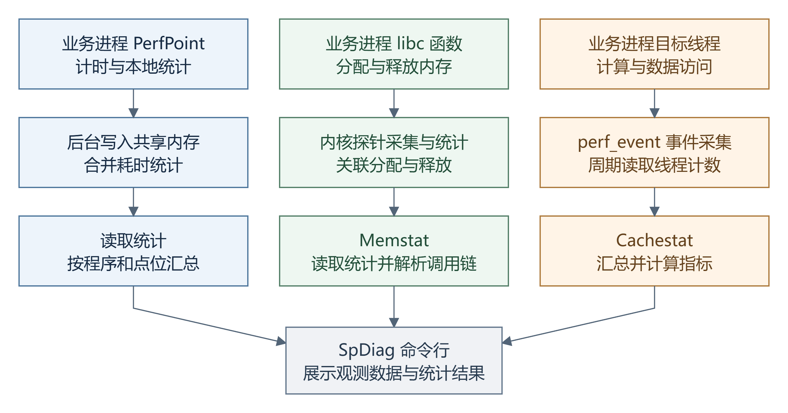
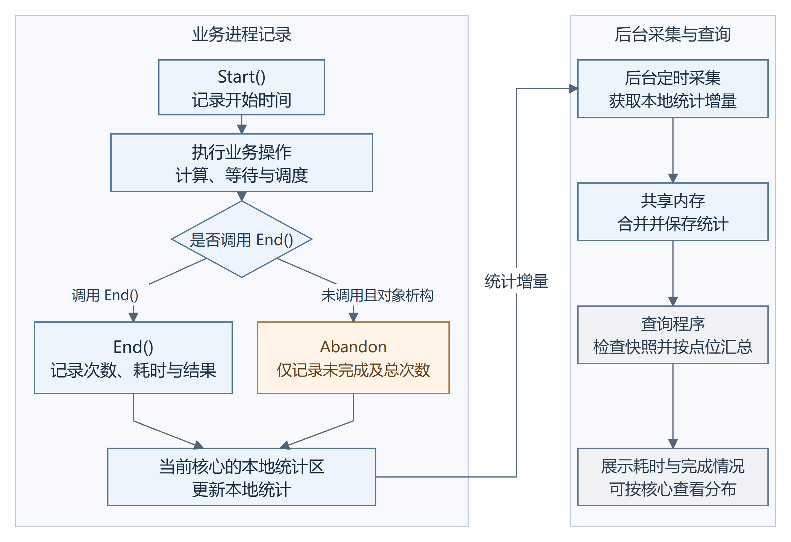
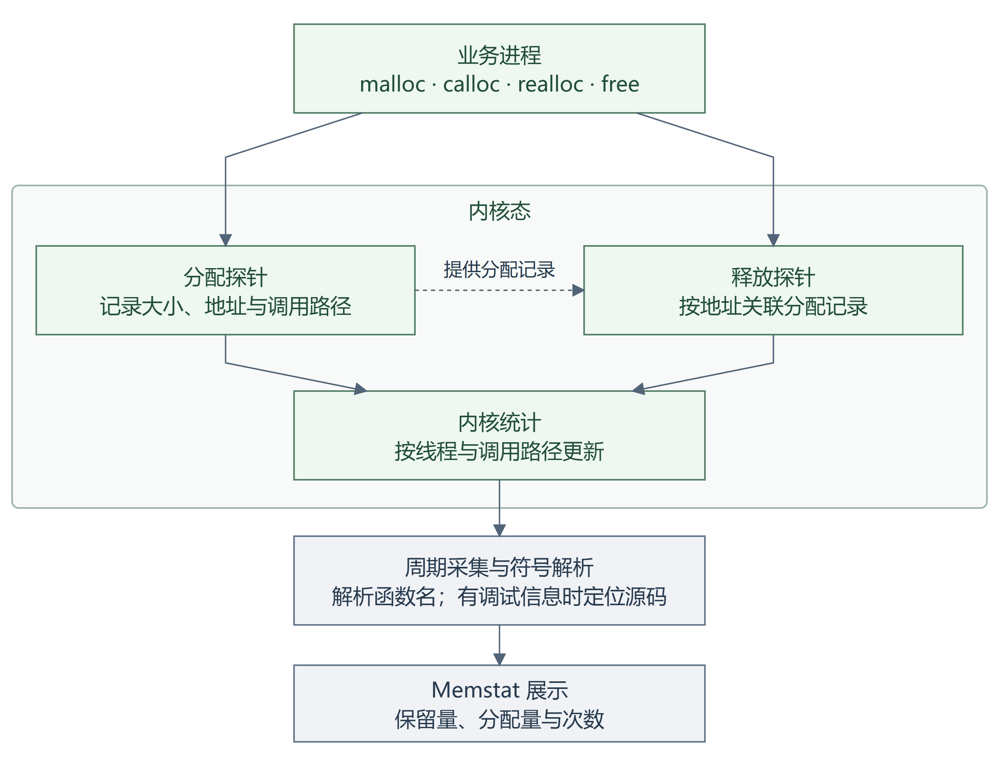
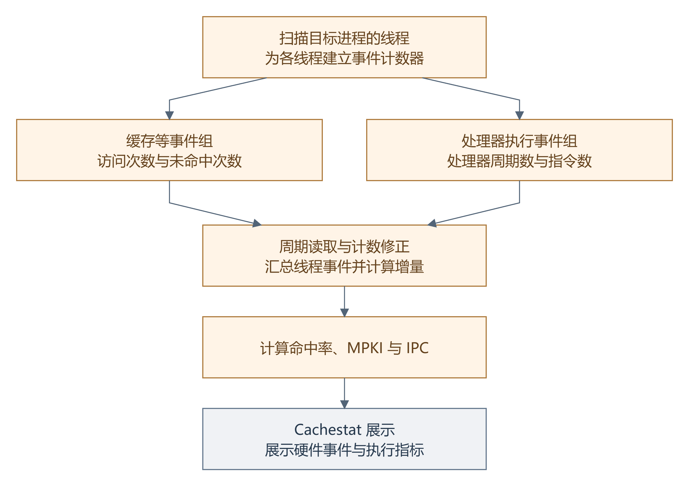

# 超节点应用的性能诊断工具 SpDiag

SpDiag（SuperPoD Diagnostics）是一套面向超节点应用的性能诊断工具，用于观察业务代码耗时、内存分配和处理器执行行为。它帮助开发者把请求变慢、内存增长、执行效率下降等现象与具体进程和业务路径联系起来，为检查代码、评估优化效果提供线索。

它面向的典型环境是鲲鹏超节点：多台服务器通过灵衢高速互联协作，并借助系统软件进行节点间通信和内存资源协作。数据库、分布式缓存和通信服务在其中运行时，需要处理本地计算与跨节点数据交换。一次数据读取可能经过查找缓存、申请缓冲区、请求远端数据和处理结果等阶段。这些阶段的计算、通信、等待和内存操作交织发生，性能异常可能出现在任何线程、任何函数、任何时刻，难以直接判断时间和资源消耗在哪里。SpDiag 的作用是补充业务耗时、内存使用和处理器行为的信息，帮助使用者找到性能瓶颈。

## SpDiag的三类观测功能

围绕这些诊断问题，SpDiag 提供三项观测功能：代码段计时功能 PerfPoint 记录业务操作的耗时和完成情况；内存分配跟踪功能 Memstat 记录分配路径与保留量；硬件事件观测功能 Cachestat 记录缓存、地址转换和分支事件。PerfPoint 功能需要业务程序侵入式接入 SDK，在关键路径加入计时点。Memstat 和 Cachestat 可以附加到运行中的目标进程，分别通过内核探针和硬件计数器采集数据，无需修改目标代码。

图 1 展示了数据如何到达使用者。PerfPoint 由后台将进程内统计写入共享内存，供其他进程读取；Memstat 捕获 libc 的分配与释放事件；Cachestat 读取线程的硬件事件。各采集模块按插件方式组织，由管理模块启动和停止，结果由命令行展示。

图 1 SpDiag 的主要采集与展示路径

## PerfPoint 记录业务代码的耗时

使用 PerfPoint 时，需要为待计时的代码段定义点位，让工具记录下模块名与点位名称。超节点应用中的各类请求解析、请求执行和结果发送都可以建立点位。进入代码段时，调用 Start() 记录开始时间；结束时调用 End() 计算耗时，并按返回码区分成功和失败。已经开始却未结束的对象，在析构时记为未完成 (Abandon)。

统计数据时，SpDiag工具读取处理器的计时寄存器，将计数差转换为时间。PerfPoint 在结束时按当前核心选择本地统计区，更新次数、总耗时和最小最大耗时。用预定义编号访问统计数组，减少记录时的查找和共享统计争用。后台线程定期将本地统计增量合并到共享内存。为检查读取时是否遇到后台更新，查询程序比较复制前后的更新序号，再按程序和点位汇总，经文本格式化后向用户展示统计结果。

图 2 普通 PerfPoint 的记录与汇总流程

每个点位展示总调用次数（Ticks）、成功次数（Good）、失败次数（Bad）、未完成次数（Not），以及累计耗时（Total）、平均耗时（Avg）、最小耗时（Min）、最大耗时（Max）。按核心查看时还显示核心编号（Core），表示调用结束时所在的核心。耗时单位是纳秒（ns）。平均值难以反映少数特别慢的调用，因此 SpDiag 还提供分位数统计(P99, P999, P9999) 和探针调用日志 (PerfLog)。分位数对应耗时排序中的某个位置，帮助观察少数慢调用。例如，P99 表示约九成九的调用耗时不超过这一数值，P999 和 P9999 进一步关注更少数的慢调用。探针调用日志功能则可以记录最近每次调用的时间、线程、核心和耗时。

在通信类的超节点应用中，部分异步任务可能由一个线程开始、另一个线程完成。为记录跨线程通信的耗时，SpDiag 提供全局点位功能 Global PerfPoint，支持在不同线程中记录开始和结束时间。

对于普通点位，通过比较同一点位在不同核心、不同时间的记录，PerfPoint 可以帮助判断任务分配是否均匀，以及调用时延是否稳定。下面是两种典型情况。

1. 如果承担相同任务的核心中，少数核心长期记录了更多调用，而各核心的平均耗时相近，则可能存在任务分配不均。可以进一步检查任务队列和线程绑核情况。
2. 如果平均耗时基本稳定，但最大耗时与平均耗时的差距明显拉大，且P999分位数耗时较高，则说明少数调用可能受到了等待的影响，产生时延波动。此时可用 PerfLog 找出发生时间和线程，再检查排队或锁竞争。

## Memstat 观察内存分配行为

超节点应用常常遇到内存问题导致的性能瓶颈，例如内存泄漏导致的内存消耗持续增长，或碎片化内存导致的性能下降。在这种场景下，诊断工具需要找到内存的分配路径。SpDiag 的 Memstat 功能根据进程标识符（PID，Process Identifier）附加到目标进程，跟踪 libc 中申请、调整和释放内存的函数，包括 malloc、calloc、realloc 和 free，按线程和调用路径统计。

为捕获这些调用，Memstat 使用eBPF (extended Berkeley Packet Filter)，在内核中运行受检查的观测程序。函数入口探针 uprobe 读取申请大小，返回探针 uretprobe 获取分配地址。地址、大小和调用路径存入内核映射表；捕获 free 时按地址关联分配记录，更新统计。

图 3 Memstat 从函数事件生成内存诊断信息

Memstat 在内核态记录地址和调用链信息，可以做到非侵入式的内存问题诊断。采集程序周期性读取统计，通过程序和动态库的符号解析函数名称，有相应调试信息时还能显示源码位置。使用者可以沿调用路径找到分配位置，检查申请和释放内存的原因与时机。

每条记录标明进程编号（PID）、线程编号（TID）和分配调用路径（CallStack）。记录的数据包括当前尚未释放的内存量（Current）、累计分配量（Total）、峰值内存占用量（Peak）、分配次数（Allocs）、释放次数（Frees）、平均分配大小（AvgSize）、最大单次分配大小（MaxSize）和首次观测时间（FirstSeen）。这些数据来自跟踪期间捕获的内存分配与释放操作。

把内存占用量与分配、释放次数放在一起看，Memstat 可以帮助判断内存是否按预期释放，以及程序是否在频繁申请小块内存。例如，如果业务负载稳定，当前尚未释放的内存量仍持续增长，分配次数与释放次数的差也越来越大，则可能存在内存泄漏。排除正常缓存增长后，可以沿调用路径检查是否遗漏释放。又如，如果平均分配大小较小，分配和释放又十分频繁，则可能有大量临时对象在反复创建，增加分配开销与碎片风险。可以尝试复用缓冲区，实际碎片情况还需结合分配器信息确认。

## Cachestat 怎样提供处理器运行效率的线索

现代CPU通常先从缓存取得数据，访问相邻数据有机会重复利用已取入的内容。跳跃访问、数据超出缓存容量或布局不合适，都可能增加未命中，缓存未命中可能导致数百纳秒的等待，导致整体性能下降。此外，地址转换缓存（TLB，Translation Lookaside Buffer）保存虚拟地址到物理地址的转换信息；分支预测帮助处理器准备后续指令。若这些环节出现问题，都会影响执行效率。

处理器通过性能监测单元（PMU，Performance Monitoring Unit）统计硬件事件。SpDiag 的 Cachestat 则使用接口 perf_event_open 为目标线程建立计数器，并更新线程列表。它支持一级数据缓存（L1-dcache）、一级指令缓存（L1-icache）、末级缓存（LLC，Last Level Cache）、数据地址转换缓存（dTLB）、指令地址转换缓存（iTLB）及分支事件（branch）。每类事件记录访问次数（References）、未命中次数（Misses）、未命中率（MissRate）和命中率（HitRate）。这些列的含义随事件类别而变化：缓存行反映缓存访问情况，地址转换行反映转换缓存的命中情况，分支行反映分支预测情况，其中 Misses 表示预测失败次数。

图 4 Cachestat 按线程采集并汇总硬件事件

在统计的同时，Cachestat 会同步计算CPU运行指标：缓存的命中和未命中比例可以提供访存行为的线索。每千条指令的未命中次数（MPKI，Misses Per Kilo Instructions）表示每执行一千条指令发生多少次未命中；每周期执行指令数（IPC，Instructions Per Cycle）表示平均每个处理器周期完成多少条指令。结合这些指标，可以检查访问方式和执行效率的变化。

Cachestat 支持展示监测期间的累计结果和周期增量：累计结果用于看总体表现，周期增量用于观察不同时间段的变化。

将这些指标与相同负载下的正常表现比较，Cachestat 可以帮助判断数据是否容易被缓存重复利用，以及处理器是否能够顺畅执行指令。例如，如果一级数据缓存未命中率升高，每千条指令的未命中次数也明显增加，则可能是访问的数据较为分散，难以复用缓存，也就是数据局部性较差。可以检查随机或跨步访问，尝试连续数据布局。

## 总结

SpDiag 提供三种互补的观测能力。PerfPoint 帮助找到耗时异常的业务阶段，Memstat 提供分配与保留内存的调用路径，Cachestat 提供缓存和执行效率的线索。开发者可以围绕遇到的问题选择功能，将表现异常的阶段与相关资源行为联系起来，逐步缩小需要检查的范围，直至定位出性能瓶颈。

SpDiag已开源至openEuler社区，我们希望更多开发者在真实业务中使用 SpDiag进行性能诊断，分享诊断案例和优化经验，帮助工具持续完善。
项目代码仓地址：https://atomgit.com/openeuler/spdiag
欢迎读者反馈使用问题、完善文档和贡献代码，共同参与 SpDiag 建设。
