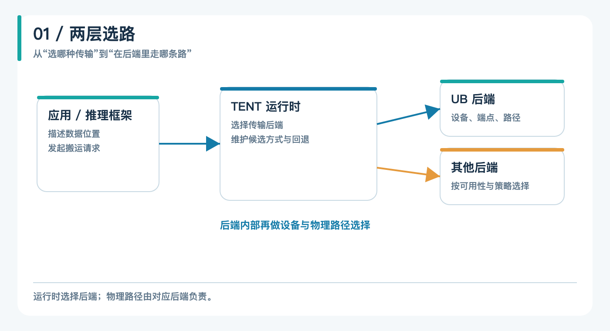
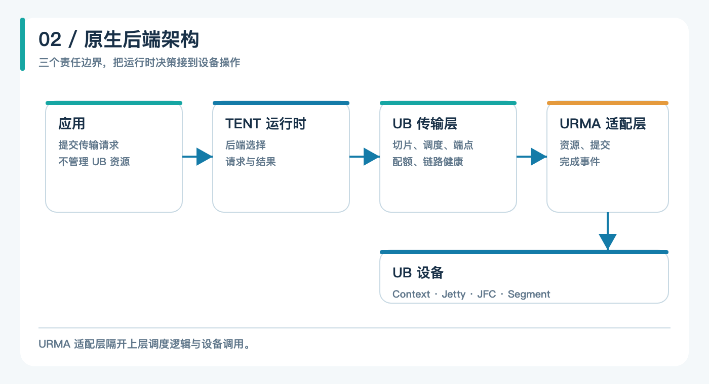
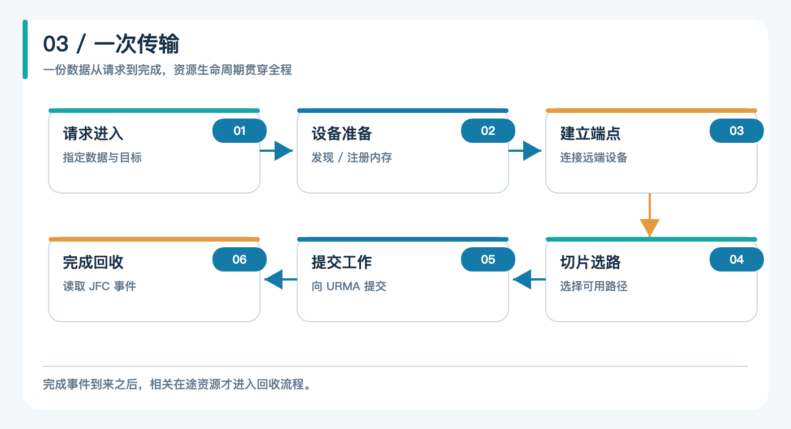
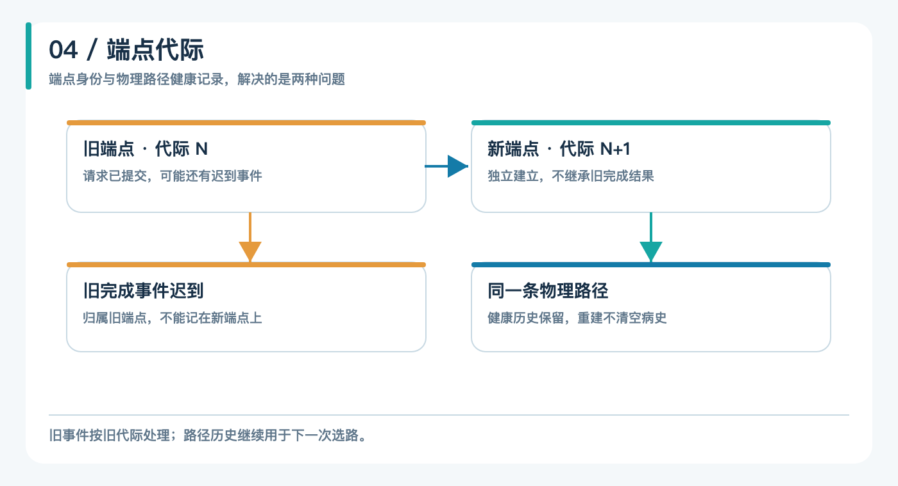
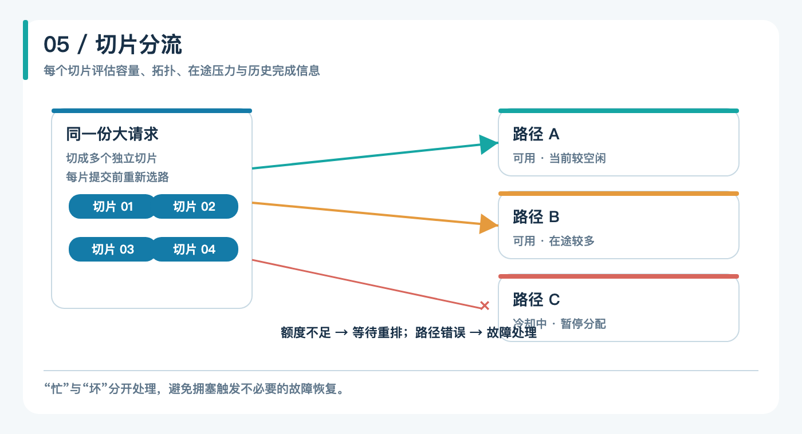
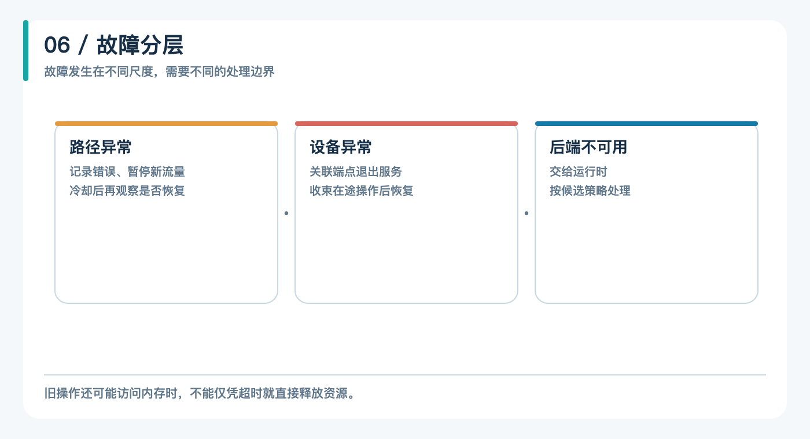

# TENT：Mooncake 下一代传输引擎的修炼

大模型推理正在从“一台机器干到底”走向“分工协作”：Prefill 节点负责读懂提示词，Decode 节点负责逐字生成，中间交接的是一份可能达到数 GB 的 KV Cache。交接得快不快、稳不稳，会影响用户等第一个字要多久。

这份“交接”的活，Mooncake 是业界常用的开源方案之一。它最早支撑月之暗面 Kimi 的线上服务，以 KV Cache 为中心组织分布式推理所需的存储和传输能力。上层框架关心怎样复用缓存、怎样分离计算阶段，底层最终都要回答同一个问题：怎样把一段内存或显存里的数据搬到另一台机器。

Mooncake 的经典传输引擎（Transfer Engine，简称 TE）已经让这件事跑得很快。但当集群里同时出现不同互联方式、多张设备、拥塞和局部故障时，传输就不再是“选一条路，把数据发出去”那么简单。Mooncake 的下一代传输引擎 TENT（Transfer Engine NEXT）要处理的，正是越来越复杂的“路”。灵衢（UB）以原生后端的形式接入 TENT，也给了我们一个观察新架构的好例子。

这篇文章沿着一份 KV Cache 的传输来讲：为什么需要 TENT，UB 后端处在什么位置，以及设备、连接、路径和完成事件怎样协同工作。

## 一、从 TE 到 TENT：传输的决定权往下移

经典 TE 的使用方式里，进程通常在启动时确定传输协议，后续请求沿着这套已确定的通道工作。对于设备和网络比较统一的环境，这种方式直接有效；而今天的推理集群未必整齐：节点之间可能走 RDMA、UB、TCP，同一台机器上也可能有不同设备和端口。一条路径在请求开始时可用，在传输途中却可能变慢甚至出错。

这会带来两个层次的选择。第一个问题是**用哪一类传输后端**：两端能否使用相同互联、运行时怎样选择候选方式、失败后是否还有退路。第二个问题是**在这个后端里走哪条物理路径**：设备如何发现、多条链路如何分担工作、一条链路异常时如何隔离。把这两种决策混为一谈，上层应用就容易被迫了解过多底层细节。

设想一次跨节点的 Prefill/Decode 分离推理：Prefill 节点已经算好前缀对应的 KV Cache，Decode 节点接下来要拿着这份状态生成回复。对上层而言，最自然的调用是说明源数据在哪里、目标数据放在哪里，以及何时需要知道结果。如果应用还必须知道哪张卡正忙、哪条端口刚恢复，就要把网络拓扑和故障细节写进业务逻辑；换一套互联，业务代码也得跟着调整。

TENT 把传输方式组织成可插拔后端，由运行时协调请求与候选后端；每个后端再处理自己熟悉的设备和数据路径。应用依然描述“搬什么、搬到哪里”，设备选择和路径管理尽量留给引擎。

把 UB 接到 TENT 中，关键也就在这里：如果 UB 是一个真正的后端，应用无需为了灵衢另外设计一套搬运流程；如果只是把它塞进另一种协议的外壳，设备和故障特性反而很难讲清楚。

## 二、UB 原生后端的三层结构

灵衢后端没有借道经典 TE，也没有把 UB 伪装成 RDMA。它通过 URMA 与 UB 设备打交道，在 TENT 中实现自己的资源管理、连接和读写路径。把架构从上往下拆，可以看到三个层次。

**TENT 运行时**负责接收上层传输请求，组织后端的选择与必要的回退。它面对的是“这次请求应该交给谁”。**UB 传输层**负责把请求变成可调度的工作：选择本地和远端设备，管理端点、切片、额度、在途任务和链路健康。它面对的是“在 UB 网络里怎么走”。**URMA 适配层**封装与底层资源直接相关的操作，包括 Context、Jetty、JFC 和 Segment 等。它面对的是“如何真正向设备提交操作并拿到完成结果”。

如果熟悉 RDMA，可以先用几组近似关系建立直觉：JFC 类似完成队列，Jetty 类似通信端点，Segment 与访问凭据对应内存注册和远端访问授权，EID 用于标识网络中的端点身份。这只是帮助理解的类比；实际资源及生命周期仍由 URMA 的接口定义。

适配层还有一个工程价值：上层的切片调度、端点状态和故障逻辑不必直接依赖一张真实网卡才能测试。用模拟适配实现替换设备操作，就能让许多路径在普通 CI 环境里得到验证。它也让传输层的业务语义和硬件调用保持一条清楚的边界。

这样的划分还有利于判断一个问题发生在哪里。请求没有找到可用后端，先看运行时的候选与能力判断；UB 已被选中却无法提交切片，继续看设备发现、端点建立和发送额度；工作已提交却迟迟没有结束，则要看完成队列、端点状态与在途资源。这种分层不只是画在文章里的方框，排查问题时也能沿着同一条线往下走。

## 三、一份数据进入 UB 后端，会经过什么

先别急着谈“多路径”。传输里有两个经常被混用的词：**请求**是上层交付的一次完整搬运，**切片**则是后端为了调度和提交而拆出来的工作单元。一个请求可能包含多个切片；只有处理好它们的提交与完成，才能向上层交代整次请求的结果。拆小之后，后端得到的不只是并行的机会，也得到按切片改变路径、限制在途数量的空间。

切片也并非越小越好。每片都要经历选择路径、占用额度、提交工作和处理完成事件；片数太多，这些管理成本会随之增加。切片过大，又会降低重新选择路径的机会，让一条慢路拖住更多数据。实际切片需要服从配置和设备能力的限制，在并行度与提交开销之间取得平衡。这也是为什么文章里只画出“拆成几片”的关系，不给出一个看似放之四海皆准的固定片数。

一份 KV Cache 真正开始传输前，要走完几步准备工作：找到合适的本地设备，理解对端有哪些可达设备，准备能被访问的内存，建立端点，再把大请求分成可以提交的小片。随后，工作请求被送到 URMA，完成事件回来后才算完成相应的账。

### 1. 设备不是“看见几个就用几个”

灵衢环境里，一个 bonding 聚合设备可能对应多个物理端口。假如把聚合设备和它下面的物理端口同时当作独立入口，流量就可能绕开聚合层，甚至导致跨节点访问失败。UB 后端在未显式指定设备时，会按发现结果优先保留聚合设备；没有发现聚合设备时，才使用其他候选。显式设备过滤则遵循用户的选择。这里的规则依据设备发现结果，并不意味着聚合设备初始化失败后一定会自动切回其物理端口。

这看似是设备发现中的一个小判断，实际决定了后面的路径视图是否正确。调度器再聪明，也无法修补一个从一开始就重复或错误的设备列表。先把“有哪些路”认对，才谈得上“哪条路更好”。

设备选择也不只看本机。本地有若干 UB 设备，对端也有自己的设备列表，真正能提交的路径是两端可达设备的组合。某一组合没有建好端点，或者恰好处于恢复冷却期，不代表全部组合都无法使用。把设备发现、远端信息和路径状态连起来，调度器才知道自己是在“还可以换一条路”，还是“这一类后端暂时走不通”。

### 2. 远端连接是有生命周期的

找到设备后，后端需要与对端建立可用于数据操作的端点。连接不是永久有效的：对端可能重启，设备可能复位，之前发出的请求也可能在故障后才返回一个迟到的完成事件。

UB 后端把端点当作有代际身份的资源。旧端点失效后退出可用集合，新连接使用新的端点身份；与旧端点相关的迟到事件，不能算到新端点头上。否则旧请求的完成可能错误地释放新请求的额度，或者把失败错误地记在新连接上。与此同时，物理路径的健康记录不会因为换了端点就清零：连接是一次性的，路径是否可靠却是一段持续的观察。

这也是为什么“重连”并非一个简单的重试按钮。若旧端点还持有尚未明确完成的工作，直接把它当成新端点继续用，就会让资源归属变得含糊。采用新的身份后，系统至少能说清楚：哪批请求在旧连接上发出，哪批请求属于新连接，晚到的事件该由谁处理。连接更新与路径评价分开，才能同时避免旧消息串账和故障历史被刷新。

### 3. 内存与完成事件必须成对考虑

传输请求指向的并非一个普通文件，而是进程中的内存或显存。设备要访问它，先得建立相应的注册与访问关系；提交操作之后，相关缓冲区也不能因为上层等得不耐烦就立刻释放。

本地注册会产生与设备相关的内存描述信息，对端要按相应的授权与地址范围访问，而不能拿一份描述任意套到另一张设备上。注册信息还需要带上代际：进程重新注册了一段内存，就算地址恰好相同，也不该复用旧的远端访问关系。地址、权限、设备和代际一起核对，才能知道一次远端访问究竟指向哪份有效资源。完成事件从 JFC 返回，后端才能知道对应操作的结果，并回收占用的在途资源。

这里有个很朴素的原则：**软件觉得超时，不代表硬件已经停止访问内存。** 对一项旧操作的清理，需要与端点状态和底层完成、冲刷过程协调好。否则表面上队列空了，设备仍可能碰到已经复用的内存。长期运行的传输系统，安全回收和发得出去同样重要。

可以把每个在途切片想成一张借条：提交时占用一个发送名额，引用相应的数据和端点；完成时核对它的身份，归还名额，再允许后续工作进入。正常完成很容易理解，异常时借条却可能没有按时回来。此时需要确认底层操作已经不可能继续使用旧资源，才能做最终清理。这个顺序如果颠倒，短期测试可能看不出问题，长时间运行却可能碰到额度耗尽或内存安全风险.

## 四、多路径：每个切片都有一次选择机会

如果一个请求有数 GB，把它整体压在一条路径上，一条慢路就可能拖住所有数据。UB 后端把大请求拆成切片，让每片在提交前评估候选路径。它先排除处于故障冷却或暂不可用状态的路径，再结合可用发送空间、拓扑距离、在途压力和从完成数据得到的带宽信息排序。也就是说，路径选择是不断发生的，而不是在请求开头做一次决定就不再改变。

举个简化例子：两条同一拓扑等级的路径都连着对端，A 当前在途请求很多，B 则还有更多余量。新切片不该只因 A 曾经快，就源源不断地堆到 A 上。调度先看有没有发送额度，再看拓扑等级；在这些条件接近时，当前在途压力和历史带宽才能进一步区分候选。历史带宽是参考信息之一，而非忽略眼前拥塞的通行证。每次完成又提供新的观测，下一批切片可以据此重新判断。

“没空位”和“出故障”也必须分开。路径额度被占满，说明它正在忙，切片等待或重新排队即可；路径真正提交失败、完成报错，则需要记录故障并考虑绕行。把拥塞误当故障，会频繁重建连接；把故障误当拥塞，又会让任务一直等待。二者在表现上都可能是“现在发不出去”，处理方法却截然不同。

发送额度还有一个更细的作用：它让在途工作量保持有界。切片越多，越不能无节制地把请求压给设备和完成队列。配额、完成回收和重新调度构成一个闭环：占用额度才能提交，收到结果后归还额度，后面的切片才有机会继续向前。

这里还要避免一种看似合理的极端：总是选择理论带宽最高的链路。带宽估计来自已经完成的工作，它描述的是过去一段时间的观察；额度和在途压力反映的是眼前能不能再接一片。若后者已经接近上限，继续按历史峰值加任务，只会把尾部切片排成长龙。反过来，完全平均地分配也忽视了路径距离与当前负载。把可用性、拓扑、压力和测得的表现放在同一个选择过程里，正是切片级调度存在的意义。

## 五、故障恢复：换路之前，先把旧账结清

传输失败有很多尺度。某一条路径暂时抖动，不等于整台设备报废；设备故障，也不等于 UB 这种传输方式在整个集群中不可用。UB 后端会记录路径健康，连续错误时暂停向问题路径派发新工作，经过冷却后再观察能否恢复。设备级问题则需要让关联端点退出服务，处理好尚未完成的操作，随后才考虑重新使用设备。更大范围的不可用情况，则交给 TENT 运行时按候选后端策略处理。

这里最难的是“旧账”。假设一个切片已经提交，完成事件却没有按预期到来：如果永远等它，对应额度会一直被占住；如果立即把额度和内存交给新任务，又可能撞上仍在访问的旧操作。因此故障恢复不能只改一个健康标志。端点退役、在途请求的收束、资源回收和重新开放路径，必须保持一致的顺序。

从这个角度看，代际身份与路径健康记录正好解决不同问题。前者回答“这个完成事件属于哪次连接”，后者回答“这条物理路径最近是否值得再试”。一个防止旧消息污染新状态，一个让绕路与恢复有依据。

想象路径 A 连续失败，切片转向 B。过了一段时间，A 的端点重新建好：如果立刻把大量任务重新灌回 A，刚恢复的路径可能再次暴露同样的问题；如果永远不再试，又浪费了恢复后的容量。因此，暂停、冷却和试探是不同的动作。设备层也是如此：让端点退出服务解决的是“停止新的错误提交”，收束旧操作解决的是“安全回收”，重新开放解决的才是“恢复容量”。把这些动作拆开，故障流程就能被检查和测试。

判断恢复逻辑是否可靠，可以沿着一片数据问四个具体问题：失败发生时它是否已经提交到设备？旧端点有没有可能继续产生完成事件？占用的额度由哪一次完成或清理归还？新端点何时才允许接下一片？这四个问题如果在状态转换中都有确定答案，恢复就不必依赖“超时以后大概没事了”这样的猜测。尤其是最后一步，重新开放路径应该发生在旧资源收束之后；否则新旧任务会在最难排查的时间窗口里交错。传输引擎的可靠性，往往就藏在这些看起来不显眼的边界里。

## 六、为什么坚持做原生后端

从实现角度看，复用一条看似相近的旧路径，短期可能少写很多代码。但设备枚举方式、端点状态、内存授权、完成队列和故障恢复，总有各自不能被一层“协议翻译”抹平的地方。把 UB 做成独立后端，是为了让这些差异显式地待在 UB 层：运行时只需要知道它是否能承担请求，后端自己决定如何准备资源、提交切片和处理完成。

这种分工也留下了继续演进的空间。以后路径评分需要更多真实运行数据，可以在后端里改；运行时新增后端选择策略，也不必改动 URMA 的资源操作。图里看上去是从上到下的几层方框，真正起作用的是它们之间的边界：哪一层有足够信息做决定，哪一层就负责做决定；哪一层持有资源，哪一层就负责把资源安全地交还。

## 写在最后

从应用看，请求仍然是“把这段 KV Cache 送到那里”；从引擎看，它要决定传输后端、找到正确设备、建立端点、切分任务、分配路径、等待完成，还要在故障时安全收束旧操作。TENT 提供后端之间的组织方式，灵衢 UB 后端则把这些动作落实到自己的设备和数据路径中。

下一代传输引擎的价值，并不只在于多支持了一种互联。更重要的是，当集群里的“路”越来越多，应用仍能用相对简单的请求表达需求，复杂性由了解设备与运行状态的那一层接住。读完一份数据的旅程，也就更容易理解 TENT 与 UB 为什么要这样分工。

文章里的图刻意把“选择”“提交”“完成”画成不同阶段：选中一条路径，只代表当前它适合承担工作；提交成功，才代表设备接下了这片数据；收到相应的完成结果，才能结算这片工作的资源。三件事看似紧挨着，任何一步出现变化，都需要把状态带到下一步，而不能提前宣布传输成功。理解了这条时间线，也就理解了为什么 TENT 要有运行时、UB 后端要有端点与路径状态、URMA 适配层要守住完成与清理的边界。

Mooncake 开源项目：https://github.com/kvcache-ai/Mooncake
