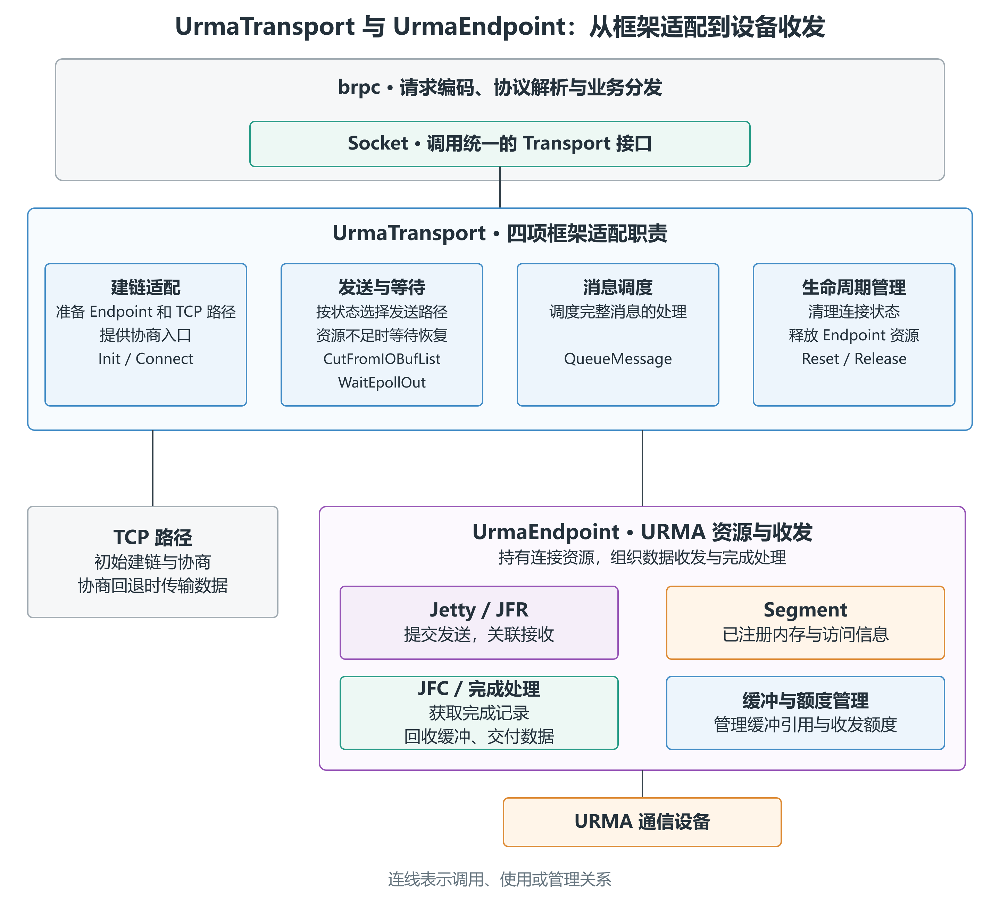
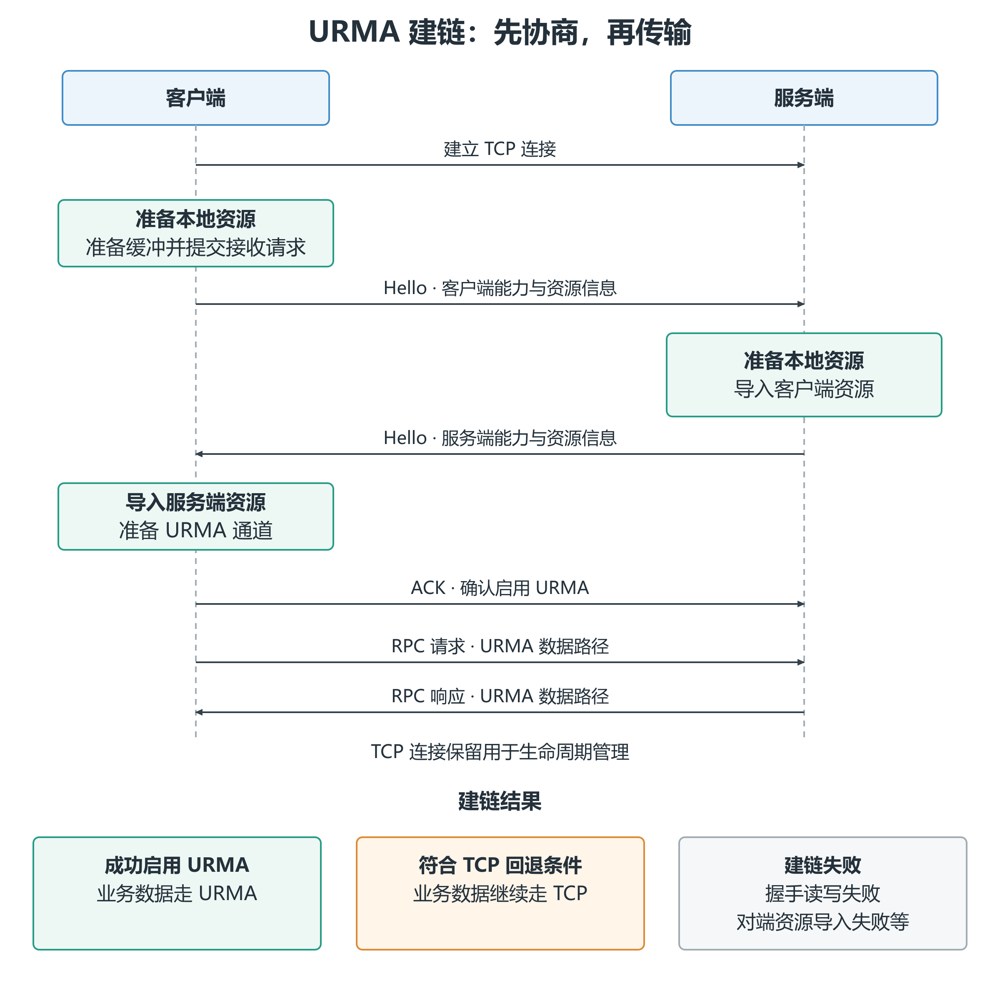
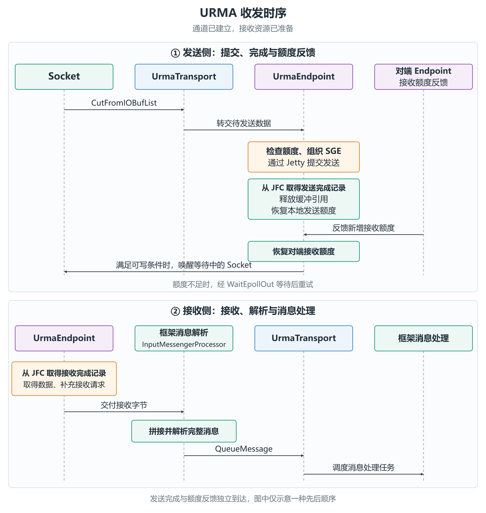
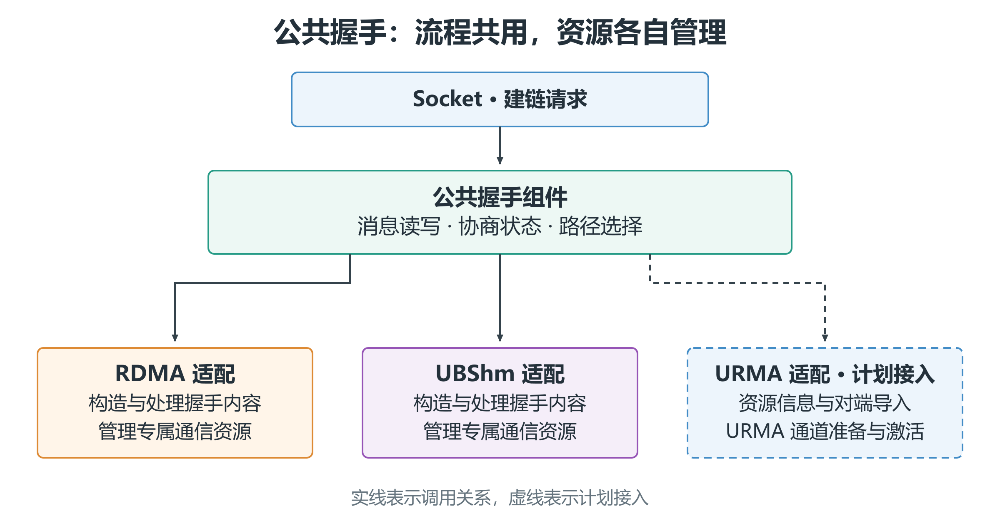
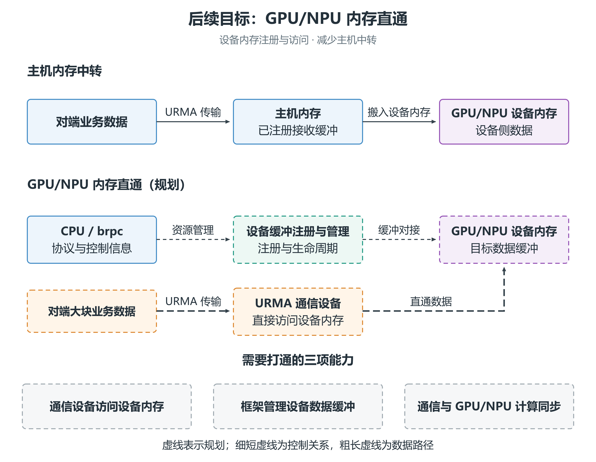

# 【UB生态使能系列】算力再强，也得等数据：bRPC 的 URMA 通信进阶

> 从 URMA 接入到后续演进，看 brpc 如何把灵衢的互联能力带给上层应用。

## 一、计算越来越快，一次请求却未必能更快完成

一次大模型回答、一次 Agent 任务、一屏推荐结果，背后常常有多个服务在协同工作。用户等待结果的时间里，数据也在这些服务之间不断流转。

检索服务要送来上下文，Agent 要调用工具、在沙箱中执行任务并取回结果；搜索、推荐和广告系统，则需要多路召回、特征查询与模型打分。算力可以加快其中的计算，但请求与数据没有及时到位，后续处理就得等待。

频繁的小消息、大块的向量与特征数据，对通信提出了不同要求。随着服务规模扩大，连接、队列和缓冲资源的管理，也成为通信链路的一部分。

TaiShan 950 SuperPoD、Atlas 950 SuperPoD 等灵衢超节点，为计算资源之间的协作提供了高速互联基础。应用要用好这套能力，还需要把服务之间的通信接到相应的底层路径上。

系列前文介绍了 [Transport 框架与共享内存路径](https://mp.weixin.qq.com/s/r9awdORvB3YetuPGXR5VJA)。本篇聚焦 UrmaTransport，看看 URMA 的通信资源如何接入 brpc 的建链、收发与消息处理。

## 二、UrmaTransport：让 brpc 支持 URMA 通信

### 1. 已有 RDMA，为什么还要接入 URMA？

RDMA，即远程直接内存访问，可以让通信设备直接访问已注册的应用内存，减少传输中的内核参与和中转拷贝。brpc 已通过 RdmaTransport 支持这类通信。

面向灵衢，UMDK 提供了 URMA（Unified Remote Memory Access，统一远程内存访问）通信接口，支持消息收发、远端读写等操作，并通过适配层衔接底层设备。接入 UrmaTransport，是让 brpc 能够使用这套通信能力。

连接规模和负载仍然影响资源组织。例如，常见 RDMA 可靠连接模式需要为连接维护相应资源；URMA 接入同样需要管理通信对象、队列与缓冲。在 [提案 #3401](https://github.com/apache/brpc/issues/3401) 中，我们提出由 URMA 路径承接大包、跨节点高吞吐通信，与共享内存路径互补。

### 2. UrmaTransport 如何适配框架接口？

应用选择 URMA 后，TransportFactory 创建 UrmaTransport，交给 Socket 使用。这项接入已通过 [PR #3428](https://github.com/apache/brpc/pull/3428) 合入 Apache brpc。

Socket 通过统一的 Transport 接口使用不同的通信方式。UrmaTransport 把 URMA 的通信机制接入这些接口，其工作可以归纳为四项主要职责：

- **建链适配。** Init 创建 UrmaEndpoint 和 TCP 备用实现，绑定 Socket 与事件回调；Connect 提供握手协商对象，由 Socket 在建链时启动。具体的 URMA 资源交换由 Endpoint 的握手流程完成。
- **发送与等待。** CutFromIOBufList 根据连接状态选择发送路径：URMA 启用后交给 Endpoint，回退时交给 TCP 实现。资源不足、暂时不可写时，WaitEpollOut 将等待接入框架的写入流程。
- **消息调度。** 接收字节由框架解析为完整消息后，QueueMessage 参与调度消息处理任务。传输层完成这一衔接，请求或响应的处理继续由框架执行。
- **生命周期管理。** Reset 清理本轮连接的资源与收发状态，为 Socket 复用做准备；Release 销毁 Endpoint，释放它持有的通信资源。

这些适配让 Socket 能按框架既有的接口使用 URMA，上层的请求编码、协议解析和业务分发流程继续保留。

### 3. UrmaEndpoint：组织通信资源与数据收发

UrmaTransport 负责框架侧的适配，UrmaEndpoint 则管理通信资源、组织收发并处理完成结果。其中，几个关键对象各有分工：

- **Jetty：提交通信操作的对象。** 当前实现采用可靠消息模式（RM），通过 Jetty 提交发送请求，并关联接收资源与完成队列。
- **JFR：承接接收请求。** 接收端提前准备缓冲并提交接收请求，告诉设备数据可以写入哪里。
- **JFC：提供收发完成记录。** Endpoint 从中取得结果，推进缓冲回收或接收数据处理。
- **Segment：已注册内存的资源与访问信息。** 设备收发需要使用可访问的内存；Endpoint 根据缓冲地址与注册信息描述数据所在的位置。

*图1｜UrmaTransport 的整体架构。*

下面沿着建链与收发，看这些对象如何配合。

## 三、一次 RPC，怎样跑通 URMA 链路？

### 1. 先协商：交换资源信息，建立 URMA 通道

客户端选择 URMA 后，需要先确认服务端的能力，并交换双方的通信资源信息。当前实现先建立 TCP 连接，再通过 Hello 与 ACK 完成协商。通道建立后，后续 RPC 可以复用这条连接。

客户端准备本地资源与接收缓冲，发出 Hello；服务端准备资源、导入客户端的资源信息，再回复自己的 Hello；客户端导入对端资源并发送 ACK，双方随后启用 URMA 数据路径。这里交换的是通信资源的标识与访问信息，让各端能够使用对方的通信资源。

*图2｜URMA 建链时序。*

客户端能力不可用、部分本地资源准备失败等符合回退条件时，RPC 数据继续通过 TCP 传输；握手读写或对端资源导入失败时，则进入建链失败路径。

### 2. 再收发：从提交数据到处理消息

**发送从 IOBuf 开始。** Socket 通过 CutFromIOBufList 把待发送数据交给 UrmaTransport，再由 Endpoint 组织发送。Endpoint 检查可用额度，根据数据地址和注册信息构造散布/聚集条目（SGE），描述本次操作涉及的内存片段，再通过 Jetty 提交发送请求。一条 RPC 消息可能拆成多个底层操作。

**资源不足时，等待可用额度恢复。** 本地发送队列要有空位，对端也要有可用接收额度。暂时不可写时，框架通过 WaitEpollOut 等待；发送完成和接收额度反馈恢复资源，满足可写条件后再唤醒写入方继续提交。

**从接收完成到消息处理。** Endpoint 从 JFC 取得接收结果，把接收字节交给 brpc 的消息解析流程。完整消息解析出来后，经 QueueMessage 等框架调度机制进入请求或响应处理。传输层负责衔接，业务处理仍由框架的消息处理任务执行。

*图3｜URMA 收发时序。*

要让这条路径持续工作，还要照顾缓冲与额度的生命周期。brpc 为 IOBuf 数据块提供主机注册缓冲池，减少逐消息注册；已提交的发送保留缓冲引用，完成后再释放。接收侧补充接收请求，并按策略反馈新增额度，让发送方继续使用这条接收路径。连接结束时，Endpoint 清理通信资源与收发状态。

## 四、公共握手：让不同传输方式共用协商流程

RDMA、UBShm 与 URMA 使用不同的通信机制，却有相似的建链需求：通过 TCP 交换信息，准备各自的资源，再确定数据路径。各自实现整套流程，会重复处理消息读写、状态切换和回退。

[公共握手设计讨论 #3432](https://github.com/apache/brpc/discussions/3432) 与 [PR #3535](https://github.com/apache/brpc/pull/3535) 将这项工作分成两部分：公共组件组织协商流程，各传输方式负责自己的资源与握手内容。PR 中实现了 RDMA、UBShm 的适配，UrmaTransport 也计划接入这一组件。

*图4｜公共握手的职责分工。*

对 URMA 而言，TCP 上的握手读写和通用状态流转可以复用；资源信息的构造与校验、对端资源导入和通道激活，则保留在专属适配中，并以兼容已有握手消息为约束。这样，框架集中维护共性，URMA 的设备资源逻辑也有明确的落点。

## 五、下一步：减少数据中转，完善通信可靠性

### 1. GPU/NPU 内存直通：减少主机中转

对于 GPU/NPU 业务，数据到达主机后，可能还需要搬到加速器的设备内存，才能参与计算。节点间传输提速之后，这段搬运也值得继续优化。

GPU/NPU 内存直通的目标，是让通信设备直接访问设备内存中的业务数据：接收时直接写入，发送时直接读取，减少主机内存中转。CPU 继续处理连接、协议与资源管理。GPU 侧的 GPUDirect RDMA 是这类能力的例子；NPU 侧需要对接相应硬件和驱动的设备内存访问能力。

我们在 #3401 中提出了 GPU 内存直接注册、对接 GPUDirect 类语义的方向，并计划进一步面向 NPU 设备内存探索直通。要把这一方向接进 UrmaTransport，需要打通设备内存注册与授权、框架缓冲管理，以及通信完成与 GPU/NPU 计算之间的同步。

*图5｜GPU/NPU 内存直通规划。*

### 2. 可靠性：完善异常处理与连接恢复

更快的通信，也需要可靠的资源管理和错误处理。当前实现会检查收发完成状态，将异常反馈给框架，并提供 bonding 模式的配置入口，用于对接底层的多链路能力。

后续将围绕链路异常后的请求处理、连接恢复和资源回收，完善框架与底层冗余能力的协同。

此外，我们还计划探索减少 RPC 序列化与反序列化开销的机制，关注现有消息格式和业务协议的适配。

从握手准备，到 Jetty 收发，再到完成处理与消息分发，UrmaTransport 把灵衢通信能力接进 brpc。后续演进继续围绕应用关心的两件事展开：让数据更直接地到达计算所需的位置，让通信在复杂运行环境中更稳地工作。

---

**参考资料**

1. [brpc 官方文档：UrmaTransport](https://github.com/apache/brpc/blob/master/docs/cn/urma.md)
2. [Apache brpc：公共握手重构 PR #3535](https://github.com/apache/brpc/pull/3535)
3. [Apache brpc：URMA 传输层与后续演进提案 #3401](https://github.com/apache/brpc/issues/3401)
4. [openEuler：URMA 使用指南](https://docs.openeuler.org/zh/docs/24.03_LTS_SP3/unifiedbus/unifiedbus/urma/URMA%20User%20Guide.ch.html)
