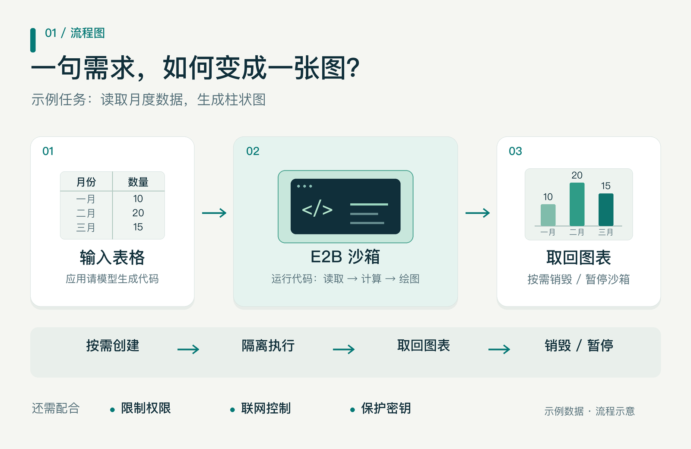
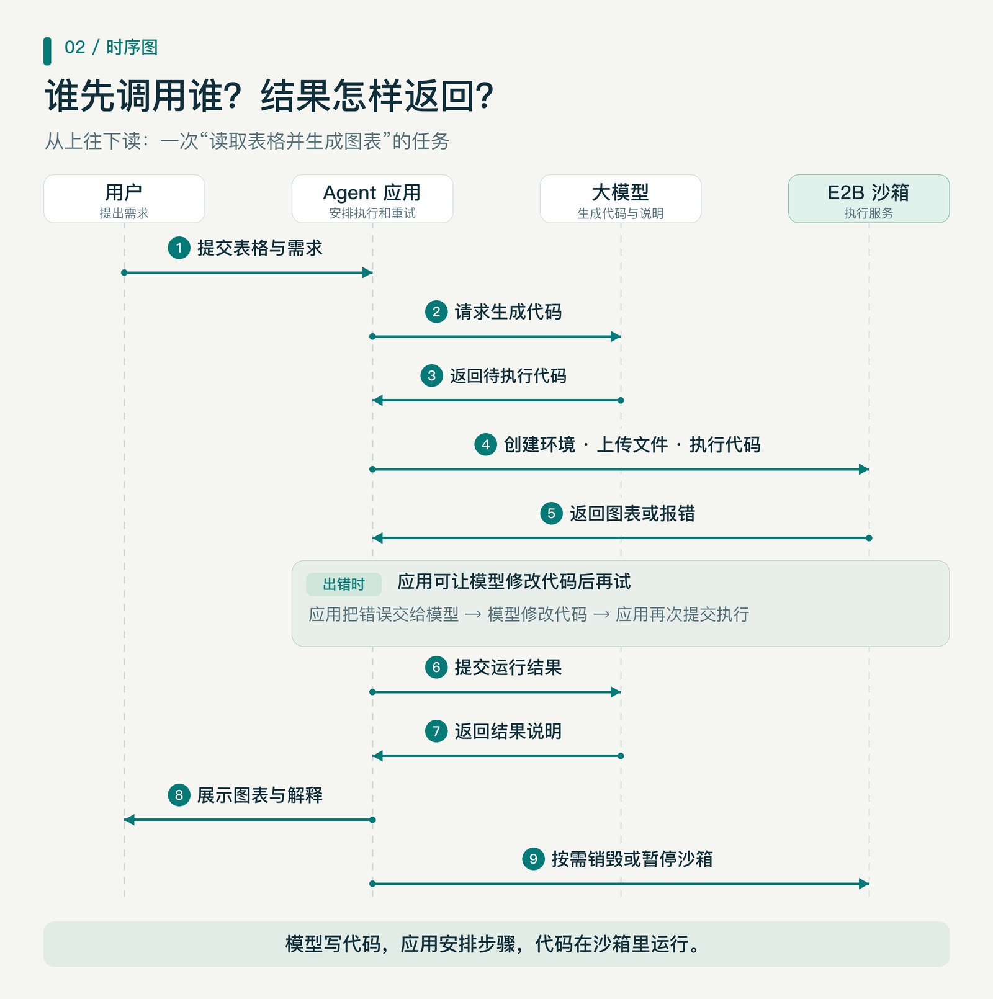
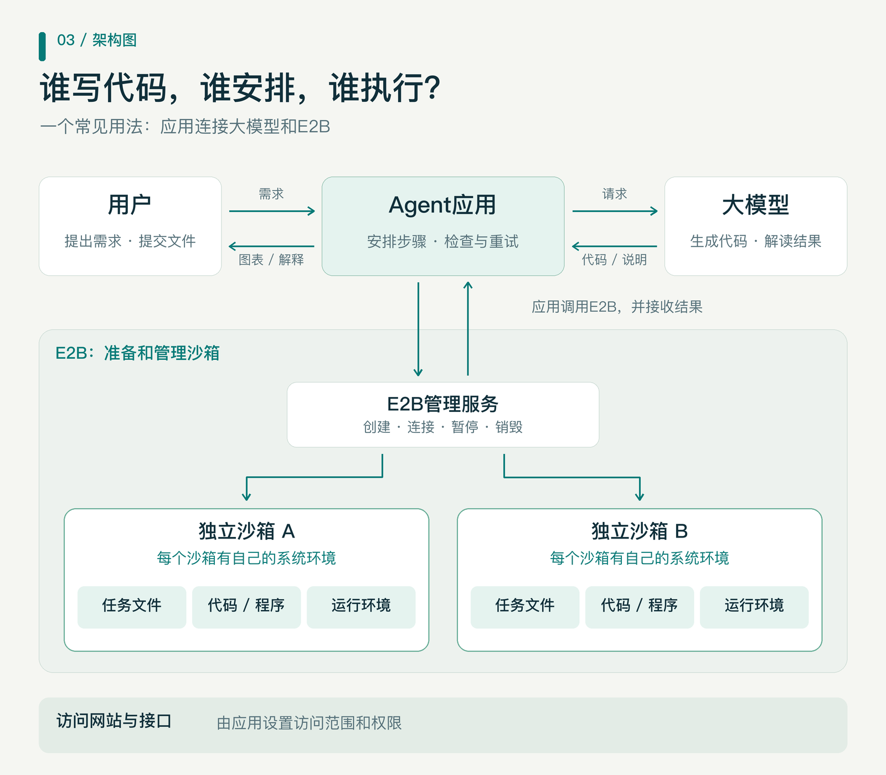

# AI Agent 安全运行基石：E2B 隔离沙箱

> **导语**：AI Agent 越来越能干：会写代码、会算表格、会自己查资料。但「会写」不等于「敢跑」——让 AI 生成的代码直接在业务服务器上裸奔，等于让刚拿驾照的新手直接开 F1 上赛道。怎么让 Agent 大胆动手、又不出圈？答案是给它一个「安全试车场」：隔离沙箱。本文以 E2B 为例，讲清 Agent 代码执行的门道。

**E2B是一套让AI生成的代码在隔离环境中运行的工具和服务。AI要处理文件、计算数据或生成图表时，应用可以把代码交给E2B执行，再取回结果。这个隔离环境叫“沙箱”。**[E2B官方介绍](https://docs.e2b.dev/)

比如，你上传一份表格，告诉AI：“帮我汇总每个月的数据，再画一张柱状图。”大模型可以写出完成任务的代码，但要得到一张真正算出来的图，还得有地方运行这段代码。E2B就可以提供这个地方。

表格分析只是最直观的例子。Agent 正从「聊天」走向「干活」：自动化办公里批量处理文档、让 Agent 自己查资料写报告、给代码仓库跑自动化测试、甚至让 AI 操作一台「虚拟电脑」——这些任务的共同点是：**模型只负责“想”，真正“动手”的代码，需要一个安全的地方落地。**在 Agent（智能体）的世界里，E2B 是可供它使用的代码执行工具之一，提供 Python 和 JavaScript 两套接入包。[官方接入示例](https://docs.e2b.dev/quickstart/connect-llms)

## 一、大模型、Agent和E2B各做什么？

一场「表格变图表」的任务里，有三个角色在分工协作：

| 角色 | 在分析表格的例子里做什么 |
| --- | --- |
| 大模型 | 理解要求，写出读取、汇总和绘图的代码 |
| Agent应用 | 把需求交给模型，再调用工具执行代码，收集结果 |
| E2B | 准备和管理沙箱，让代码在里面运行 |

大模型负责思考，将需求拆解并且生成代码。Agent应用，就是你使用的AI助手背后的程序。它负责衔接模型和工具：把代码交给E2B，再把运行结果交给模型解释。而E2B 负责提供运行环境，使大模型生成的代码可以安全高效的运行起来。

## 二、从表格到图表，要走哪几步？

**第一步：把需求说清楚。** 用户提交表格，说明要统计什么。应用把要求交给大模型，模型生成处理代码。

**第二步：准备运行环境。** 应用通过E2B创建沙箱，准备读表、计算和绘图所需的软件，再传入这次任务要用的文件。无关文件不必一起上传。这里有个巧劲：常用软件可以提前“烙”进沙箱模板——就像精装修的样板间，拎包入住，不必每次现刷墙、现铺地板。[自定义软件包](https://docs.e2b.dev/quickstart/install-custom-packages)

**第三步：运行代码，查看结果。** 代码在沙箱中读取表格、计算数据、生成图片。如果列名写错，程序可能报错。没关系——应用可以把报错交给模型，它看完错误、改好代码、再跑一次，像医生看诊、改方、再抓药。是否重试、最多试几次，由应用控制，不会无限循环。

**第四步：取回文件，结束任务。** 运行成功后，应用取回图表，并让模型根据实际结果作出说明。代码能跑通，也要检查统计口径和图表是否符合要求。[执行过程示例](https://docs.e2b.dev/quickstart/connect-llms)

任务完成后，应用应先取回需要保存的成果，再按需销毁沙箱。如果稍后还要接着处理，也可以先暂停：**E2B 的暂停会同时保存文件和运行状态（内存），之后恢复使用，进度原样接续**，长任务可分段接力。[沙箱生命周期](https://docs.e2b.dev/sandbox)

## 三、代码为什么要放进沙箱？

前两章讲「怎么用」，这章讲「为什么必须这样用」——正是标题里「安全基石」的由来。

AI 生成的代码有两宗「原罪」：**可能有错，也可能闯祸。**一个下标越界、一条误删文件的命令，直接跑在业务服务器上，改动原有文件、拖累其他程序，后果由整个系统承担。沙箱的作用，就是把这次代码执行关进一个相对独立的环境——出了事，也只波及沙箱自己。

问题来了：把代码「关起来」的办法不止一种，E2B 为什么选虚拟机？

业界常见的隔离手段分两档。**容器**像合租套房：住户各有各的房间（进程、文件视图相互隔离），但共享同一面承重墙（操作系统内核）——轻便省钱，隔离强度却有限，内核一旦被突破，就可能「串门」。**虚拟机**像独栋小楼：每栋楼自带地基和围墙（独立的操作系统内核），隔离最彻底；但传统虚拟机又重又慢，起一台要等半天，跑几秒钟的小脚本实在大材小用。

E2B 取两头之长：官方说明，**每个沙箱都运行在一台独立的轻量虚拟机（microVM）里，自带操作系统内核**——盖得快、拆得快，但围墙独立完整。隔离边界打在虚拟机管理层（hypervisor）上，而不是容器或进程层；不同客户的沙箱之间，不共享内核、不共享文件系统、不共享内存。这是「敢跑不可信代码」的底气。

沙箱还是「一次性」的：到点即毁、用完即换新，像隔离病房——上一位「客人」的痕迹，随销毁清零。这套隔离机制也已通过 SOC 2 Type II 独立审计。[隔离机制说明](https://e2b.dev/security)

下图中，大模型在沙箱外生成代码，应用调用E2B管理服务准备沙箱，再执行任务。不同任务可以使用不同沙箱；需要延续上一次处理进度时，也可以根据权限和数据要求决定是否复用。

## 四、用了沙箱，还要注意什么？

沙箱挡得住「跑出去的祸」，挡不住「自己递进去的东西」。沙箱内的代码仍可能读取交给它的文件、使用提供给它的密钥。因此，实际使用时要明确三件事：

- **给它哪些文件：** 只提供任务需要的数据，无关的敏感资料不要放进去。
- **允许访问哪里：** E2B默认可以访问外网。可以按任务一键关闭联网；更讲究的，可以设「白名单」——只放行指定域名或 IP 段，支持通配符，运行中还能动态收紧。[联网控制说明](https://docs.e2b.dev/network/internet-access)
- **允许做哪些操作：** 控制密钥权限、运行时长和重试次数。每个沙箱创建时就可以定好「闹钟」（超时时间），到点自动暂停或销毁，运行中还能随时调整；涉及删除文件、修改正式业务数据时，应用应设置确认或审核步骤。

还有两件事，沙箱帮不上忙。一是**沙箱不判断结论对不对**：数据选错了、计算方法写错了，即使程序正常运行，结果仍可能出错。二是密钥进了沙箱，就等于交到了正在运行的代码手里——最小授权，永远是第一原则。

## 五、任务多了，还要考虑什么？

单个 Agent 用沙箱，考验的是好不好用；成百上千个 Agent 同时用沙箱，考验的就是：**供给能力。**

别忘了，每个沙箱都是一台「五脏俱全」的小虚拟机——创建得快不快、每个占多少 CPU 和内存、同一套设备能同时塞下多少个，直接决定成本与体验。用多少开多少、用完就还，是成本的基本盘；模板则在这里再次立功：环境提前预制好，沙箱随取随用，不必每次现场装配。

华为公开资料介绍了鲲鹏超节点（SuperPod）对Agent沙箱启动速度和同时部署数量的优化——把大量算力核拼成一台「大电脑」，恰好是「同时开出成百上千间沙箱」的合适底座。分工很清楚：**超节点负责算力底座，E2B 负责环境供给——一个管「能开多少间」，一个管「每间长什么样」。**[华为官方资料](https://www.huawei.com/cn/news/2026/9/hc-wang-keynote)

---

回到开头的问题：Agent 从「会说」走向「会做」，中间隔着一段要有人铺好的安全轨道。隔离沙箱，就是这段轨道的第一根枕木——它不生产智能，只负责让智能放心动手。下次你看到 AI 助手几秒吐出一张算好的图表，背后多半有这样的「安全试车场」默默兜底。
