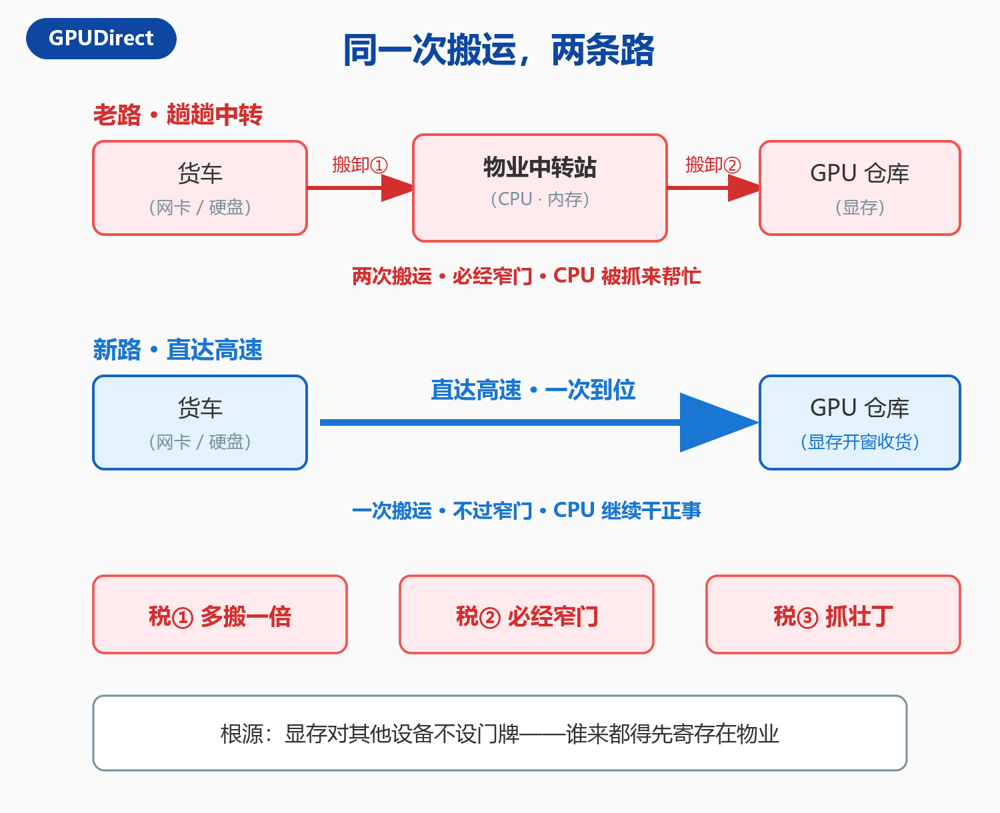
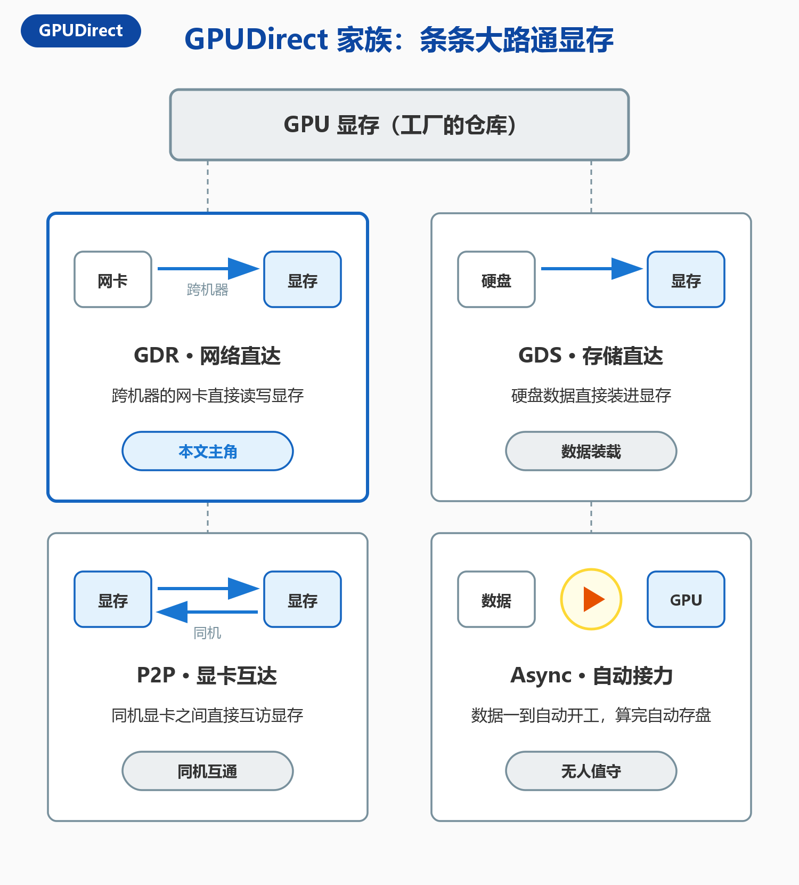
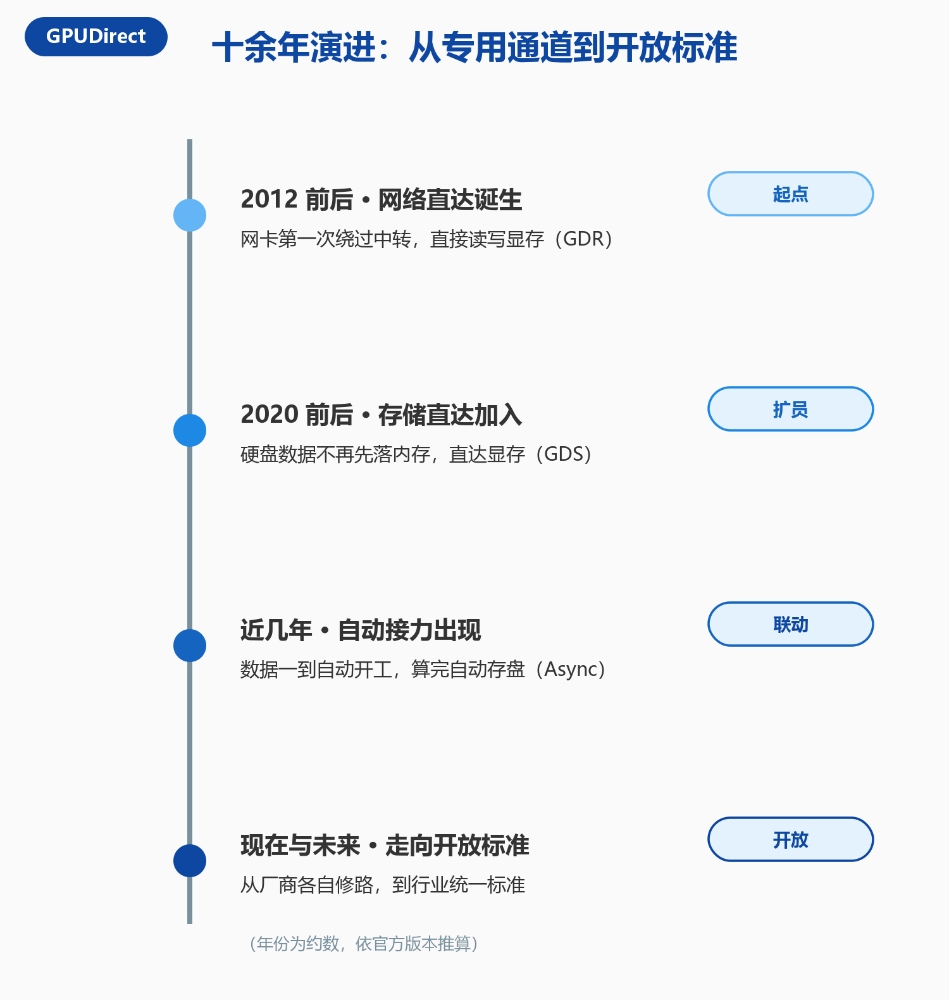
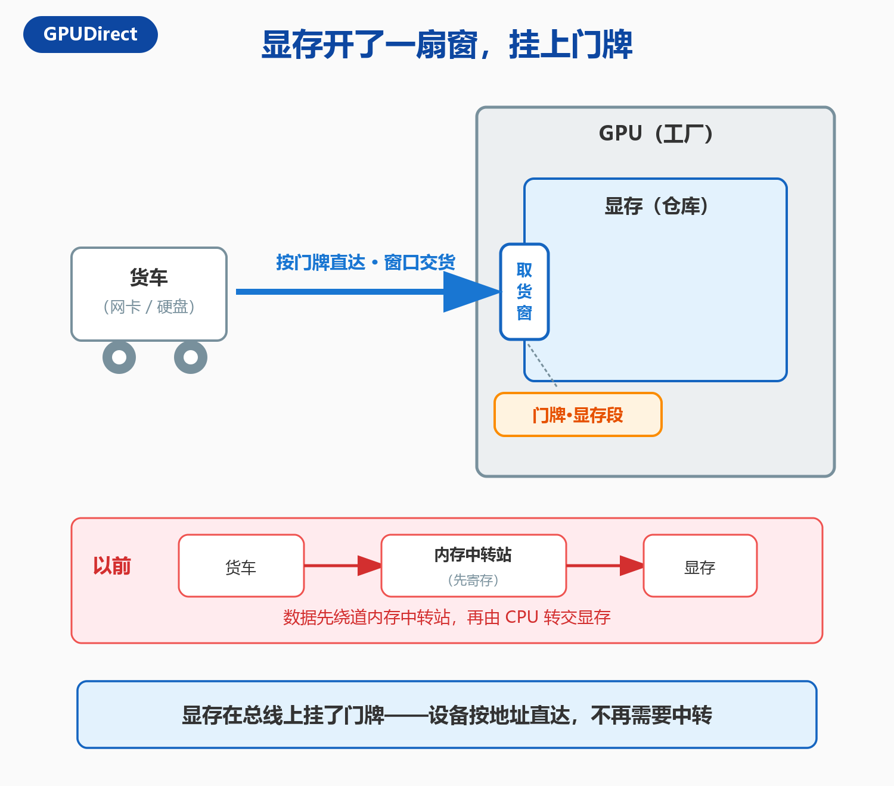
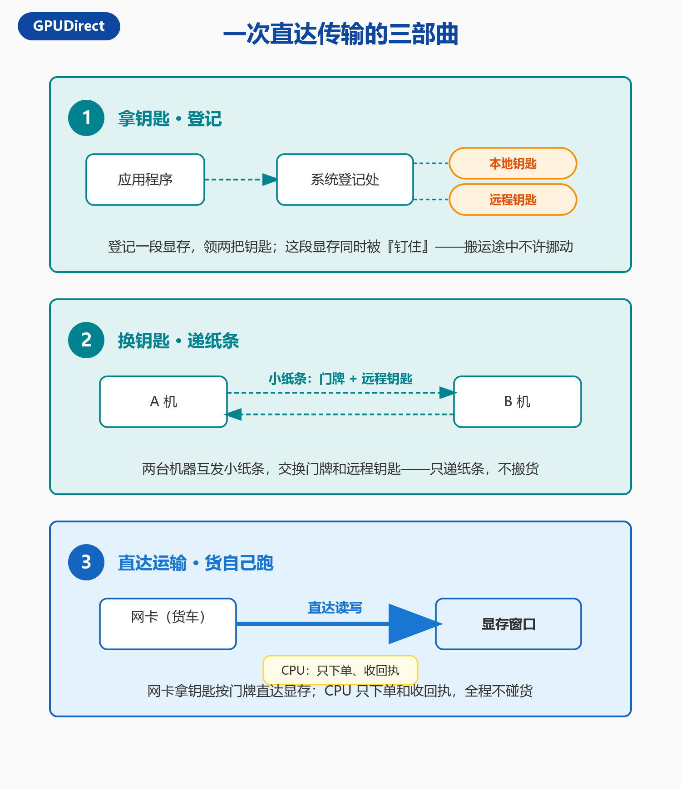
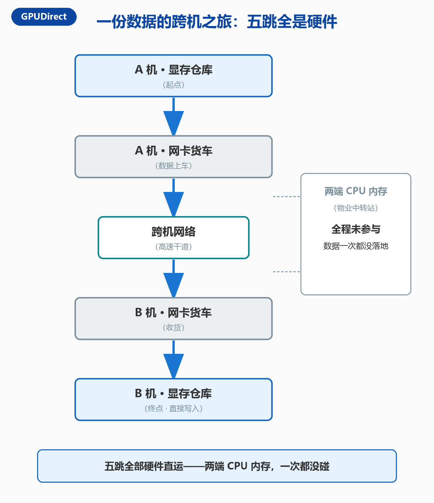
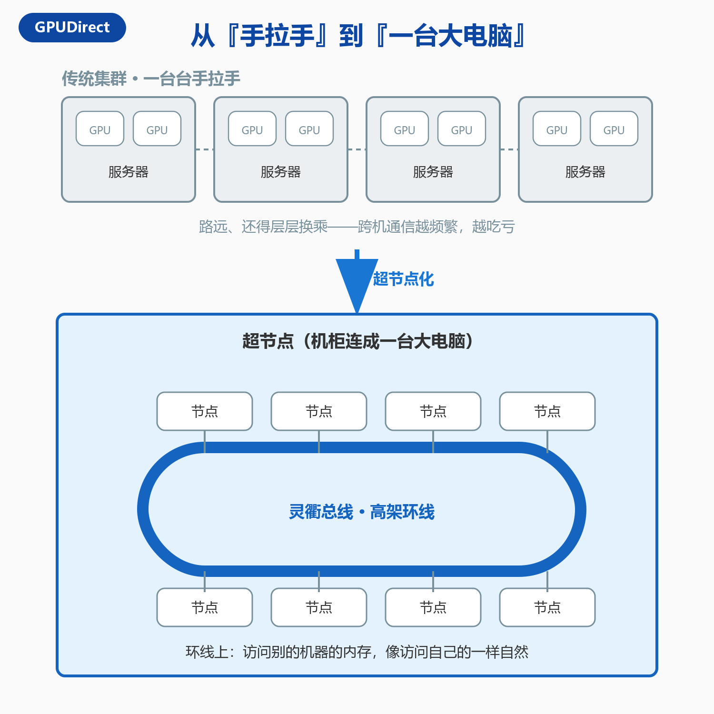
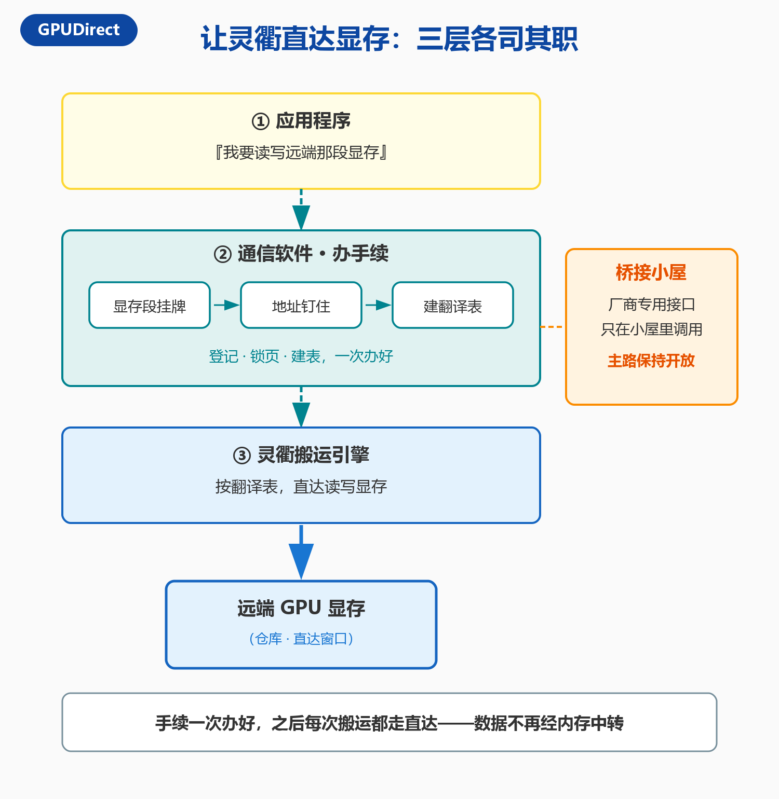
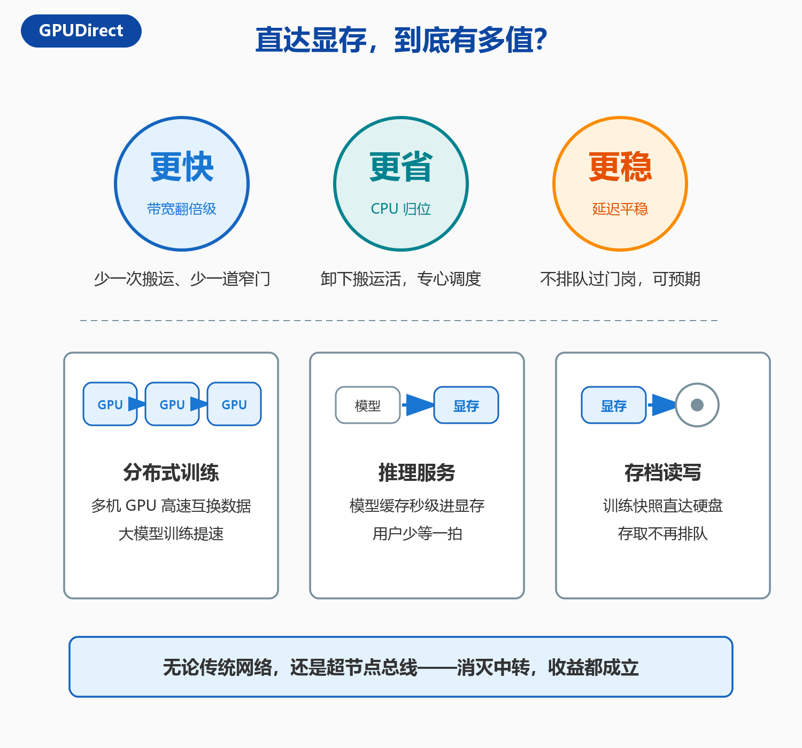
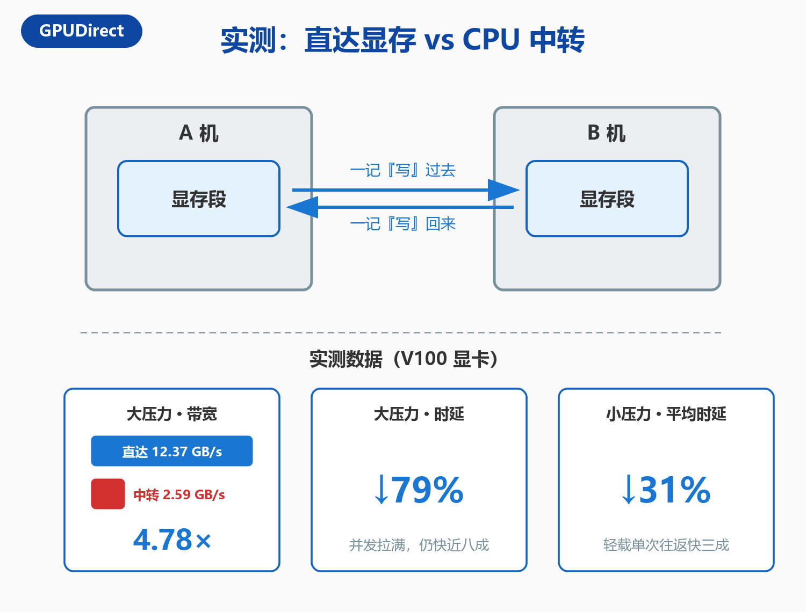

一块顶配 GPU 的一小时租用费，够吃一顿不错的大餐。但如果你在机房里盯它一分钟，会看到一个扎心的画面：大部分时间，它不在算，它在等。计算时等数据从网卡来，推理时等kv-cache从硬盘来，扩容时等模型参数从存储设备来。

算力是发动机，数据是汽油。发动机一代代升级，油管却还是小区里的双向单车道。这篇文章就聊这根「油管」：数据是怎么进显存的，为什么要给它修「直达高速」，以及当这门技术遇上新一代超节点总线，又撞出了什么火花。

## 一、GPU 再快，也怕堵车

过去十来年，GPU 的算力涨了上千倍；而把数据从外部搬进显存的速度，只涨了几倍。这不是比喻，而是每天都在机房里上演的现实：每一次搬运的间隙，成千上万个计算核心集体停工，而它们每一分钟的租金都贵得惊人。

数据为什么搬得这么慢？看看它的「传统路线」就明白了。

在老路上，网卡或硬盘收到的数据，并不能直接进显存。它们必须先把数据卸进内存——你可以把内存理解成小区的物业中转站——然后 CPU 再从中转站把数据取出来，转交给显存。一进一出，一卸一装。

这条路，要交三重「税」：

**第一重，多搬一倍。**同一份数据，先进中转站、再出中转站，搬运量直接翻倍。数据集动辄以 TB 计，翻倍的搬运就是翻倍的时间。

**第二重，必经窄门。**所有货物都要穿过 CPU 这道门岗，而门岗的宽度是有限的。两边的路修得再宽，挤在同一道门上，快不起来。

**第三重，抓壮丁。**CPU 本是调度中心，负责跑逻辑、响应请求；现在却被拉来当搬运工。每次搬运都是一次打扰，正常工作被切得零零碎碎，延迟也变得忽高忽低。

更麻烦的是，这笔税还在越交越多。大模型时代的搬运量是空前的：训练数据以 TB 计，模型动辄千亿参数，训练中途还要不断把快照存进硬盘。搬运跟不上，GPU 就只能干等——工程师管这叫「喂不饱」。花最贵的钱，买最长的等待，没有比这更亏的生意。

为什么偏偏是搬运拖了后腿？因为算力的进步靠制程与架构，一路狂奔；而搬运走的是一条「通用路线」——它的设计前提很保守：默认设备之间互不信任，所有数据都得先经过内存这道「海关」，由 CPU 验货放行。在数据量小的年代，这点开销无伤大雅；到了 AI 时代，它就成了木桶上最短的那块板。

问题的根源，其实就一句话：**显存对其他设备「不设门牌」。**谁想送货，都只能先寄存在物业，等 CPU 有空了再转交。

那——能不能让显存直接挂牌收货？

## 二、GPUDirect：修了十年的高速

答案是：能，而且这条路已经修了十多年。这门技术的家族名叫 GPUDirect，核心思想一句话就能说完：**给显存修直达高速，让网卡、硬盘这些设备直接读写显存——中转站，原地退役。**

「直接读写显存」如今是一整个家族的事业：

- **GDR（网络直达）**：本文的主角，远端的内存，不经过对方的 CPU，直接读写。它是分布式训练的大动脉；
- **GDS（存储直达）**：硬盘数据不再先落内存，直接装进显存；
- **P2P（显卡互达）**：同一台机器里，显卡之间直接互访，不必绕道内存；
- **Async（自动接力）**：数据一到自动开工，算完自动存盘，搬运与计算无缝衔接。

为什么需要一整个家族？因为数据进出显存的通道本就不止一条：从网络来、从硬盘来、从隔壁显卡来——每一条，都值得修一条直达高速。

回头看它的成长轨迹，也颇有意思：2012 年前后，网络直达诞生，网卡第一次绕过中转直接读写显存；2020 年前后，存储直达加入，硬盘到显存也通了直达；近几年，「自动接力」出现，搬运开始和计算流水线咬合；而眼下正在发生的最重要一步，是从「厂商各自修的专用道」，走向「行业统一标准」——这件事，留到最后一节说。

## 三、直达显存的魔法

现在拆开讲主角 GDR。整个魔法分三层：**开窗、发钥匙、跑货车。**

### 显存开了一扇窗

第一层，给显存「开窗挂牌」。

每块 GPU 都会在总线上为自己留一个「窗口」，相当于把仓库的一面墙改成取货窗，再挂上门牌。从此，总线上的设备——网卡、硬盘——都能看见这块门牌，按地址把货直接递进窗口。

你可能会问：这扇窗是一直都有，还是最近才开的？答案是——**窗口一直都在，缺的是「谁有权送、送哪一段」的登记制度。**总线本是一条公共高速，每个设备都挂着自己的门牌；显存的门牌其实也一直挂着，只是默认遮着帘——系统不敢让外人直接使用，怕出乱子。直达技术做的事，就是把帘子掀开，再配上一套严格的登记与钥匙制度。这就引出第二层。

### 一次传输的三部曲

第二层，是用窗的规矩。一次完整的直达传输，分三步。

**第一步，拿钥匙。**程序向系统登记一段显存，声明「这段我要用来收发数据」。登记成功，领到两把钥匙：一把本地钥匙，留给本机的网卡用；一把远程钥匙，交给对端机器用。登记的同时，系统会把这段显存「钉住」——搬运途中，这段地址不许挪动。道理很简单：快递在途，门牌不能变。

顺带说个老司机的小聪明：登记本身要花时间，毫秒级——对一秒钟几十万次搬运的网卡来说，不算便宜。所以聪明的做法是登记一次、反复使用：办过手续的显存段留在名册里，下次直接用，不必重新排队。

**第二步，换钥匙。**两台机器互相递一张小纸条，上面写着远端显存的门牌号和配对的远程钥匙。注意，这一步只是递纸条，一个字节的数据都没搬。

**第三步，直达运输。**网卡拿着钥匙和门牌，直接对显存窗口发起读写。CPU 全程只做两件事：下单（发出指令）和收回执（收到完成通知）。货，自己跑。

### 数据的跨机之旅

把三步串起来，看一份数据从 A 机到 B 机的完整旅程：

从 A 机显存出发，交给 A 机网卡——网卡通过总线，直接从显存把数据读出来，这是头两跳；网卡把数据打包成报文，穿过网络，这是中间一跳；B 机网卡收货、拆包、核对钥匙，然后直接写进 B 机显存，这是最后两跳。**五跳，全部由硬件完成。**两台机器的 CPU 内存，一次都没有沾到这份数据——它们甚至不知道发生过这次搬运。

顺带回答一个常见担忧：直达，安全吗？安全。没有配对钥匙的对端，连窗口都摸不到；钥匙还自带权限，只读就是只读。**直达不等于裸奔，钥匙制度就是安检。**

## 四、当 GDR 遇上灵衢

故事讲到这里，GDR 已经是身经百战的成熟技术，跑在全球无数 AI 集群里。但它的新舞台，才刚刚搭好——**超节点**。

### 从「手拉手」到「一台大电脑」

传统集群，是一台台服务器靠网线手拉手连起来的。机器一多，路就远，数据还得层层换乘。模型大到单机装不下、机器间的通信越来越频繁，这条老路的短板就被急剧放大——千亿参数的模型训练时，GPU 之间每秒都要互传海量的中间结果；机器越多，通信占比越高，甚至出现 GPU「等通信」比「等数据」还常见的局面。

新一代的解法很干脆：把整个机柜、甚至几排机柜连成「一台大电脑」。这就是超节点。华为发布的灵衢总线，就是超节点里的「高架环线」——它让机器访问别的机器的内存，就像访问自己的内存一样自然、一样快。更重要的是，这条环线自带一整套「交通规则」：读、写、消息、同步，远端内存的各种用法都安排得明明白白——应用程序用起来，和用本地内存几乎是同一套姿势。

新问题随之而来：GDR 的直达魔法，是给传统网络修的路。**灵衢这条新高架，能不能也直达显存？**

### 让灵衢直达显存

能。思路一脉相承，还是熟悉的三件事，只是换了新路的修法：

应用先声明「这段是显存」，给显存段挂牌；通信软件来办手续——登记、把地址钉住、建好一张「地址翻译表」，让新高架认识显存的门牌；最后，灵衢的搬运引擎按表作业，把数据直接写进远端显存。**手续一次办好，之后每一次搬运都走直达。**

这里有个很「工程」的细节。GPU 厂商提供的显存访问接口，是一条专用通道，使用上各有条款约束。想借用，又不想被绑死，怎么办？修一间「桥接小屋」：所有对专用通道的调用，都关进这间小屋；小屋之外，主路保持开放整洁。既用上了成熟通道，又留足了后路。专用通道的条款，有点像「仅限本厂车辆行驶」的内部道路；而主路要对所有车辆开放。把专用调用关进小屋，主路就能保持开放——小屋可以随时翻修、更换，主路纹丝不动。

### 这到底有多值？

无论传统网络，还是灵衢高架，直达显存的账本是一样的：

**更快**——少一次搬运、少一道窄门，带宽常常是翻倍级的提升；

**更省**——CPU 卸下搬运工的活，回归调度本行，同样的机器能服务更多任务；

**更稳**——数据不再排队过门岗，延迟可预期，长尾抖动明显收敛。

## 五、验证

经典的测法像打乒乓球：两台机器各自登记一段显存，一记「写」过去，对端再一记「写」回来，如此往返数万回合，每一回合都掐表计时。平均延迟、最差延迟、九成位的延迟，一目了然；再拉满并发，测出吞吐带宽。数据在两段显存之间往返，CPU 内存全程旁观——这就是直达显存的验收现场。

带宽测试则反过来：不打乒乓，改开车队——几十条传输同时发车，把路塞得满满的，看每秒总共能运多少货。延迟与带宽，一快一多，合起来才是完整的成绩单。

实际测试下来，在两台搭载 V100 显卡的机器上，直达路线对上走 CPU 中转的路线：大压力下拉满并发，带宽 12.37 GB/s 对 2.59 GB/s——接近 4.8 倍的吞吐，时延还降低了 79%；小压力下单次往返的平均时延也快了约三成。规律也很直白：压力越大，直达的优势越明显——中转路线的窄门，越挤越堵。

