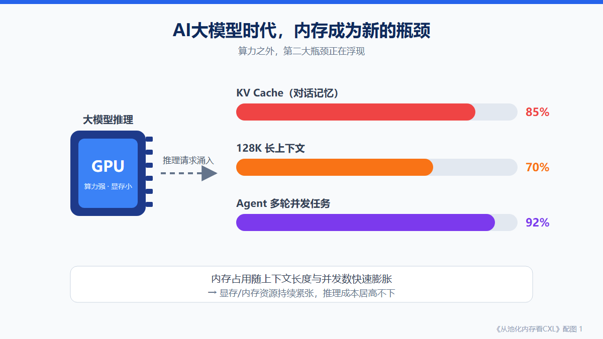
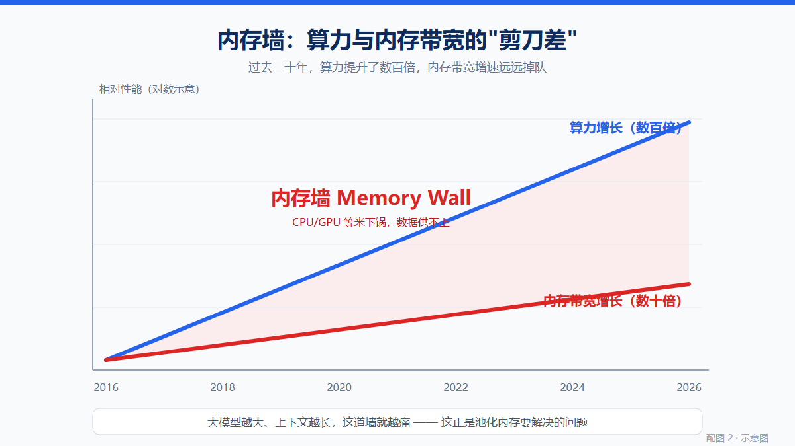
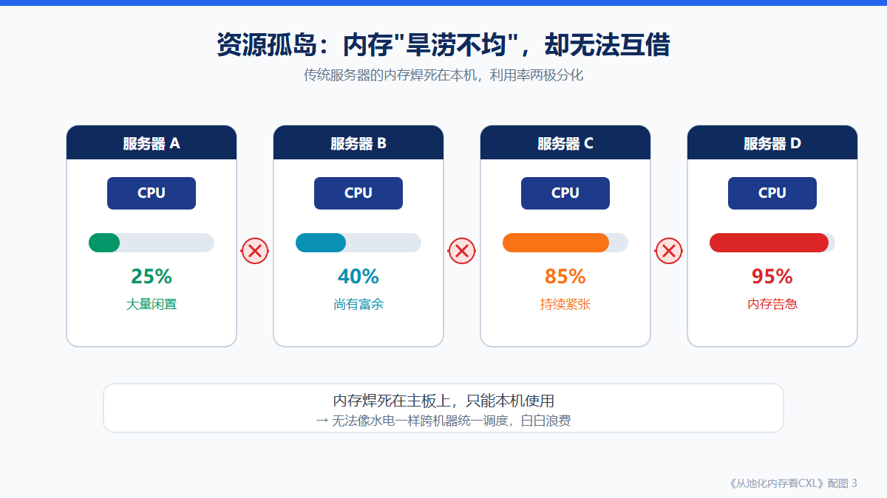
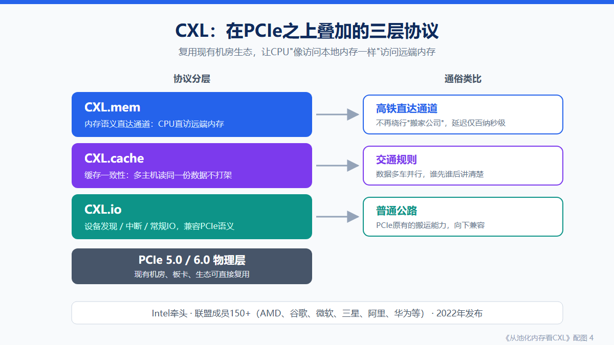
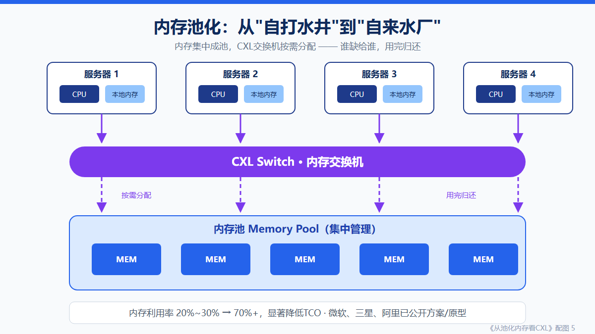
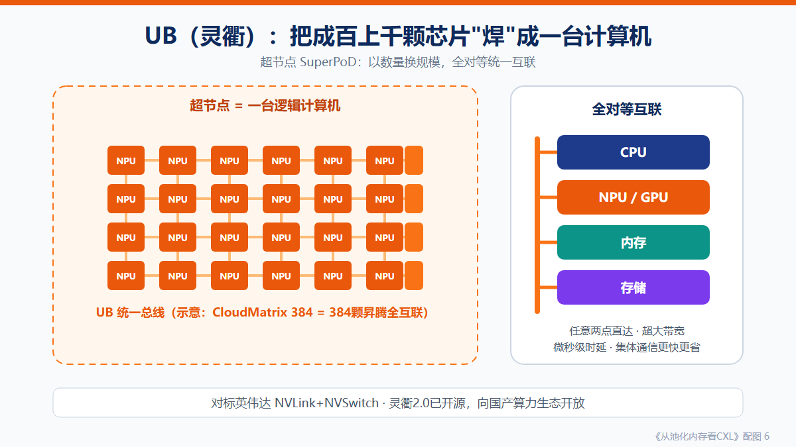
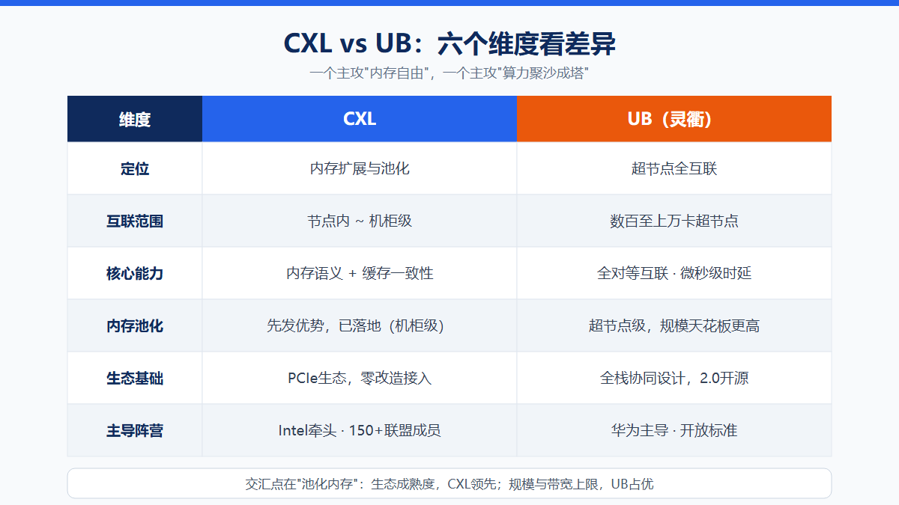
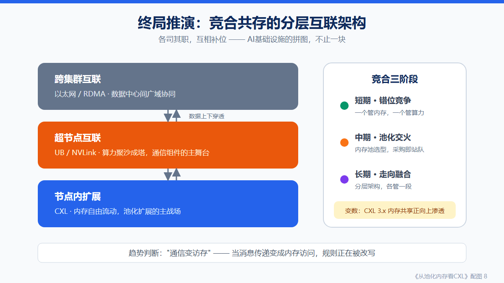

# 从池化内存看CXL：新一代互联协议，会成为UB通信组件的最大对手吗？

> **导语**：大模型（LLM）狂飙的今天，万卡集群、DeepSeek爆火、Sora迭代，算力已经不再是唯一的瓶颈——**"内存"和"通信"正在成为新的胜负手**。一边是被称为"内存救星"的 **CXL（Compute Express Link）**，另一边是支撑超节点高并发通信的 **UB（UnifiedBus，灵衢）通信组件**。它们究竟是终极PK的对手，还是携手破局的黄金搭档？今天我们用最接地气的方式，为你拆解这场数据中心内部的技术变革！

## 先补个背景：AI大战，为什么突然"卷"起了内存和互联？

看懂这场变革，先要理解三件事：

**第一，算力军备竞赛进入"下半场"。** ChatGPT引爆全球，DeepSeek用极低成本震惊业界，Sora让视频生成一步到位——大模型一次比一次"能吃"。为了喂养这些巨无霸，各大厂商纷纷上马**万卡集群**：把上万颗GPU/NPU连成一台逻辑上的"超级计算机"。

**第二，芯片之间的"路"不够宽了。** 单芯片算力再强，数据送不进去、传不出来也是白搭。"算得快、传得慢"的矛盾越来越尖锐，互联协议正从"配角"变成"主角"。

**第三，两条技术路线浮出水面。**

- **CXL**：Intel牵头的开放标准，联盟成员超150家，让内存可以跨设备共享、池化，被称为"**内存救星**"；
- **UB**：华为2025年发布并开源的灵衢互联协议，撑起超节点内部的高并发通信，堪称"**国产算力的神经网络**"。

一个盯上"内存不够"，一个解决"通信不畅"，两条路线的交汇与碰撞，正在改写数据中心的底层规则。

先把几个高频名词翻译成"人话"，看不懂可以随时回翻：

- **HBM**：GPU上焊的高端显存，速度快但巨贵；
- **KV Cache**：大模型推理时缓存的"对话记忆"，上下文越长，吃内存越多；
- **内存墙**：算力涨得快、内存供得慢，中间那道沟；
- **池化（Pooling）**：把资源从设备里抽出来集中管理、按需分配。

---

## 一、大模型时代，全行业都在"内存焦虑"

先看一组扎心的事实：

**第一，大模型是"内存无底洞"。** 推理时模型要为每个用户维护KV Cache，从8K到128K上下文，再到Agent的多轮长任务，内存消耗随并发和长度一路飙升。

**第二，HBM太贵了。** GPU搭载的HBM显存单价是普通DRAM的数倍，还长期供不应求。推理成本降不下来，一大原因就是"内存自由"遥遥无期。

**第三，内存墙越垒越高。** 过去二十年，CPU/GPU算力提升了几个数量级，内存带宽的增速却远远掉队——这道速度鸿沟，就是业内常说的"内存墙"（Memory Wall）。

还有一个更隐蔽的问题：**内存浪费。**

很多数据中心的现状是"旱的旱死、涝的涝死"——有的服务器内存利用率不到30%，有的AI节点却内存告急。但传统服务器的内存是"焊死"在本地的，只能本机使用，无法像水电一样统一调度。

能不能把内存从服务器里"解放"出来，变成一个按需取用的"公共水池"？这就轮到CXL登场了。

---

## 二、CXL：给内存修一条"高铁"

CXL由英特尔在2022年牵头推出，如今联盟成员已超过150家，AMD、谷歌、微软、三星、阿里、华为尽在其中。

它要解决的问题很朴素：**让CPU像访问本地内存一样，访问远端的内存。**

### 三层协议，各司其职

CXL建立在PCIe物理层之上（现有机房设备可平滑升级），协议分三层：

- **CXL.io**：类似PCIe的通道，负责设备发现、中断和常规数据搬运，好比"普通公路"；
- **CXL.cache**：缓存一致性协议，让多颗CPU看到同一份数据，不吵架、不打架；
- **CXL.mem**：内存语义直达通道，CPU访问远端内存就像访问本地内存，额外延迟仅百纳秒级。

### 池化内存：从"自打水井"到"自来水厂"

有了CXL，最杀手级的应用就是**内存池化（Memory Pooling）**：把内存从各台服务器里抽出来，集中放进"内存池"，通过CXL交换机按需分配——谁缺内存就给谁，用完归还。

就像以前每家每户自己打水井，现在改成自来水厂统一供水：管够、按需、不浪费。

行业测算显示，内存池化可以把内存利用率从20%~30%提升到70%以上，显著降低总拥有成本（TCO）。微软、三星、阿里等都已公开CXL内存池化方案或原型。除了池化，CXL还支撑**内存扩展**（给服务器插外挂内存）与**内存共享**（多机读写同一块内存）两大场景。

---

## 三、UB（灵衢）：超节点的"神经网络"

再看另一位主角。

2025年，华为正式发布开放互联协议**灵衢（UnifiedBus，简称UB）**并开源2.0版本，瞄准的是比CXL更宏大的场景——**超节点（SuperPoD）**。

什么是超节点？随着单芯片制程逼近物理极限，业界开始"以数量换规模"：把成百上千颗芯片用高速互联"焊"成一台逻辑上的超级计算机。英伟达的NVLink+NVSwitch方案、华为的CloudMatrix 384（384颗昇腾芯片通过UB全互联）都是这一思路。

UB的核心设计是**全对等互联**：CPU、NPU、内存、存储挂上同一条"统一总线"，彼此都是平等成员，任意两点之间都有超大带宽、微秒级时延的直达通道。

对上层通信组件（基于UB的集合通信库，可类比英伟达生态的NCCL）来说，UB意味着AllReduce、AllGather这些"集体舞"动作可以跳得更快、更省。

一句话概括两者分工：**CXL管"节点内内存不够用"，UB管"超节点算力不够用"。**

---

## 四、正面对决：CXL与UB到底在争什么？

表面看，两者定位不同；但在"内存"这个交叉地带，火药味已经闻得到了。

**重叠地带：池化内存。**

- CXL有先发优势：标准成熟、PCIe生态现成、联盟阵容豪华，是当前唯一大规模落地的内存互联标准；
- UB也不甘示弱：原生支持内存语义互联，池化范围可覆盖整个超节点，理论上规模和带宽都超过CXL的机柜级方案。

**关键分歧点有三个：**

1. **规模**：CXL目前主打机柜内、十数台服务器级别；UB天然面向数百到上万卡的超节点；
2. **生态**：CXL背靠PCIe，x86服务器"零改造"接入；UB需要整机柜、全栈协同设计，但换来量级领先的互联带宽；
3. **开放路径**：CXL是150余家成员的行业联盟；UB 2.0直接开源，向整个国产算力生态开放。

---

## 五、CXL会成为UB通信组件的最大对手吗？

回到标题的问题。我的判断是：**短期不是对手，长期是"最熟悉的竞争者"。**

**短期看，两者是错位竞争。** CXL解决内存扩展，UB解决超节点互联——一个管"内存自由"，一个管"算力聚沙成塔"，井水不犯河水。

**中期看，池化内存是必争之地。** 超节点的内存池化，选CXL标准设备（生态成熟、供应商多），还是UB原生方案（深度优化、时延更低）？每一次采购决策都是一次站队。

**更值得通信组件警惕的是**：CXL 3.x已支持内存共享与多主机访问。当跨节点的"消息通信"部分变成"内存语义访问"，基于UB的通信组件的一部分舞台，可能被CXL内存网络悄悄接管——**"通信变访存"，这才是最深层的竞争。**

**长期看，大概率走向融合。** 更可能的终局是分层架构：节点内用CXL做内存扩展，超节点内用UB做全互联，跨集群用以太网/RDMA做广域协同——各司其职，互相补位。

---

## 结语

CXL与UB，与其说是对手，不如说是AI基础设施拼图的两块：

- **CXL让内存自由流动，UB让算力聚沙成塔。**

真正的胜负手不在协议本身，而在**谁能让更多厂商、更多开发者用起来**——毕竟在基础设施领域，生态即命运。

你觉得CXL和UB，谁会是下一代数据中心的 "主角"？欢迎评论区聊聊。
