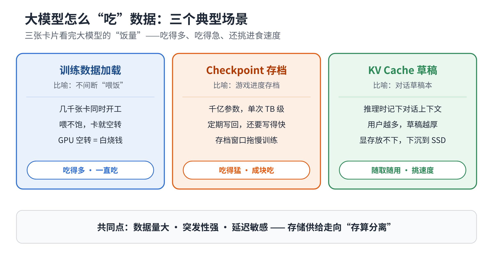
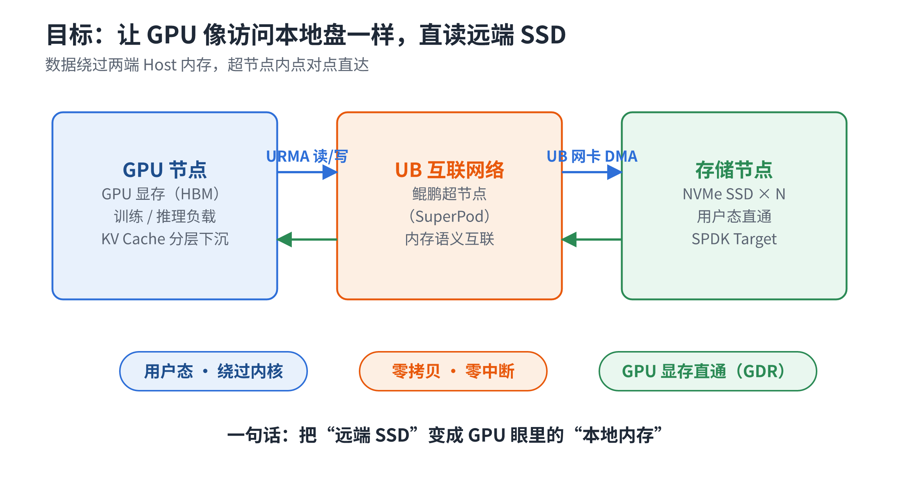
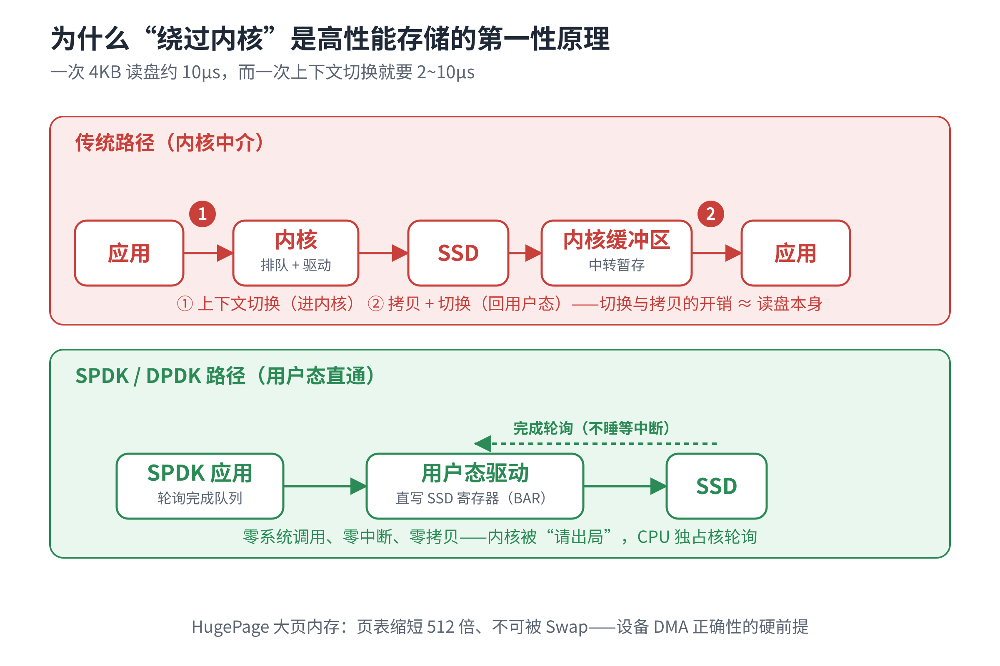
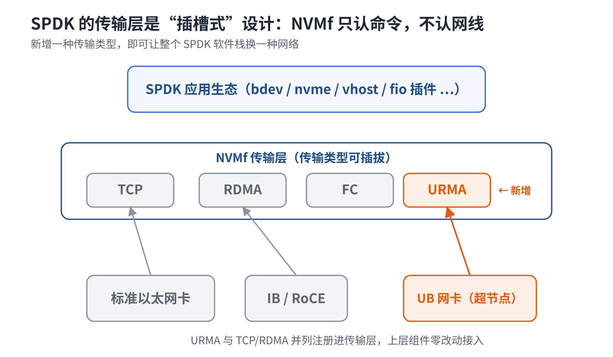
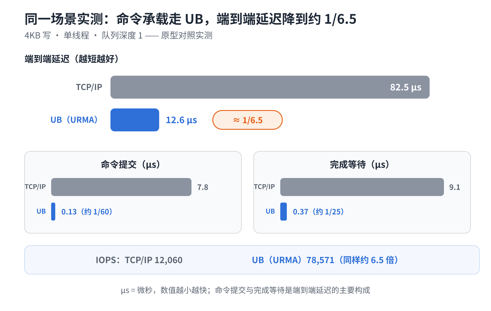
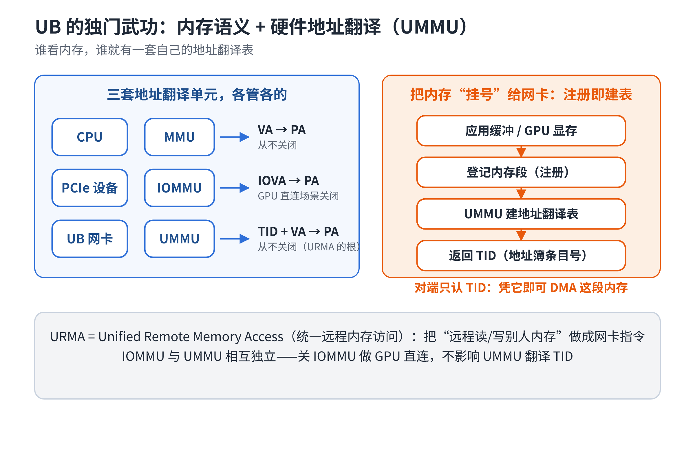
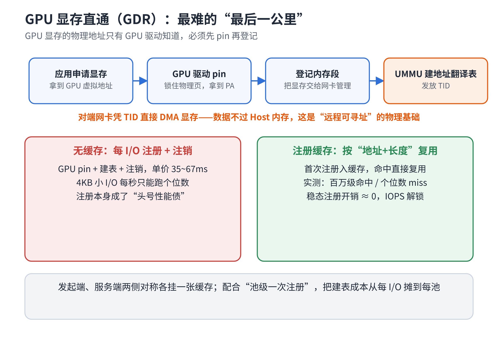
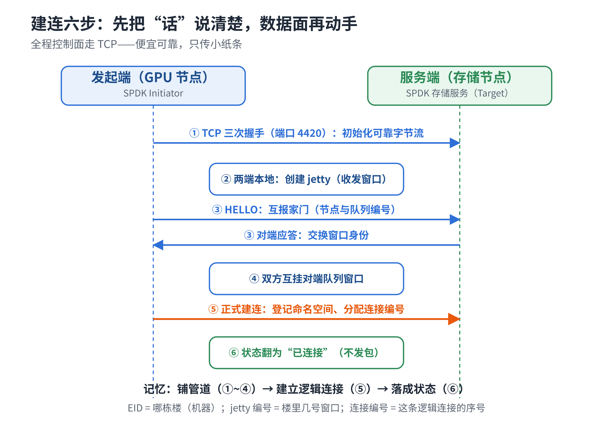
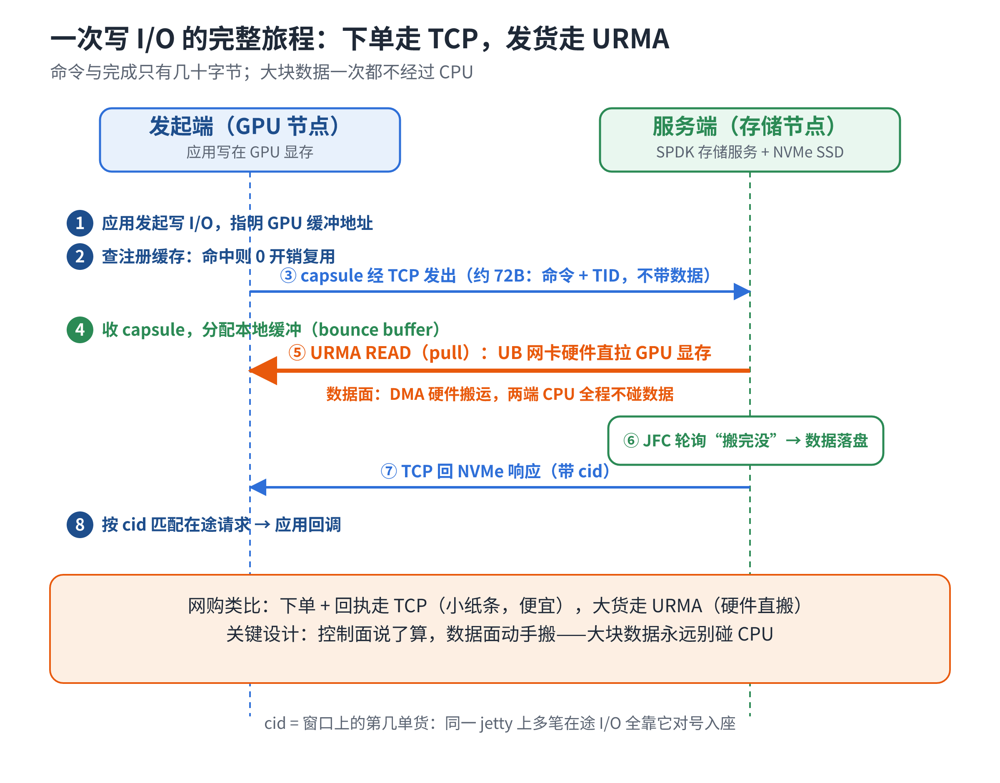
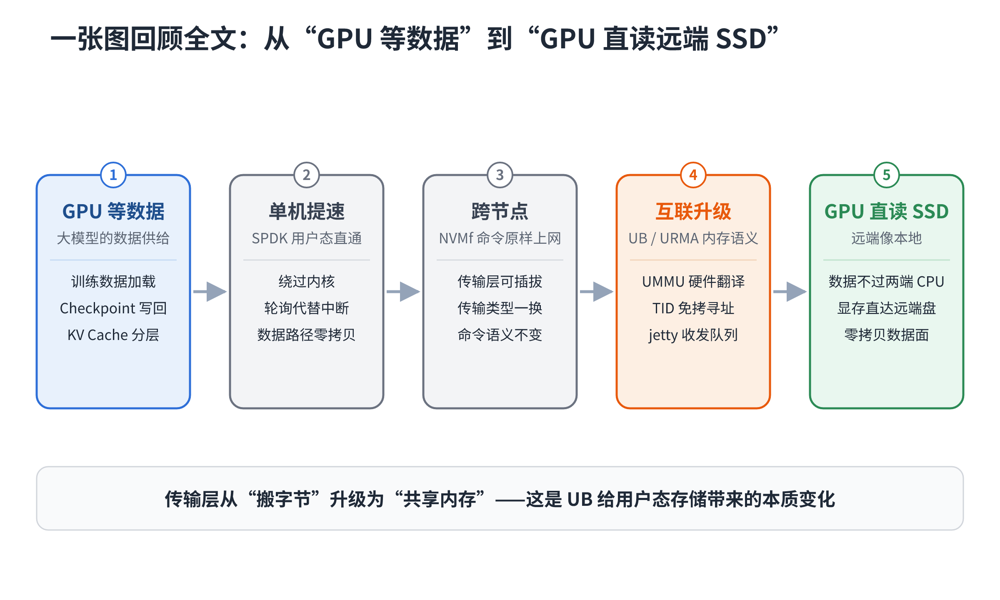

# 解锁SPDK终极性能：UB如何重塑SPDK用户态高性能存储架构

> **导语**：大模型越算越快，数据供给却越来越吃力——训练数据、Checkpoint、KV Cache 正把存储推到新的瓶颈。本文拆解我们为 SPDK 实现的 URMA 传输：在鲲鹏超节点（SuperPod）上，让 GPU 与远端 SSD 之间搭起一条不经过两端 CPU 软件搬运的高性能数据路径。

## 一、大模型为什么越来越"吃"存储？

大模型的能力越来越强，背后依赖的不只是更多 GPU，还有越来越庞大的数据。有三类数据正在把存储推到新瓶颈。

**第一类：训练数据。** 训练阶段 GPU 几乎一直在"吃"数据，供给速度跟不上计算速度，昂贵的 GPU 就会空转。

**第二类：Checkpoint。** 训练要周期性保存模型状态，模型越大，一次 Checkpoint 的数据量越大，写盘不仅要"写得下"，更要"写得快"。

**第三类：KV Cache。** 推理时模型不断产生 KV Cache，用户越多、上下文越长，需要保存和访问的数据越多；显存放不下时，部分数据要下沉到更大容量的存储层。

> GPU 算得有多快，数据就必须跟得有多快。

GPU 显存无法容纳全部数据时，就需要引入更大容量的内存或存储层；在本文关注的场景中，这一层是 NVMe SSD。而 SSD 又常常不在 GPU 所在节点。传统思路下，数据要从远端 SSD 走到 GPU，往往要经过远端主机内存、CPU/软件栈、网络、本端主机内存等多层中转——每多一层，就多一次软件处理或数据搬运。我们的目标是把这条路径尽量"拉直"：GPU 发起的 I/O 中，数据面由 UB 网卡硬件 DMA 完成 GPU 显存与存储节点缓冲区之间的数据搬运，不经过两端 CPU 的软件拷贝路径。

要做到这一点，需要两步：单机上把访问盘做到极致，跨节点后让命令与数据走上新的互联。SPDK 恰好各有一套解法。

## 二、从单机到跨节点：SPDK 的两步解法

先看单机。传统路径下，一次读盘请求要经过系统调用、内核存储栈和中断等软件路径。SPDK（Storage Performance Development Kit）可以理解成一套"把存储驱动搬到用户态"的高性能存储工具箱：NVMe 驱动进用户态，直接读写设备寄存器提交与收割 I/O，中断改轮询，数据路径零拷贝——这里说的零拷贝，指数据面不需 CPU 软件复制，由硬件 DMA 完成搬运，前提是大页锁定内存。

但 SSD 不在本机呢？NVMf（NVMe over Fabrics）把"访问 NVMe SSD 的方式"搬到网络上：上层看到的仍是 NVMe 命令，变的只是"命令怎么跨网络到达 SSD"。关键在于传输层可插拔——每种传输按同一套框架接口接入并注册，应用只需在配置里写一个传输类型的名字，bdev、vhost、fio 等上层组件不感知差异。我们为鲲鹏超节点 UB 互联实现的 URMA 传输，就以与 TCP/RDMA 并列的方式注册进了这个框架：切换传输只需在配置里把传输类型改写为 URMA，上层软件栈原样复用。

## 三、为什么需要 UB/URMA：让 SPDK 适配鲲鹏超节点

在鲲鹏超节点（SuperPod）场景中，底层互联采用 UB（Unified Bus），因此需要让 SPDK 的 NVMf 数据路径能够利用 UB 的能力。URMA（Unified Remote Memory Access）就是连接两者的关键：它把 UB 的远程内存访问能力接入 SPDK 的传输层。

用上 UB/URMA，最直接的收益是**时延**。命令与完成的收发不再进内核协议栈，由用户态直接提交、直接收割。原型对照实测（4KB 写、单线程、队列深度 1）：

在小 I/O、低队列深度场景下，软件协议栈的固定开销会变得非常突出。URMA 把这部分路径压缩为用户态"提交 WR + 轮询 JFC"两条队列操作，命令提交和完成等待显著降低。

更重要的是，UB 并不只是"存储网络"。在大模型场景中，计算通信本身也依赖这条互联。MoE（混合专家模型）的 token 分发、KV Cache 访问本来就在 UB 上跑——每个 token 的分发与合并要跨数百张卡，通信时延直接卡着推理吞吐；存储 I/O 与计算通信走同构路径，数据供给的节奏才跟得上专家并行。

支撑低时延的，是 UB 的**内存语义**。可以把 TID 理解成一张"内存通行证"：内存段（含 GPU 显存）经注册领到 TID，对端凭 TID 就能由网卡硬件直接 DMA 这段内存，不必先把数据交给软件组织发送。在硬件层面，UMMU（UB 网卡自己的地址翻译单元，与 CPU 的 MMU、PCIe 的 IOMMU 并列）负责把"通行证"+段内偏移翻译成实际可访问的物理地址。数据面资源以对象管理：**jetty** 是队列对，数据搬运以 WR 提交，完成记录写入 **JFC**（完成队列），由用户态轮询批量收割。

## 四、GPU 显存如何进入这条链路？

GPU 显存不能直接拿来 DMA——网卡首先得知道"这块显存对应哪些可访问的物理地址"。显存物理地址只有 GPU 驱动掌握，要先让驱动把显存物理页"钉"在原地（pin 住，期间不许被系统挪动），再注册成 URMA 内存段换取 TID，这就是 GPUDirect 直通链路。

### GPUDirect 能跑，不代表 GPUDirect 能跑得快

注册是重操作，单次 35~67ms。如果每个 4KB I/O 都注册、注销一遍，IOPS 会退化到个位数——实测正是如此。所以**注册缓存不是优化项，而是让 GPUDirect 从"能跑"变成"能跑得快"的关键**。解法是双侧注册缓存，两端各一张，以（虚拟地址，长度）为键：每次 I/O 先查缓存，命中就直接复用已有的注册；只有未命中时才真正执行一次重注册，并把结果放进缓存供后续 I/O 命中。

这样在稳定运行阶段，大多数 I/O 都命中缓存，注册开销接近于零。已知约束：数据面当前要求单段连续缓冲。

## 五、传输设计：控制面与数据面分离

TID 这条线说完了，回到传输本身：命令与数据在网上怎么分工？命令与完成只有几十到上百字节，数据块却有 4KB~4MB，量级悬殊，因此分开处理。简单说：小东西走控制面，大东西走数据面。

- **控制面**：capsule（约 72 字节，命令+描述符，不含数据）与响应走 TCP 可靠字节流，端口 4420（命令通道也可改走 URMA，收益见第三节实测）；
- **数据面**：写方向由存储节点发起"拉取"，读方向由它"推送"，UB 网卡硬件 DMA，数据面不经过两端 CPU 的软件搬运路径。

建连每个连接做一次：先 TCP 建链；两端各自创建 jetty（收发数据的队列资源）；HELLO 互报家门，把对端的队列"挂"到自己这边；最后一次正式建连握手，由存储节点登记命名空间、分配连接编号，连接落成。

## 六、端到端串联：一次写 I/O 的完整时序

把前文机制汇总成一条时间线。建连之后，每一次 4KB 写 I/O 是这样走的：应用提交写请求，发起端从注册缓存查到这段显存的 TID；命令连同显存段描述符装进一个几十字节的小包裹，沿控制面发给存储节点；存储节点解析命令、分配好接收缓冲，随即由 UB 网卡硬件 DMA 直接把 GPU 显存数据拉取过来；确认数据到齐后交给 SPDK 落盘；最后沿控制面回传完成状态，发起端按请求编号对号入座、回调应用。

整条链路里真正动数据的只有一处：GPU 显存 → 存储节点接收缓冲，由 UB 网卡硬件 DMA 完成，CPU 不参与这次软件级数据拷贝。

这里需要特别区分"零拷贝"和"零中转"：当前实现卸载的是 CPU 软件拷贝，GPU 数据仍会在存储节点的接收缓冲区里经过一次中转；因此，它并不是物理意义上的 GPU→SSD 单跳直达。

两点工程经验：一是**两端的 URMA 设备名必须显式配置成同一个**：每颗 UB 网卡芯片的地址翻译表独立，两端枚举到不同芯片会出现"读报错而写正常"的静默失败；二是**版本强绑定**：驱动栈按内核版本预编译，内核漂移会出现"全链路返回正常、硬件拒绝读"的静默失败。

## 七、小结：从"存储访问"走向"存算直连"

整条技术线可以压缩成四步递进：SPDK 解决"本地 SSD 怎么快"；NVMf 解决"SSD 怎么跨节点"；URMA 解决"SPDK 怎么利用 UB 的远程内存能力"；GPUDirect + 注册缓存解决"GPU 数据怎么高效进入这条路径"。最终形成 GPU → UB → 存储节点接收缓冲 → NVMe SSD 的高性能数据通路：控制面沿用 TCP，数据面由 UB 网卡把 GPU 显存数据搬到存储节点接收缓冲再落盘，两端 CPU 不参与软件搬运，SPDK 上层生态零改动获得该能力。

---